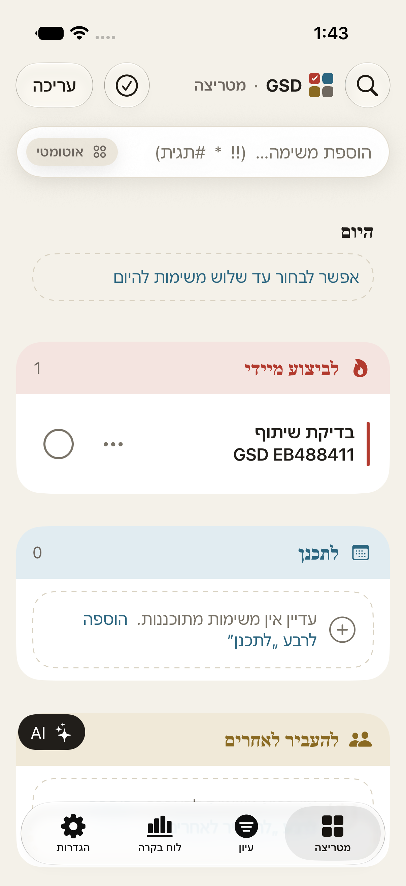
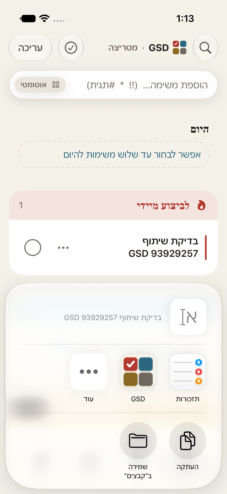
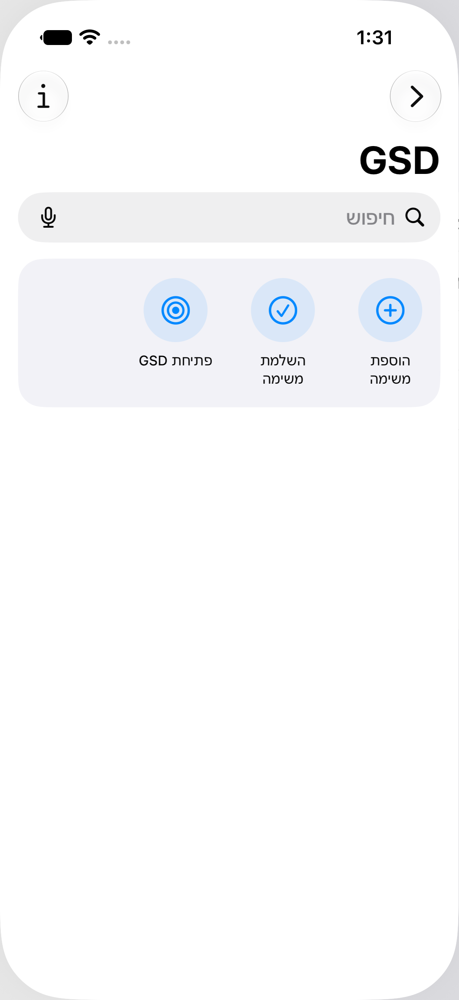
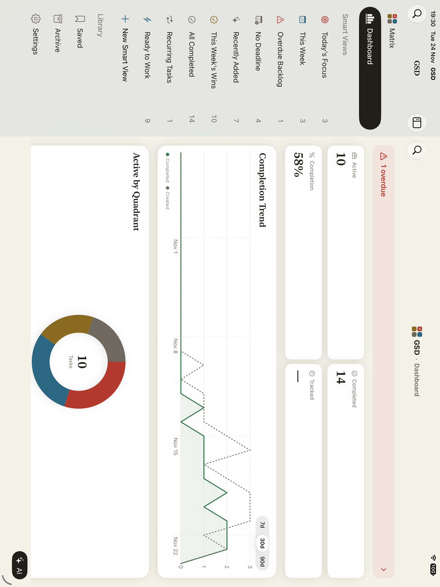
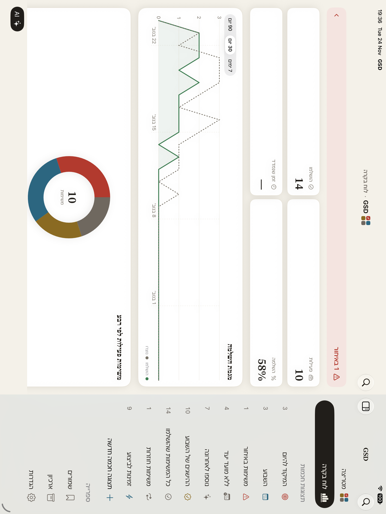
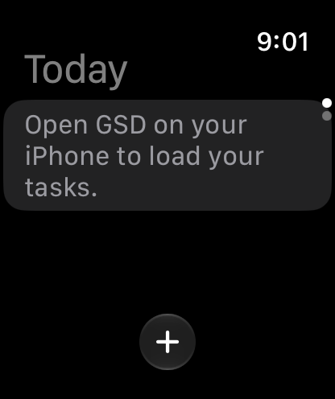

# GSD — מצב מסירה נוכחי, עדכון 25.11.2026

טיוטת מסירה לעדכון סופי בידי המתאם, עם ראיות שנמסרו עד 25.11.2026, 03:34:47 UTC. ריצת Widget של a2 הוכיחה התקנה והצגת המשימה הראשונית, אך נכשלה בהמשך בשאילתת שדה העריכה. קבלת Share הושלמה ב־00:44:38: בדיקות b558 על תוצרי הייצור הקפואים 9f עברו 2/2 וכל שמונת התנאים אומתו, לרבות Cancel, חיפוש בכל Matrix והתמדה לאחר הפעלה מחדש. בניית בדיקות 870 עברה, אך שני מקרי המערכת שלה נכשלו בנפרד; תיקוני Widget ו־Shortcuts פורסמו בקומיטים 41d ו־7098. Shortcuts ב־7098 עבר 1/1, לרבות יצירת משימה ברקע והתמדה; Widget הגיע לגלריה ולחיפוש GSD, אך נכשל בבחירת רכיב התוצאה וטרם התקבל. בניית תיקון הבחירה a2 והרכבת רץ הבדיקות הושלמו ב־03:16:34; חמשת תוצרי הייצור 9f נשמרו. המקרה היחיד הסתיים ב־03:28:28 בתוצאה 1/0/1, ללא דילוגים או כישלונות צפויים; רענון timeline ופתיחת המשימה המדויקת עדיין לא אומתו. קריאת Apple מ־02:14:47 מצאה רק build 48, ללא 49 או 50. הארכיון, ייצוא ה־IPA ובדיקת Apple למקור 9f הסתיימו בהצלחה ב־02:24:43. **49 חתומה ומאומתת, אך טרם הועלתה ל־TestFlight.**

**GSD 4.1.0 (48) כבר נמסרה במסלול TestFlight המאומת.** המועמד המעודכן ל־4.1.0 (49) כולל SDK חדש, תיקוני AI ותיקון טעינת Share. Share, הפעלת Shortcuts והחתימה המחודשת התקבלו; נדרשות קבלת Widget והשלמת ההעלאה, עיבוד Apple וזמינות הבנייה במסלול הבודקים. הראיות ההיסטוריות של 48 נשמרות ב־[דוח ההפצה](TESTFLIGHT_DELIVERY_20261124.md) וב־[דוח האינטגרציה](GSD_INTEGRATION_20261124.md).

## מקורות והיקף השימוש החוזר

| רכיב | מקור מאומת | היקף הראיה |
|---|---|---|
| מקור הייצור והיסטוריית בדיקת Share | [`9f2736d3e071d2ceb4a6dfada1a2c3767c9906be`](https://github.com/davidpovarsky/gsd-iosapp/commit/9f2736d3e071d2ceb4a6dfada1a2c3767c9906be), tree `1079979780cfcac4ef19ac2bef9731f9d1d75b6e` | build-for-testing עבר ב־21:54:27; ריצת 9f המקורית נכשלה לאחר Add. הכישלון נשמר כהיסטוריה; קבלת Share הושלמה בהמשך בבדיקות b558 על תוצרי 9f. |
| תיקון בדיקה ותשתית בדיקות לאחר 9f | [`6bd91d6a36155bd73ab71a428e69642b5989d842`](https://github.com/davidpovarsky/gsd-iosapp/commit/6bd91d6a36155bd73ab71a428e69642b5989d842) | מעבר על כל רבעוני Matrix, רישומי בדיקות בפרויקט ותוכנית משטחי מערכת; מקור הייצור 9f נשמר. בניית UI runner עברה ב־22:40:34; ריצות ההמשך מתועדות למטה. |
| תיקון מחרוזת בבדיקה לאחר 6bd | [`0ae293b8f1d867a09be6d95cc7029a9442728bfc`](https://github.com/davidpovarsky/gsd-iosapp/commit/0ae293b8f1d867a09be6d95cc7029a9442728bfc) | שינוי מחרוזת צפויה אחת לכותרת שנצפתה בפועל: `היום, 0 מתוך 3`. מקור הייצור נשאר 9f; אין כאן טענה שהריצה החדשה עברה. |
| ריצת Share שהתקבלה | [`b5588f3f0c42df328dba34024d569be8605e51d0`](https://github.com/davidpovarsky/gsd-iosapp/commit/b5588f3f0c42df328dba34024d569be8605e51d0), חמשת תוצרי הייצור 9f ללא שינוי | **2/2 עברו, כל שמונת הדגלים true**, סיום 25.11 ב־00:44:38; ביקורת המתאם בדקה גם את מעבר Matrix המלא ואת הצילום לאחר סגירת החלונית. b558 שולב בענף הקנוני לאחר הקבלה. |
| בדיקות מערכת ראשונות | בדיקות [`9190c72587cea69d1fd4b186051eef70d73d7500`](https://github.com/davidpovarsky/gsd-iosapp/commit/9190c72587cea69d1fd4b186051eef70d73d7500) על ייצור 9f | Widget ו־Shortcuts נכשלו כל אחת ב־1/1; קלטי המקור והתוצרים נשמרו והסימולטורים שבבעלות הריצות הוסרו. אלה אינן קבלות התקנה או הפעלה מוצלחת. |
| תיקון בחירת רכיבי מערכת 870 | [`870cf76ff383b7b90368e952796f7c250d10e1d6`](https://github.com/davidpovarsky/gsd-iosapp/commit/870cf76ff383b7b90368e952796f7c250d10e1d6), parent b558 | קובץ בדיקות יחיד, ‎+36/−8. בניית Xcode עברה ב־15.96 שניות; Widget ו־Shortcuts נכשלו בנפרד בשערי ממשק, כמפורט בהמשך. פסק הזמן הקודם של Swift parse ב־Windows נשמר כתצפית כלי נפרדת. |
| תיקוני גלריית Widget והגשת Task — קבלת Shortcuts בלבד | [`41d2b422dd259cd4b04abef8911449c74a89c9e4`](https://github.com/davidpovarsky/gsd-iosapp/commit/41d2b422dd259cd4b04abef8911449c74a89c9e4) ולאחריו [`7098dcb9abdc2d7e8e20afa8d9ec95d7e69c34ef`](https://github.com/davidpovarsky/gsd-iosapp/commit/7098dcb9abdc2d7e8e20afa8d9ec95d7e69c34ef) | שני קומיטים נפרדים שנבדקו ופורסמו; ביחד קובץ בדיקות יחיד, ‎+112/−24 לעומת 870. מקור הייצור 9f והעזר המשותף נשמרו. בניית Xcode של המקור המשולב עברה ב־24.22 שניות, וההרכבה הושלמה ב־02:31:02 UTC. לאחריה Shortcuts עבר 1/1 ו־Widget נכשל 1/1 בבחירת תוצאת הגלריה; הקבלות הנפרדות מובאות בהמשך. |
| תיקון בחירת Cell ובניית a2 | [`a2f1c09d6ef2b3ba9a281288bab985ebe44aa9ac`](https://github.com/davidpovarsky/gsd-iosapp/commit/a2f1c09d6ef2b3ba9a281288bab985ebe44aa9ac), parent 7098 | שינוי בדיקה בלבד, ‎+5/−8. בניית Xcode ראשונה עברה בכ־31 שניות; הרכבת רץ הבדיקות עם חמשת תוצרי 9f הושלמה ב־03:16:34 UTC. הריצה התקינה את ה־Widget והציגה את המשימה הראשונית, ואז נכשלה בשאילתת TextField לפי ערכו הישן. קבלת timeline ופתיחת המשימה עדיין ממתינה; קבלות Share ו־Shortcuts נשמרות לפי מקורן. |
| Hanlin המקורי | [`bea35c3c2a435d1cc5f7ce93b08a649b104bc10f`](https://github.com/davidpovarsky/hanlin-ai/commit/bea35c3c2a435d1cc5f7ce93b08a649b104bc10f) | שילוב ה־SDK המקורי, תיקון הנתיב הפרטי ב־Darwin, חוזי SIWC והתמדה; אין מנוע משימות או SDK חלופי. |
| בדיקות חבילות Native | GSDKit ב־[`9d0faa061b0b41f7127fa40c265fef3e3fc3dd88`](https://github.com/davidpovarsky/gsd-iosapp/commit/9d0faa061b0b41f7127fa40c265fef3e3fc3dd88): 160; Hanlin ב־[`77c0455823cad90168106f2196d6e94d1ce03598`](https://github.com/davidpovarsky/gsd-iosapp/commit/77c0455823cad90168106f2196d6e94d1ce03598): 23 | **183 בדיקות שעברו**, בשני מקורות מתועדים. שימוש חוזר חל רק על קלטים שנבדקה זהותם. |
| ממשק iPhone/iPad בעברית ובאנגלית | [`6712921d1dc379c41c6919524e599ad7e0b9e5e0`](https://github.com/davidpovarsky/gsd-iosapp/commit/6712921d1dc379c41c6919524e599ad7e0b9e5e0) | **13/13** בדיקות UI, סיום 18:45:08; ביקורת **24/24** תמונות. אין טענה שכולן הורצו מחדש ב־9f. |
| Watch מעודכן | [`ee5e95f536c375cfdbfa13cb6c812dcef8987a5f`](https://github.com/davidpovarsky/gsd-iosapp/commit/ee5e95f536c375cfdbfa13cb6c812dcef8987a5f) | הפעלה רגילה בעברית ובאנגלית, חיות תהליך במשך 5 שניות וביקורת חזותית 416×496; עבר ב־20:02:07. לא בדיקת WatchConnectivity או מחזור WidgetKit. |
| Cloud פעיל | [`e74abb292cfb10b43cf5dfa11fac5167caa98cad`](https://github.com/davidpovarsky/gsd-iosapp/commit/e74abb292cfb10b43cf5dfa11fac5167caa98cad) | hardening מאומת ופריסה; אינו שינוי ב־Native או ב־TaskStore. |

[הוכחת השימוש החוזר במקור 9f](evidence/delivery-20261124/source-reuse-9f.json) נשמרה עם SHA-256 `7ebf4dbe4967dda431fde6d849e33e5f91ad0f74bf0d5370aaf1c7af93362eb1`; [אימות המתאם](evidence/delivery-20261124/source-root-review-9f.json): `7155fc11aae63d6a04d51fa19406c4475a59b378f520e7a8351443aa3042176d`. זו הוכחת קלטים תואמים בהיקף הרשום, ולא טענה לזהות בינארית בין בניות. שינוי Share מחייב קבלה משלו ו־IPA חתום מחדש.

קבלות החבילות ההיסטוריות נשמרו במלואן: [Hanlin ב־77c045](evidence/delivery-20261124/packages-77c045-historical.json) ו־[GSDKit ב־9d0faa](evidence/delivery-20261124/packages-9d0faa-historical.json). מצב הכישלון הכולל בקבלות אלה מתייחס גם לשלבים מאוחרים ואינו משנה את תוצאות החבילות שעברו. [קבלת הבנייה ב־671](evidence/delivery-20261124/native-build-671.json) מרכזת את השימוש החוזר בתוצאות לפי מקורן; אין כאן הצגה של הריצות ההיסטוריות השלמות כעברו.

## מטריצת תנאי הקבלה

| תנאי | מצב נתמך בראיות | מה עדיין אינו מאומת |
|---|---|---|
| עברית ו־RTL | 13 בדיקות UI בארבעה פרופילים, 24 תמונות ו־Watch EN/HE התקבלו; Share בעברית עבר עם כל שמונת התנאים ו־Matrix נגיש לאחר Cancel. | הפעלה אמיתית של Shortcuts ויצירה ברקע התקבלו. Widget הותקן והציג את המשימה הראשונית; רענון timeline ופתיחת המשימה עדיין ממתינים. ה־prompt המקורי הציג Task/Done באנגלית, והסיבה לכך עדיין לא הוכחה. אין להמיר תצוגת Widget בתוך האפליקציה להוכחת מחזור WidgetKit, Siri או VoiceOver מלא. |
| יצירת חשבון והתחברות | התחברות דרך המסך האמיתי ב־iPad Simulator, ניהול Session, בידוד חשבונות ומחיקה מכוסים בראיות הקיימות. | התקנה ומעבר חשבון באייפד פיזי חדש של המשתמש. |
| סנכרון עם Oracle | כתיבה לשרת כשהאפליקציה סגורה, הופעה לאחר פתיחה, כתיבה בכיוון ההפוך והתמדה אחרי פתיחה חוזרת אומתו במסלול Native; חוזי אופליין, גרסאות, מחיקות ובידוד נבדקו. | אין להציג בדיקת סימולטור כהתקנה פיזית. |
| קריאה וכתיבה ללא אייפד פתוח | כל **22 כלי MCP** עברו E2E מול הענן בחשבונות בדיקה; הנתונים נשמרים ב־Oracle. | הפעלה מתוך חיבור ChatGPT האישי של המשתמש. |
| Plugin עם כניסה רגילה | OAuth בענן, PKCE, scopes, רענון, דחיית replay, ביטול והרשאות לפי חשבון; plugin פרטי 0.2.0 מפנה לענן. | Connect אישי הסתיים ב־abort ב־18:49; הזמינות ב־iPad כפופה גם למסלול Desktop-only שתועד. |
| Hanlin ו־22 הכלים | SDK המקורי משולב; 23 בדיקות הצרכן וחוזי הכלים נשמרו, יחד עם בדיקות הענן לכל 22 הפעולות. | תשובת AI אמיתית ראשונה אחרי התיקון אינה נובעת מבדיקות חוזים. |
| Continue with ChatGPT | זרימת preconsent עברה; המשתמש דיווח על התחברות אישית מוצלחת. | תשובה ראשונה לאחר תיקון SDK, זכאות inference ושימוש בפועל במכסת ChatGPT טרם אומתו. |
| דוחות, תרשימים וממשק | ראיות UI ו־MCP הקיימות מכסות את התצוגות והפעולות שנבדקו; תוצאות 24 התמונות נשמרו. | משטחי מערכת נוספים שלא נכללו בקבלות אינם מסומנים כעברו. |
| Xcode ובדיקות | 183 בדיקות חבילות, 13 UI, בניית 9f, Share 2/2 ובניות בדיקות 870, 7098 ו־a2 התקבלו לפי מקורותיהן; Actions של 48 נשמרות למטה. | שני מקרי המערכת נכשלו גם ב־870. ב־7098 התקבל Shortcuts, ואילו Widget נכשל בבחירת תוצאת הגלריה. ב־a2 התקנה והצגת המשימה הראשונית אומתו, אך הריצה נכשלה בשאילתת שדה עריכה; timeline ופתיחת המשימה ממנו טרם אומתו. אין בדוח ריצת Actions 49 חדשה או קבלת מערכת שנוצרה מהנחה. |
| מזהי Apple ופרופילים | ארכיון ו־IPA של מקור 9f קושרים את חמשת יעדי `com.itorah.gsd` והפרופילים ל־Team `NA6HPWARQ2`, גרסה 4.1.0 (49), עם חתימות תקינות ו־EN/HE בכל יעד. | קבלת העלאה, עיבוד Apple וזמינות במסלול הבודקים עדיין נדרשות. |
| Release חתום | ארכיון 9f, ייצוא IPA חתום, ביקורת חתימות של חמשת היעדים ואימות Apple עברו ב־25.11, 02:24:43 UTC; הגרסה היא 4.1.0 (49). | אין עדיין העלאה או עיבוד TestFlight של 49. IPA ההיסטורי של ee5 נשמר בנפרד ואינו תוצר המסירה המתוקן. |
| TestFlight | בקריאת כל עמודי Apple ב־25.11, 02:14:47 UTC, נמצאה רק 4.1.0 (48), במצב `VALID` וללא פקיעת תוקף. מצב `IN_BETA_TESTING` וחברות בקבוצת הבעלים נשמרים מהבדיקה הנפרדת ב־24.11, 22:57 UTC. | 49 נעדרה והייתה מעל מספר הבנייה הגבוה ביותר במסלול; גם 50 לא נמצאה בזמן הקריאה. אישור ההזמנה הנוכחי והתקנה פיזית אינם מאומתים. |
| Asana וראיות | קבלת Share ושילוב b558 נשמרו בעדכונים הקודמים. תגובת Apple `1220886939058073` מתעדת את הצלחת הארכיון. תגובת עברית `1220886763711564` ומצב הפרויקט `1220887224717102` מ־02:57:33.500 מתעדים את קבלת Shortcuts. לאחר פרסום a2, תגובת עברית `1220887056614113` מ־03:07:12 ומצב הפרויקט הצהוב `1220887056764173` מ־03:08:05, 25.11 UTC, מתעדים את תיקון Widget שפורסם ואת קבלת הריצה שעדיין ממתינה. תגובת עברית `1220887415507496` ב־03:20:09 ומצב הפרויקט הצהוב `1220887058797386` ב־03:20:23 מתעדים את בניית a2; תגובות Cloud `1220887057484372` ב־03:12:24 ו־`1220887675719651` ב־03:24:47 מתעדות את בדיקת הבריאות ואת השלמת הגיבוי המתוזמן. תגובת עברית `1220887334436578` ב־03:34:46 ומצב הפרויקט הצהוב `1220887495836438` ב־03:34:47 מתעדים את ההתקנה שנצפתה ב־a2 ואת בדיקת ההמשך הפתוחה. תגובת ההבהרה למשימת המכשיר הפיזי `1220887333647629` ב־03:29:02 אינה ראיית הצלחה אישית חדשה. | עדכון סופי לאחר קבלת Widget, העלאה ועיבוד Apple. פרסום תיקוני הבדיקה והצלחת הארכיון אינם קבלת runtime או TestFlight. |

## Cloud, OAuth וגיבויים

[קבלת E2E הציבורית של הענן](https://github.com/davidpovarsky/gsd-iosapp/blob/cfe9470b6020c28474395ff97f0672d4a5c8f126/docs/ai-agent/evidence/cloud-20261124/public-e2e.txt) מכסה את 22 הכלים, CRUD, דוחות, התנגשויות ובידוד. [קובץ המטא־נתונים הנלווה](https://github.com/davidpovarsky/gsd-iosapp/blob/cfe9470b6020c28474395ff97f0672d4a5c8f126/docs/ai-agent/evidence/cloud-20261124/public-e2e.json) שומר את פרטי ההרצה. [דוח OAuth/MCP](CLOUD_MCP_AUTH_ACCEPTANCE_20261124.md) מוסיף חוזי scopes ותגובות reconnect. [דוח ההגנה והשחזור העדכני](CLOUD_AUTH_BACKUP_ACCEPTANCE_20261124.md) מקשר **21/21 בדיקות HTTP** ופריסת e74. מספר הכלים ומספר בדיקות ההגנה מודדים דברים שונים.

השחזור העדכני אימת מסד פעיל עם WAL, שני משתמשים, שתי משימות, שתי תצוגות ונתוני OAuth; לאחר שחזור הופעלו שירותי החשבון האמיתיים ונבדקו גישה מבודדת, רענון מתחלף ודחיית replay. [הגיבוי המתוזמן](BACKUP_CALENDAR_ACCEPTANCE_20261124.md) והקבלה המאוכלסת הקודמת ב־`540bde78d1eb7b90de9eb12d20d319d1c439f1f4` נשמרים כראיות קודמות. לא נטען שחזור volume של ספק הענן או מעבר באייפד פיזי.

בבדיקת המתאם ב־22:02:46 UTC מקור gateway הפעיל עדיין תאם SHA-256 `4bcc55288e28576aaacf24cd6657f254e6703637f732929b139ca78645b2a598`; ארבעת השירותים והגיבויים שנבדקו היו תקינים ושתי בדיקות health החזירו 200. מקום פנוי שנצפה: כ־7.23 GiB בשורש וכ־27.74 GiB בדיסק הנתונים. זו מדידה נקודתית בלבד; אין בדוח ייחוס שלה לפעולת ניקוי.

[בדיקת מוכנות Oracle מ־23:57–23:58 UTC](evidence/delivery-20261124/oracle-release-readiness-20261124T235834Z.json) היא תוספת מאוחרת לקריאה זו: PocketBase, gateway, הגישור הישן ו־Lorvex פעילים; שני נתיבי health החזירו 200 וה־backup timer פעיל. שאילתת SQLite במצב קריאה בלבד מצאה אפס רשומות users/tasks/gsd_library של בעל חשבון הבדיקה הסינתטי המדויק. לא נקראו נתוני משתמשים אישיים, לא הופעל שחזור נוסף, ולא בוצעו מחיקה, שינוי תצורה או restart. הקבלה המקורית נשמרה ב־1,952 בתים, SHA-256 `59153ece72ada26435802a689f1c2dc55d691b9b9234cc0cb0243873545b91ed`.

[קריאת Oracle מ־25.11, 03:10:54–03:11:34 UTC](evidence/delivery-20261124/oracle-readonly-health-20261125T031134Z.json) נשמרת כמצב קודם: שירותי GSD ו־Lorvex הפעילים שנבדקו פעלו, PocketBase ו־gateway הפנימי והציבורי החזירו 200, וה־timer המתוזמן היה פעיל. בכונן הנתונים `/mnt/development` נצפו אז 5,122,420,736 בתים פנויים. שירות הגיבוי מסוג `oneshot` היה במצב `inactive` לאחר השלמה מוצלחת של הריצה הקודמת; זה אינו כשל שירות. באותה קריאה הריצה הבאה של 25.11 עדיין הייתה מתוכננת ל־03:23:05.

[קבלת הגיבוי המתוזמן המאוחרת](evidence/delivery-20261124/oracle-scheduled-backup-20261125T032340Z.json), שנקראה ב־03:23:40.664 UTC, מאשרת שההפעלה האוטומטית של **25.11 ב־03:23:05 UTC הסתיימה בהצלחה**, `Result=success` ו־`ExecMainStatus=0`. ה־timer נשאר פעיל והריצה הבאה מתוכננת ל־**26.11 ב־03:22:58 UTC**. לא הופעל גיבוי ידני, לא בוצעו שינוי שירות או ניקוי, ולא חזרו על בדיקת השחזור שכבר התקבלה. במדידה המאוחרת נותרו בכונן הנתונים **4,707,729,408 בתים** פנויים; זו מדידה נקודתית חדשה, ללא ייחוס הסיבה לשינוי בנפח. מצב הפרויקט נשאר צהוב.

## ChatGPT: שני חיבורים נפרדים

**Plugin לחשבון GSD בענן.** השרת וה־OAuth נבדקו, אך ניסיון Connect אישי ב־18:49 הופסק. תגובת הכלי נשמרה בשיחה; [משימת Plugin](https://app.asana.com/0/1220770501963372/1220828170561422) מפנה לקבלת iPad/Desktop-only בתגובה `1220863768674461`. התגובה `1220879074525208` מתעדת שאין בהגדרות שנבדקו `requires_local_executor`, `stdio`, פקודות מקומיות או hooks. לא אותר דגל נוסף להסרה, לא נצפתה דחיית זכאות של החשבון, ואין בסיס להבטיח שמעבר דרך דפדפן שולחני יאפשר את התוסף ב־iPad. ההקשר הרשמי: [Desktop-only](https://developers.openai.com/plugins/deploy/desktop-only.md), [Connect to ChatGPT](https://developers.openai.com/plugins/deploy/connect-chatgpt.md). בחיבור הכלים הנוכחי לא נצפה Session אישי פעיל של GSD MCP.

**Continue with ChatGPT בתוך GSD.** קבלת f1 בדקה את כניסת המשתמש הרגילה, מעבר לדפדפן וביטול לפני הסכמה, בשני מחזורים: 1/1 בדיקה ו־10 דגלים. נצפה host `auth.openai.com` במצב `visible_host_only`; השדה `observedOrigin` לא נכתב. אין להסיק מכך URL מלא או אישור חשבון. הריצה הכוללת של f1 נכשלה ב־Share; הצלחת רכיב preconsent נשמרת בנפרד.

ב־24.11.2026, בשעה 14:29 UTC, המשתמש דיווח על התחברות אישית מוצלחת, לפני בדיקת preconsent של 21:25 UTC, כמתועד ב־[משימת AI](https://app.asana.com/0/1220770501963372/1220820292511448), סיפורים `1220863756603297` ו־`1220865013712659`. תיקון ה־Darwin ב־SDK שוחזר ונבדק, אך ללא נתיב או לוג מהמכשיר לא הוכחה סיבתיות מדויקת לתקלה באייפד הפיזי. אין עדיין קבלה של התשובה הראשונה אחרי התיקון, זכאות inference או שימוש במכסה. אפשרויות OpenRouter ו־OpenAI API נשמרו.

## Share — הקבלה שהושלמה והיסטוריית התיקונים

### קבלת b558 — 25.11.2026, 00:44:38 UTC

[הקבלה הסופית](evidence/delivery-20261124/share-b558-terminal.json), [קשירת הריצה](evidence/delivery-20261124/share-b558-runtime-binding.json), [הסיכום הציבורי](evidence/delivery-20261124/share-b558-summary.json) ו־[ספירות XCTest](evidence/delivery-20261124/share-b558-test-counts.json) מאמתים **2 בדיקות, 2 עברו, 0 נכשלו, 0 דילוגים ו־0 כישלונות צפויים**. הריצה החלה ב־00:40:14.194720 והסתיימה ב־00:44:38.370081 UTC, exit 0. מקור הבדיקות הוא b558; מקור הייצור הוא 9f, manifest קפוא `38aae93e3330893c26c1ce837a05af933b1d2115b69b01b0ea67f0e8fb2eb67f`. manifest ההרכבה הוא `605a5631510c1632d690dac26a2b71132237065fbfb7a9b54c081dbe412d2a8a`.

[תמצית שמונת התנאים](evidence/delivery-20261124/share-b558-observation-summary.json) משמרת את כולם כ־true: `sourceCreated`, `activitySheetOpened`, `extensionOpenedForAdd`, `addCreatedExactlyOne`, `addedTaskPersisted`, `extensionOpenedForCancel`, `cancelCreatedNone`, `cancelNoneAfterRelaunch`. כלולה יצירה של משימה אחת בדיוק, התמדה אחרי relaunch, והיעדר משימה מבוטלת גם לאחר relaunch. הבדיקות ממשיכות לעבור על כל ארבעת הרבעונים ועד לתחתית ולשמור את זהות המשימה.

[ביקורת המתאם העצמאית](evidence/delivery-20261124/share-b558-root-review.json), שנשמרה ב־00:57:28, מאשרת שקרא את הקבלות ואת הוכחת מעבר Matrix וצפה בפועל בצילום שלאחר הסגירה. צילום יחיד אינו מחליף את בדיקות ההיעדר וההתמדה. מקור התוצרים וקבלות המערכות הקודמות נשמרו, וכל הסימולטורים שבבעלות הריצה הוסרו. השדות `fullSystemSurfaceCoverage` ו־`accountGrantVerified` נשארים false בכוונה: קבלת Share אינה קבלת WidgetKit, Shortcuts או הרשאה אישית.

התיקון [b558](https://github.com/davidpovarsky/gsd-iosapp/commit/b5588f3f0c42df328dba34024d569be8605e51d0) החליף רק את מחוות ההחלקה בהקשה על `PopoverDismissRegion` שנצפה, עם ייחודיות, hittability והיעלמות אמיתית של החלונית. הוא שולב בענף הקנוני ב־fast-forward לאחר קבלה; לא שונה קוד הייצור ולא הורצה שוב סוויטת Share בעקבות תיקון מערכות 870cf76. השדה `canonicalLastVerified: 0ae` בקבלת הביקורת נשמר כמות שהיה בזמן יצירתה, לפני ה־fast-forward המאוחר.

הצילום אושר אחרי צפייה: 395,765 בתים, SHA-256 `85afd910ad09ef4126a00db8975a58f5738df4611c0dd5ce6d21e76aa9d5085a`. מצב קבלת Share אינו משנה את השערים הנותרים לחתימה ולהפצה של 49.

### היסטוריה: כישלון מחוות הסגירה ב־9190 — 25.11, 00:13:18 UTC

[הקבלה הסופית של 9190](evidence/delivery-20261124/share-9190-terminal.json), [קשירת הריצה](evidence/delivery-20261124/share-9190-runtime-binding.json), [הסיכום הציבורי](evidence/delivery-20261124/share-9190-summary.json) ו־[תמצית הדגלים](evidence/delivery-20261124/share-9190-observation-summary.json) נשמרו ללא שינוי. הריצה נכשלה: קריאת XCTest השמורה תיעדה 2 בדיקות, 1 עברה ו־1 נכשלה, ללא דילוגים או כישלונות צפויים. אין בחבילת ההמשך קובץ ספירות נפרד של 9190. ששת הדגלים הראשונים עברו; שני תנאי Cancel נשארו false משום שהבדיקה לא הגיעה אליהם.

כשל XCTest התרחש בסינתזת `swipeDown` על `ActivityListView`: המערכת דיווחה שה־visible frame ריק, אף ששערי הייחודיות וה־hittability עברו. באותה נקודת זמן נצפה `Other(identifier: PopoverDismissRegion)`, והצילום שנבדק הראה את חלונית הפעילות מעל Matrix, ללא כפתור סגירה מצויר. זו הייתה הראיה לתיקון הבדיקה b558; אין כאן ראיה לכשל שמירה נוסף. ה־AX המקורי: SHA-256 `56e08f1ba7098aa9fd240fb1e836394d929009bb797973ce3f5786f6abdeff49`.

זהו תיעוד לפני המחווה, לא תוצאת סגירה. הצילום הסינתטי נשמר ב־844,466 בתים, SHA-256 `191c93ff74ffc5bd10bc89e747c8ff9968b7ca6d4b856aee8985870c6fb33620`.

### היסטוריה: בדיקות 0ae על תוצרי 9f — 24.11, 23:31:52 UTC

הריצה החלה ב־23:28:26.894760 והסתיימה ב־23:31:52.697571 UTC עם exit 1. בניית runner הבדיקות 0ae עברה קודם לכן ב־19.37 שניות, exit 0; חמשת תוצרי הייצור נשארו 9f. manifest הייצור הוא `38aae93e3330893c26c1ce837a05af933b1d2115b69b01b0ea67f0e8fb2eb67f`; manifest ההרכבה הוא `d6f999a9647e8bc9c3c7aaaa93aa5bae3f0d02df8124fb6c5f49b6e23779f8b3`.

| בדיקה | תוצאה | משך XCTest |
|---|---|---|
| `test00RecordSystemSurfaceDiscovery` | עברה | 18.524 שניות |
| `test01TextShareExtensionRoundTripAndCancellation` | נכשלה לאחר Cancel | 133.950 שניות |
| סיכום | 2 בדיקות, 1 עברה, 1 נכשלה, 0 דילוגים, 0 כישלונות צפויים | |

ששת התנאים `sourceCreated`, `activitySheetOpened`, `extensionOpenedForAdd`, `addCreatedExactlyOne`, `addedTaskPersisted`, `extensionOpenedForCancel` אומתו כ־true. הוספה יצרה בדיוק משימה אחת, והתמדתה אחרי פתיחה חוזרת אומתה. שני התנאים `cancelCreatedNone` ו־`cancelNoneAfterRelaunch` נשמרו כ־false מפני שהריצה לא הגיעה לאימותם; אין מכך מסקנה שנוצרה משימה מבוטלת.

כישלון XCTest בפועל הוא `The Matrix capture field is obscured.` בעת המתנה ל־`capture-field.isHittable` לאחר Cancel. המתאם בדק בפועל את צילום `09-after-cancel` ב־23:43 UTC: מסך ה־compose נסגר, אך חלונית הפעילות/השיתוף המקורית של iOS נשארה מעל Matrix, ללא כפתור סגירה גלוי. זו הראיה לחסימת הגישה ל־Matrix; `share_assertion_keys` שבסיכום העזר הוא קוד האימות המסכם ולא תיאורו של כשל ה־UI המקורי. Native הוא הבעלים היחיד של תיקון בדיקה ממוקד לסגירת החלונית שנצפתה; בעת תמונת מצב זו עדיין אין ריצה חוזרת או קבלת Share מלאה.

| קבלה מצורפת — בתים מקוריים | בתים | SHA-256 |
|---|---:|---|
| [share-0ae-runtime-binding.json](evidence/delivery-20261124/share-0ae-runtime-binding.json) | 1,401 | `d84829d52e328776b54744e0bd65473fc3026d541651b1555533bd7be8989ef2` |
| [share-0ae-summary.json](evidence/delivery-20261124/share-0ae-summary.json) | 636 | `63935c8d02927ae0a011e423d13e397a5f9d48f40d1acc3c0a93f84a0334d4b5` |
| [share-0ae-test-counts.json](evidence/delivery-20261124/share-0ae-test-counts.json) | 148 | `a307390d19251c9b80f7cacdb0e7fed774c3d1577759614df3d2dde43192c0f2` |
| [share-0ae-terminal.json](evidence/delivery-20261124/share-0ae-terminal.json) | 1,078 | `04e28333555650e365b448a5479b98e9f16bc565dce577d9ae6561d0a4cfae4d` |
| [share-0ae-observation-summary.json](evidence/delivery-20261124/share-0ae-observation-summary.json) | 587 | `66f986096168c4068c67501f2bedf42ab7ef932a37cc07a5668c492396e7f471` |

שדה `appSourceSHA` בתמצית התצפית נשמר בדיוק כ־0ae, כפי שסיפק ה־runner. מקור הייצור בפועל הוא 9f לפי `productionSourceSHA` ב־runtime binding וקשירת חמשת התוצרים ב־composition; השדה בתצפית לא שוכתב. הקבלה הסופית מאשרת תוצרים שלא השתנו וסימולטורים בבעלות הריצה שהוסרו, ומציינת שלא בוצעו חתימה, העלאה או הרצה חוזרת של הסוויטות ההיסטוריות שהתקבלו.

צילום האבחון הבא מכיל נתוני בדיקה סינתטיים בלבד ואושר לפרסום בידי המתאם לאחר צפייה. הוא הועתק ללא שינוי: 846,012 בתים, SHA-256 `5e46e2fd5dcec15462f5c1b591b02a9d451d238743444dba829277dbdfe3a6cd`. חמש קבלות ה־JSON והצילום הם נספחים נפרדים; ה־manifest המקורי של 19 קובצי הראיות לא הורחב ולא שונה.

בקשת העוקב `job_11be8a7df705` נדחתה לפני הפעלה משום ש־timeout של 4,320 שניות חרג ממגבלת 3,600. הדבר לא ביטל את ריצת Share בפועל; התוצאה לעיל נשענת על הקבלות הסופיות של הריצה, שנקראו לאחר סיומה.

### היסטוריה: תיקון המקור ותוצאת 9f הקודמת

[תיקון 9c3efb81](https://github.com/davidpovarsky/gsd-iosapp/commit/9c3efb81e1cc05ea44cb40d5a382566c56a67cd9) מטפל בטקסט מספקי נתונים; [דוח Foundation](SHARE_INPUT_ACCEPTANCE_20261124.md) ו־[הקבלה המצונזרת](evidence/share-input-20261124/foundation-regressions.json) מראים 4/14 במקור הישן לעומת **14/14** במתוקן. גבולות TaskStore ותיבת ה־Share נשמרו.

בריצת 3c552350 היו 2 בדיקות: אחת עברה ואחת נכשלה. הכישלון היה באיתור שדה הכותרת לפי placeholder לפני בדיקת ההתאמה המחמירה; בהיררכיה כבר נצפתה כותרת שאינה ריקה. לכן זו אינה ראיה נוספת לכשל פענוח, וגם אינה הוכחה שהכותרת המלאה עברה את ה־assertion. מקור 9f מוסיף מזהה נגישות קבוע `share.title` ומעדכן את בחירת השדה, תוך שימור שמונת שערי Share.

בניית 9f הסתיימה בהצלחה ב־21:54:27. [manifest התוצרים](evidence/delivery-20261124/simulator-products-9f.json): `38aae93e3330893c26c1ce837a05af933b1d2115b69b01b0ea67f0e8fb2eb67f`. ריצת Share החלה ב־21:55:43 והסתיימה בכישלון ב־22:12:25.938982. התוצאה המדויקת: **2 בדיקות, 1 עברה, 1 נכשלה, 0 דילוגים, 0 כישלונות צפויים**. גילוי עבר ב־16.818 שניות; round-trip נכשל אחרי 905.978 שניות. שלושת דגלי הפתיחה הראשונים מתוך שמונה היו true; חמשת האחרים לא הושגו. בדיקת הכותרת המקורית המחמירה, אימות סמן העריכה וסגירת חלון ה־compose הושלמו לפני כשל הכרטיס. כשל XCTest המקורי הוא `No task card contains synthetic marker Added-D561D70F`: ב־`uniqueCard`, [שורה 242 במקור הבדיקה](https://github.com/davidpovarsky/gsd-iosapp/blob/9f2736d3e071d2ceb4a6dfada1a2c3767c9906be/ScreenshotTests/GSDSystemSurfaceUITests.swift#L242), שנקראה משורה 180. שורה 102 היא הדיווח העוטף ב־catch ואינה מקור הכשל. התוצרים נשארו ללא שינוי והסימולטורים שבבעלות הריצה הוסרו. קבלת binding: `06995cb1f17905b5d12ab669274324cdfe9ebf942558a5f037c2962b8ea5db3a`; summary: `98c3b3f2f219b7fdf1f7485e998779f8d28e93a80effbc63690ffee23e63e47e`.

צילום המארח אחרי Add נבדק בידי המתאם ב־22:24. Q4 נמצא מחוץ לאזור המוצג. במקור 9f, ברירת המחדל של `ShareComposeView` היא Q4 וסדר `MatrixList` הוא Q1 עד Q4; הבדיקה אינה גוללת לפני שאילתות הכרטיס החיוביות או השליליות. זהו פער מוכח בכיסוי החיפוש של הבדיקה. תוצאת הייבוא ומצב מסד הנתונים בפועל עדיין אינם ידועים; הצילום אינו מוכיח שהמשימה נשמרה או אבדה.

צילום האבחון הנוסף מן הריצה שנכשלה מכיל נתוני בדיקה סינתטיים, ללא מסך אימות, ואושר בידי המתאם. הוא נשמר בנפרד מחבילת 19 הקבצים המקורית, שה־manifest שלה לא שונה: 397,431 bytes, SHA-256 `fc2d09c192c84725ec30360813973fed9246c8dba04dea12b522dc9db41a16e7`.

בתיקון הבדיקה [`6bd91d6a36155bd73ab71a428e69642b5989d842`](https://github.com/davidpovarsky/gsd-iosapp/commit/6bd91d6a36155bd73ab71a428e69642b5989d842) החיפוש עובר על כל ארבעת הרבעונים ועד לתחתית, ובדיקות Add ו־Cancel שומרות אימות זהות, ספירות מלאות והיעדר משימה שבוטלה. זמני ההמתנה של ה־assertions לא השתנו; רק תקציב הזמן החיצוני לריצה גדל מ־2,400 ל־3,600 שניות. נוספו ארבעה רישומי בדיקות בפרויקט ו־[תוכנית משטחי מערכת נפרדת](https://github.com/davidpovarsky/gsd-iosapp/blob/6bd91d6a36155bd73ab71a428e69642b5989d842/docs/ai-agent/SYSTEM_SURFACE_ACCEPTANCE_PLAN_20261124.md). קוד הייצור של 9f נשמר. [השוואת המקורות 9f→6bd](https://github.com/davidpovarsky/gsd-iosapp/compare/9f2736d3e071d2ceb4a6dfada1a2c3767c9906be...6bd91d6a36155bd73ab71a428e69642b5989d842) נבדקה בידי המתאם: כל 497 קובצי קלט ה־Native שהושוו שומרים אותו Git blob ואותו mode; ארבע השורות שנוספו ל־pbxproj שייכות רק ליעד `GSDScreenshotTests`, והסרתן משחזרת בדיוק את קובץ 9f. אין שינוי ביעדי הייצור או בהגדרותיהם. Git blob של בדיקת Share החדשה הוא `4d9b06caaba655ef5b82f2640b0a259cfb3b1524`. בניית ה־UI runner של 6bd עברה ב־22:40:34. לאחריה נוסף 0ae, המשנה רק את מחרוזת הכותרת הצפויה כמפורט בטבלת המקורות. ריצת 0ae המאוחרת נכשלה לאחר Cancel, כמפורט לעיל; קבלות הכישלון וה־manifest של 9f נשארים ראיות היסטוריות מלאות.

## WidgetKit ו־Shortcuts — Shortcuts התקבל, Widget ממתין לקבלה

### היסטוריה: שני מקרי 9190

שני המקרים הורצו בנפרד על מקור בדיקות 9190 ותוצרי ייצור 9f, בסימולטורים חדשים בבעלות הריצה. כל מקרה כלל בדיקה אחת בלבד; כל אחד הסתיים ב־**1 בדיקה, 0 עברו, 1 נכשלה, 0 דילוגים ו־0 כישלונות צפויים**. קלטי המקור והתוצרים נשארו ללא שינוי והסימולטורים הוסרו. אלה בדיקות ההפעלה האמיתית שנכשלו; בדיקת גילוי עורך Shortcuts ההיסטורית אינה משמשת תחליף לקבלתן.

| מקרה | קבלה ותצפית | תוצאה שהושגה |
|---|---|---|
| Widget: `test01RealWidgetTimelineRefreshAndTaskTap` | [binding](evidence/delivery-20261124/systems-9190-widget-binding.json), [observation](evidence/delivery-20261124/systems-9190-widget-observation.json); 00:27:52–00:30:27 UTC | המשימה הסינתטית נוצרה באפליקציה; בחירת בקרת Widget בינוני נכשלה. התקנה, עדכון timeline ופתיחת המשימה מן ה־Widget לא אומתו. |
| Shortcuts: `test02RunRegisteredCreateTaskShortcutAndVerifyPersistence` | [binding](evidence/delivery-20261124/systems-9190-shortcut-binding.json), [observation](evidence/delivery-20261124/systems-9190-shortcut-observation.json); 00:30:34–00:32:08 UTC | GSD הייתה סגורה לפני הפעולה, אך בחירת הפעולה הרשומה נכשלה. הפעלה, יצירת משימה והתמדה נשארו false. |

**Widget.** בהיררכיה ובהקלטה שנשמרו, תפריט GSD מכיל את פעולות האפליקציה, `עריכת מסך הבית` והסרת אפליקציה, ללא רצועת גדלי Widget. במקביל עדיין מופיעה הדרכת QuickPath: `UIContinuousPathIntroductionView` עם כפתור `המשך`. קיים במקור עזר המטפל בדיוק בחלונית הזאת, אך קריאותיו הקודמות התרחשו לפני הופעתה. מזהה הפעולה שנצפה עבור עריכת מסך הבית הוא `com.apple.springboardhome.application-shortcut-item.rearrange-icons`. לא נצפתה עדיין גלריית Widget, ולכן אין כאן בחירה מומצאת של פקד גלריה. הרחבת Widget קיימת במטא־נתונים הקפואים; הראיות האלה אינן מוכיחות קריסת הרחבה או ליקוי בתצורת הייצור. SHA-256 של ה־AX שנשמר: `d8e8aa7c9491e4eadd8e050da40e051eb99d95f9775bf7f6c9a6b8b3f678b797`.

**Shortcuts.** בדפי GSD שנבדקו בפועל מופיעות שלוש פעולות בעברית. `הוספת משימה` רשומה ומתורגמת: הכותרת נמצאת ב־Other וב־StaticText, ואילו כפתור הביצוע שמתחתיה הוא `Button(identifier: plus.circle, label: הוספה)`. הבדיקה חיפשה Button שכותרתו מתחילה ב־`הוספת משימה`, ולכן לא התאימה לרכיב שנצפה. אין כאן היעדר רישום או תרגום. שתי היררכיות המקור נשמרו עם SHA-256 `efff1db5c3334bc0f4f1fb63ff16127a3ea1949f08924e935dca7ae19a91bd1c` ו־`eea5e0f5adc878c196381d1c9d299de3473cfbce33705fb2a0e9e72547afccdd`.

**תיקון 870 שהורץ בהמשך.** [870cf76](https://github.com/davidpovarsky/gsd-iosapp/commit/870cf76ff383b7b90368e952796f7c250d10e1d6), בענף `fix/gsd-system-controls-20261125`, מבוסס על b558 ומשנה רק את `ScreenshotTests/GSDNativeSystemAcceptanceUITests.swift`, ‎+36/−8. הוא בוחר את פעולת Shortcuts לפי רכיב Other בעל הכותרת המדויקת וכפתור הביצוע שנצפה בתוכו; ב־Widget הוא מטפל בהדרכה אחרי הלחיצה הארוכה, שומר PNG+AX לפני ואחרי, ומשחזר את התפריט פעם אחת בלבד אם בקרת העריכה שנצפתה חסרה. אם בחירת הגודל עדיין חסרה, מותרת פעולה מתועדת אחת של עריכת מסך הבית ולאחריה כישלון מפורש לצורך גילוי המצב הבא. מסלול זה אינו יכול לסמן התקנה או קבלת Widget.

שערי ה־timeline, הקישור למשימה, הפרמטר המקורי של Shortcuts, מצב GSD ברקע, זהות המשימה והתמדה נשמרו. `git diff --check` עבר; ניסיון Swift frontend ישיר ב־Windows הסתיים לאחר 45.437 שניות בפסק זמן, ולכן תחבירו לא אומת באותו ניסיון. בהמשך בניית Xcode של אותו מקור עברה; שתי תוצאות ה־runtime שנכשלו מובאות בסעיף הבא. Git blob: `12139c0c98d041e0e43669b190c23503d739ccdd`; SHA-256 של מקור LF ב־Git: `8af32d387ec5409330dd1c06f14536aab9fbc89a817000949c4807f73a770704`. אין שינוי בייצור או הרצה חוזרת של Share שהתקבל.

[manifest נספחי ההמשך](evidence/delivery-20261124/continuation-20261125-0106-manifest.json) מפרט 15 קבלות JSON וארבע תמונות שהועתקו בדיוק, כולל מקור, מספר בתים ו־SHA-256 לכל קובץ. ה־manifest המקורי של 19 הקבצים נשאר ללא שינוי; גם היסטוריית 9f/0ae/48 לא שוכתבה כתוצאה מוצלחת. הנספחים אינם כוללים מסכי אימות אישיים או סודות.

### בניית 870 והמעבר להפעלה לפי משאבים מדודים

[קבלת הבנייה](evidence/delivery-20261124/systems-870-build-binding.json) ו־[קבלת סיום הבנייה](evidence/delivery-20261124/systems-870-build-terminal.json) קושרות למקור 870 הנקי בנייה שעברה ב־01:13:14–01:13:30 UTC, במשך **15.96 שניות**; קבלת הסיום נרשמה ב־01:13:32. חמשת תוצרי הייצור הקפואים נשארו 9f. SHA-256 של קבלת הבנייה: `ff6f2b39e2bde092a26f7d8bb49d3ebe9a71ef3a6d107168a04b175aa5179a9b`; manifest ההרכבה: `91334a990923bd9003000389f13d1136797e08b6b06e8177867ce58e4587624c`; קבלת ההרכבה: `c3ea662d59fab790d04c18ee0ddc43ddee6f90dd5b1cf1c029e644dacfd3bdf8`.

המתאם הישן המתין ללא התחלת מקרה כלשהו: **0 מקרים ו־0 תיקיות ריצה**. ב־01:39:25 נעשה [מעבר מתועד לבקרת משאבים מדודים](evidence/delivery-20261124/systems-870-capacity-transition.json), תוך נעילת בעלות ושליחת SIGINT רק למתאם הממתין שבבעלות המסלול. יציאתו אומתה ונשמרו הראיות. בתחילת המסלול החדש לחץ הזיכרון היה תקין, כ־7.7 GiB זמינים לעומת תקציב 4 GiB, ו־38.45 GB דיסק זמינים לעומת תקציב 9.14 GB. שערי מקור, תוצרים, ספירות, תצפיות וניקוי נשמרו; לא הורצו שוב בדיקות שכבר התקבלו. ההמתנה הישנה אינה כישלון של בדיקת UI.

### שתי תוצאות 870 שנכשלו

| מקרה | זמנים וקבלות | תוצאה מדויקת |
|---|---|---|
| Widget | 01:39:26–01:45:33 UTC; [binding](evidence/delivery-20261124/systems-870-widget-binding.json), [observation](evidence/delivery-20261124/systems-870-widget-observation.json) | **1 בדיקה, 0 עברו, 1 נכשלה, 0 דילוגים, 0 כישלונות צפויים**; `xcodebuild` החזיר 65. הדרכת QuickPath נסגרה ופעולת עריכת מסך הבית הצליחה; לא הופיעה רצועת הגדלים והבדיקה נעצרה במפורש לצורך גילוי הגלריה. |
| Shortcuts | 02:07:17–02:09:08 UTC; [binding](evidence/delivery-20261124/systems-870-shortcut-binding.json), [observation](evidence/delivery-20261124/systems-870-shortcut-observation.json) | **1 בדיקה, 0 עברו, 1 נכשלה, 0 דילוגים, 0 כישלונות צפויים**; `xcodebuild` החזיר 65. פעולת `plus.circle` / `הוספה` אותרה, אך בחירת שדה הפרמטר בבעלים הלא נכון נכשלה. |

ב־01:45:37, לאחר סיום Widget, קבלת המקרה הבא נדחתה בגלל סיכון משאבים מדוד; Shortcuts **לא התחיל באותו מתאם**. רק ב־02:07:17 התחילה הריצה הנפרדת שלו. בשני המקרים שהושלמו הוסרו הסימולטורים שבבעלות הריצה, והמקור ותוצרי הייצור נשארו ללא שינוי. כישלון Widget אינו הוכחת התקנה או timeline; כישלון Shortcuts משאיר `shortcutInvoked`, יצירת המשימה והתמדתה ב־false.

בצילום ובהיררכיה הסופיים של Widget נצפה מצב עריכת מסך הבית, עם Button ייחודי שכותרתו `עריכה`, ללא מזהה. SHA-256 של ה־AX: `3a9efd7609764a883c2b1a68969df5da6ff44f07edbc424e33e73ed4a5b1aa46`; של הצילום שנבדק: `3a69a5346256f7dad9576264c5dc95d58ce5694a4afc49f0dba8ceeb452a7245`. לא הוכחה תקלה ברישום הרחבת הייצור.

ב־Shortcuts נצפה prompt אמיתי מעל דף הפעולות, ולא עורך הגדרה. שדה `Task` וכפתורי `Done` / `Cancel` שייכים ל־SpringBoard; הבדיקה חיפשה `shortcuts.textFields`. ל־TextField יש placeholder `Task` ללא label או identifier. בתיקון 7098 שהתקבל בהמשך, כפתור ההגשה נבחר לפי **label מדויק `Done`** כדי להבדילו ממקש המקלדת בעל identifier `Done` ו־label `סיום`. SHA-256 של ה־AX: `227da1a1400fedbb87e6de97e7e0c135e84265e27b9c43c227d9c4cfd520fd56`; של הצילום שנבדק: `48e14812423845ac4f9d01938031c9623a4fe2f7889d284d8732c4923cf7a677`. תרגום `Task=משימה` כבר קיים ב־[קטלוג האפליקציה ב־9f](https://github.com/davidpovarsky/gsd-iosapp/blob/9f2736d3e071d2ceb4a6dfada1a2c3767c9906be/App/Localizable.xcstrings) ובמשאב האפליקציה שהורכב, SHA-256 `ebcff91cc1cefb5bfb16ef88adb239855974c5012f0b0a90848793aafaf973c9`; השפה המעורבת שנצפתה אינה מוכיחה חוסר בתרגום הייצור.

### תיקוני הבדיקות 41d ו־7098 — מקור ובנייה שהתקבלו

שני התיקונים נמצאים בענף המבודד `fix/gsd-widget-gallery-20261125`, בקובץ `ScreenshotTests/GSDNativeSystemAcceptanceUITests.swift` בלבד. [41d](https://github.com/davidpovarsky/gsd-iosapp/commit/41d2b422dd259cd4b04abef8911449c74a89c9e4), parent 870, משנה רק את מסלול Widget, ‎+88/−16: מעבר מ־Edit אל פעולה ייחודית ונגישה המזוהה במפורש כהוספת Widget, חיפוש מקורי, זיהוי GSD, המתנה לבקרת ההתקנה ורישום מאפייני התצוגה שנבחרה. אין בחירת עמוד לפי סדר, קואורדינטות או כפתור Add כללי. משפחה מפורשת מתועדת אם נחשפה; אחרת נשמר `unknown/default`. גודל medium אינו תנאי פונקציונלי: [תצוגת הייצור ב־9f](https://github.com/davidpovarsky/gsd-iosapp/blob/9f2736d3e071d2ceb4a6dfada1a2c3767c9906be/Widgets/TodaysFocusView.swift) משתמשת באותו קישור מדויק למשימה בכל שלוש המשפחות. שערי שורת המשימה האמיתית, שינוי הכותרת, רענון timeline ופתיחת עורך **אותה משימה** נשמרו.

[7098](https://github.com/davidpovarsky/gsd-iosapp/commit/7098dcb9abdc2d7e8e20afa8d9ec95d7e69c34ef), parent 41d, משנה רק את קטע הפרמטר של Shortcuts, ‎+24/−8: בחירת השדה בבעלותו שנצפתה ב־SpringBoard, בדיקת placeholder ראשונית נפרדת מהשאילתה הנשמרת בעת הקלדה, טיפול בהדרכת QuickPath באמצעות העזר הקיים, והקשה על כפתור `Done` ייחודי, פעיל ונגיש. מסלול הפעולה הרשומה, ערך הפרמטר המדויק, היעדר GSD מן החזית, זהות המשימה והתמדה אחרי הפעלה מחדש נשמרו ללא שינוי, וכך גם העזרים המשותפים.

ה־Push הרגיל אומת מול SHA מרוחק מדויק וה־worktree נקי. ההשוואה [870→7098](https://github.com/davidpovarsky/gsd-iosapp/compare/870cf76ff383b7b90368e952796f7c250d10e1d6...7098dcb9abdc2d7e8e20afa8d9ec95d7e69c34ef) מכילה קובץ יחיד, ‎+112/−24. blob המקור הסופי: `e615904645eb55685a03ce20798baa686ba9d082`; SHA-256 של מקור LF ב־Git: `46d2bca77d3cd0a8b0dede074d9569755765c4b46270cb917aec31f2400a3ae8`. `git diff --check` עבר. לא חזרו על Swift parse של Windows. [בניית Native של 7098](evidence/delivery-20261124/systems-7098-build-binding.json) עברה ב־24.22 שניות, 02:30:33–02:30:57 UTC; [קבלת סיום הבנייה וההרכבה](evidence/delivery-20261124/systems-7098-build-terminal.json) נרשמה ב־02:31:02.750 UTC. [קשירת המקור](evidence/delivery-20261124/systems-7098-source-closure.json) ו־[קבלת ההרכבה](evidence/delivery-20261124/systems-7098-composition.json) מאמתות את מקור הבדיקה 7098 ואת חמשת תוצרי הייצור הקפואים 9f ללא שינוי. [manifest ההרכבה הנוכחי](evidence/delivery-20261124/systems-7098-composed-products.json) הוא `e6097dd7767e578561a81f2dab64d793c663014916c0a3213a3915c20dd59e15`; [קבלת בעלות המטמון](evidence/delivery-20261124/systems-7098-cache-terminal.json) מאשרת את סיום ילדי הבנייה ושחרור הנעילה שבבעלותה. קבלות אלה מתייחסות לבנייה בלבד, ו־`runtimeExecuted=false` בקבלת הסיום. תוצאות ההפעלה בפועל מובאות בנפרד בהמשך: Shortcuts התקבל ו־Widget נכשל. בדיקת Share שהתקבלה נשמרת לשימוש חוזר.

בניסיון ההפעלה הראשון של Widget ב־7098, בדיקת המשאבים המקדימה נעצרה ב־02:34:28: `suites={}`, ללא יצירת מנהל סימולטור, מכשיר או XCTest; גם Shortcuts לא התחיל באותו ניסיון. הזיכרון הזמין ירד זמנית מכ־4.376 GB לכ־4.230 GB מול תקציב 4 GiB, ולחץ הזיכרון נשאר תקין. זו עצירת קבלה לפני ביצוע, **לא כישלון assertion או XCTest**. הניסיון הריק נשמר בנפרד; ההמשך למקרים שטרם הורצו משתמש בהמתנה מוגבלת בתוך אותם שערי משאבים, ללא שינוי בקוד המקור, בתקציבים או בתנאי הקבלה הפונקציונליים. בנקודת זמן זו עדיין לא הייתה תוצאת XCTest ל־7098; התוצאות המאוחרות מובאות להלן.

עדכון היסטורי 02:40 UTC: ניסיון חדש של Widget ב־7098 התחיל ב־02:37:51.994; עד 02:39:13 נוצר והותקן הסימולטור שבבעלות הריצה ונרשמה פקודת XCTest למקרה הנבחר, בריצה `ui7098dcb9-widget-lau5_by9`. תוצאת המקרה עדיין ממתינה; Shortcuts עדיין לא הורץ בעדכון זה. ניסיון זה נפרד מעצירת הקבלה הריקה של 02:34.

[manifest התוספות לעדכון זה](evidence/delivery-20261124/continuation-20261125-0225-manifest.json) מפרט 20 קובצי JSON: 19 הועתקו בדיוק, ובעותק [manifest העברת בניית 7098](evidence/delivery-20261124/systems-7098-transfer-manifest.json) נורמלו סיומות שורה בלבד מ־CRLF ל־LF, ללא שינוי בערכי ה־JSON. המקור ב־Windows נשמר: 2,534 בתים, SHA-256 `e24b8848c7f0a1b5ca17145594d3c8b79044883a5128897fb0febfb8da3441c5`; העותק לפרסום הוא 2,485 בתים, SHA-256 `96a8bf18f15b2f289aabb3f54cfbb61a5f6476752498bbf6490abb4c42c80ddc`. שתי הזהויות והנרמול מתועדים ב־manifest התוספות. שני ה־manifests ההיסטוריים נשמרו ללא שינוי. לא נוספו צילומי אימות אישיים, לוגים גולמיים או בדיקות חדשות במסגרת עריכת הדוח.

### תוצאות 7098 — יצירה ב־Shortcuts התקבלה; בחירת תוצאת Widget נכשלה

שני המקרים הורצו בנפרד על מקור הבדיקות `7098dcb9abdc2d7e8e20afa8d9ec95d7e69c34ef` ועל חמשת תוצרי הייצור הקפואים `9f2736d3e071d2ceb4a6dfada1a2c3767c9906be`. זמני הסיום בטבלה הם זמני קבלות המקרים לאחר ניקוי הסימולטורים. בשניהם נשמרו המקור והתוצרים, והסימולטורים שבבעלות הריצה הוסרו.

| מקרה | תוצאה וסיום UTC | קבלות נפרדות |
|---|---|---|
| Shortcuts: `test02RunRegisteredCreateTaskShortcutAndVerifyPersistence` | **PASS: 1 בדיקה, 1 עברה, 0 נכשלו, 0 דילוגים, 0 כישלונות צפויים**; 25.11, 02:47:52.097 | [binding](evidence/delivery-20261124/shortcut-7098-binding.json), [observation](evidence/delivery-20261124/shortcut-7098-observation.json) |
| Widget: `test01RealWidgetTimelineRefreshAndTaskTap` | **FAIL: 1 בדיקה, 0 עברו, 1 נכשלה, 0 דילוגים, 0 כישלונות צפויים**; 25.11, 02:45:37.201 | [binding](evidence/delivery-20261124/widget-7098-binding.json), [observation](evidence/delivery-20261124/widget-7098-observation.json) |

**Shortcuts — קבלה תפקודית.** הפעולה הרשומה `plus.circle` / `הוספה` הופעלה כאשר GSD לא הייתה פעילה; הפרמטר הסינתטי `GSD-Shortcut-F4B1368C !!` הוזן ל־TextField בבעלות SpringBoard והוגש בכפתור בעל label מדויק `Done`. הקבלה מאשרת `appNotRunningBeforeShortcut=true`, `requiredTaskSubmittedFromShortcuts=true`, `shortcutInvoked=true`, `createdTaskVisibleAfterInvocation=true` ו־`persistedAfterRelaunch=true`. המשימה `task-card-Pw9j-ScjR4J0` נשמרה בזהותה לאחר הפעלה מחדש. זו ראיית הפעלה ויצירה אמיתית, ולא רק גילוי הפעולה הרשומה. הקבלה נשמרת לשימוש חוזר עם מקור 7098; תיקון Widget מבודד אינו מחייב הרצת Shortcuts מחדש אם מקטע Shortcuts והעזרים נשארים זהים. `personalAccountUsed`, `siriVerified`, `voiceOverSpeechVerified` ו־`watchConnectivityVerified` נשארו false.

הצילום השמור, שנבדק בפועל בידי המתאם, מציג את המשימה הצפויה `GSD-Shortcut-F4B1368C` ב־Q1 לאחר הפעלה מחדש. הודעת האישור שהאפליקציה מחברת, `Added … to GSD.`, מוצגת באנגלית ב־Shortcuts המתארח במערכת, וגם `Done` באנגלית. [מקור ה־IntentDialog](https://github.com/davidpovarsky/gsd-iosapp/blob/9f2736d3e071d2ceb4a6dfada1a2c3767c9906be/App/Intents/GSDAppIntents.swift) ומשאבי העברית כבר כוללים את התרגום `המשימה „%@” נוספה ל־GSD.`; סיבת בחירת השפה בתהליך המארח לא אומתה. הצילום תומך בראיית ההתמדה, ואינו קבלה של עברית בחלונית המערכת.

**Widget — תוצאת חיפוש קיימת, בחירת תפקיד שגויה.** הריצה עברה דרך הבקרות המקוריות `עריכת מסך הבית`, `עריכה`, `הוספת וידג׳ט` ו־`חיפוש וידג׳טים`; מאפייניהן בפועל נרשמו ב־observation. היא הסתיימה ב־`11-widget-gallery-04-gsd-results` עם `visible matches: 0` בבורר הבדיקה. בביקורת השמורה של צילום ו־AX נמצאה בתוך `CollectionView(identifier: add-sheet-collection-view)` תוצאה יחידה מסוג `Cell` עם label מדויק `GSD`; הילד `StaticText` שהבדיקה ניסתה לבחור לא עבר את בדיקת הנגישות להקשה. ערך החיפוש היה `GSD`. לכן אין ראיה לחיפוש ריק או לפגם ברישום ה־Widget. זהויות הראיות שנבדקו: PNG — `d4730ecce67c195a22ed8a1aa945fa584fea37d294b0196036429283ca11e4e0`; AX — `f3238f37cfbc754e8a412c92c406a9d46388623a2551c8417601603a474e08b4`. התקנה, רענון timeline ופתיחת אותה משימה מן ה־Widget **לא הושגו**. תיקון בחירת ה־Cell פורסם בנפרד ב־[`a2f1c09d6ef2b3ba9a281288bab985ebe44aa9ac`](https://github.com/davidpovarsky/gsd-iosapp/commit/a2f1c09d6ef2b3ba9a281288bab985ebe44aa9ac), parent 7098: קובץ בדיקות יחיד, ‎+5/−8, ללא שינוי בייצור, ב־Shortcuts או בעזרים המשותפים. תוצאת הריצה המאוחרת של תיקון זה מובאת להלן; כישלון 7098 נשמר במלואו כראיה היסטורית.

[קבלת סיום שני המקרים](evidence/delivery-20261124/systems-7098-terminal.json) מסתיימת ב־`passed=false` בגלל Widget; היא משמרת את `cases.shortcut.passed=true` ואין להשתמש בתוצאה המצטברת כדי לבטל את קבלת Shortcuts הנפרדת. `uploadAuthorized=false` נשאר כפי שנרשם. [manifest ההעתקה](evidence/delivery-20261124/systems-7098-terminal-transfer-manifest.json), SHA-256 `3247caace1cd385d83e695708071715c21dd2bf8e3c8264f69ffa35ee151ed97`, ו־[manifest התוספת הנוכחית](evidence/delivery-20261124/continuation-20261125-0254-manifest.json) קושרים חמישה קובצי JSON מקוריים, את קבלת העברתם ואת צילום המשימה לאחר ההפעלה מחדש. כל שבעת הקבצים הועתקו בדיוק. ששת קובצי ה־JSON כבר היו ב־LF ולא נורמלו; הצילום הסינתטי נוסף בנפרד לאחר ביקורת המתאם. `newRuntimeExecuted=false` ב־manifest ההעתקה מתייחס לפעולת העתקת הראיות בלבד. הקבלות ההיסטוריות ו־manifests הקודמים נשמרו ללא שינוי.

### בניית a2 והפעלת Widget — התקנה הוכחה, בדיקת ההמשך נכשלה

[קבלת המשך הבנייה](evidence/delivery-20261124/widget-a2-build-continuation.json) קושרת את המקור והשימור הקודמים לעצירת התזמור שלפני Xcode, SHA-256 `0a16fc98801119cfd141aa47c74a46047747e6d22e42f57860113dad8cfc9d4d`. העצירה נבעה מפסק זמן של פקודת `ps` מידעית, לפני תחילת קומפילציה; היא אינה כשל Xcode או XCTest. הקבלה מציינת במפורש `priorNativeBuildExecuted=false`, `nativeBuildAttempt=1`, ושימוש חוזר בהעברת המקור ובבדיקות השימור. אין כאן בנייה כפולה.

[בניית a2](evidence/delivery-20261124/widget-a2-build-binding.json) התחילה ב־25.11, 03:15:59.407 UTC והסתיימה ב־03:16:30.068 עם `xcodebuild returncode=0` — כ־31 שניות. [קבלת הסיום](evidence/delivery-20261124/widget-a2-build-terminal.json) נרשמה ב־03:16:34.621, לאחר [הרכבת התוצרים](evidence/delivery-20261124/widget-a2-composition.json). [קשירת המקור](evidence/delivery-20261124/widget-a2-source-closure.json) מאשרת מקור בדיקה נקי `a2f1c09d6ef2b3ba9a281288bab985ebe44aa9ac`, blob `c0f82627d16466f912f6de917b4a916ca311a16b` ו־SHA-256 של קובץ הבדיקה `f512cf030bfff35a63c834dcb18783380568e9219f71c814659b84a71a153814`. השינוי היחיד לעומת 7098 נשאר בחירת Cell בבדיקת Widget. קבלת Share במקור b558 וקבלת Shortcuts במקור 7098 נשמרות לשימוש חוזר.

[manifest ההרכבה](evidence/delivery-20261124/widget-a2-composed-products.json), SHA-256 `1ce5327d90029445753aba9ad329c1ed211541a15aa4574511e20f126411eba7`, קשור ל־422 קבצים בתוצר המשולב ולחמשת יעדי הסימולטור הקפואים של ייצור 9f, עם `productionBundlesEqualOriginal=true`. [קבלת בעלות המטמון](evidence/delivery-20261124/widget-a2-cache-terminal.json) מאשרת שילדי הבנייה הסתיימו והנעילה שבבעלותה שוחררה. ביקורת המשאבים כאן מתייחסת לתוצרי הסימולטור; חתימת Apple Distribution וה־IPA נשענות על קבלות Release של 9f המובאות בפרק Apple. קבלת הבנייה מציינת `runtimeExecuted=false` ו־`signingOrUploadExecuted=false` לגבי שלב זה.

[קשירת הריצה](evidence/delivery-20261124/widget-a2-binding.json), [התצפית המקורית](evidence/delivery-20261124/widget-a2-observation.json) ו־[קבלת הסיום](evidence/delivery-20261124/widget-a2-terminal.json) מתעדות את הריצה `uia2f1c09d-widget-a3cijbv7`, 25.11, **03:21:23.073–03:28:28.945 UTC**. הופעל רק `test01RealWidgetTimelineRefreshAndTaskTap`: **1 בדיקה, 0 עברו, 1 נכשלה, 0 דילוגים ו־0 כישלונות צפויים**, `xcodebuild returncode=65`. מקור הבדיקה a2 ותוצרי ייצור 9f נשארו ללא שינוי, והסימולטור שבבעלות הריצה הוסר.

התצפית מאשרת בחירת `Cell(label: GSD)` פעיל ונגיש בגלריה, ולאחריה כפתור ההתקנה המקורי. נרשמו `widgetGalleryInstallationRequested=true` ו־`installedWidgetDisplayedInitialTask=true`: ה־Widget המותקן הציג את המשימה הסינתטית `GSD-Widget-A-0ADEF83A`, זהות `task-card-PyJF4VC4HVvQ`. משפחת התצוגה נשארה `unknown/default`, במצב `native_default_preview`; לא נטען שנבחר medium.

הכשל המאוחר נרשם בשאילתת `TextField` שתלויה בערך הישן `value == "GSD-Widget-A-0ADEF83A"`, לאחר שהעריכה החלה: `Failed to get matching snapshot`. התוצאה אינה מוכיחה פגם מוצר או כשל שמירה. העדכון לכותרת `GSD-Widget-B-0ADEF83A`, רענון timeline ופתיחת עורך אותה משימה מן ה־Widget **לא אומתו**. בירור ה־UI והמקור נשאר בבעלות הסוכן המיועד; אין בדוח תיקון נוסף שהורץ. בדיקות Share ו־Shortcuts שהתקבלו נשמרות ולא הורצו שוב. קבלת ההעתקה מציינת `newRuntimeExecuted=false` לגבי ההעתקה בלבד, ומשמרת את הכישלון בפועל.

[manifest העברת בניית a2](evidence/delivery-20261124/widget-a2-build-transfer-manifest.json), SHA-256 `fe675d072b385582030c70a356f08df91ff58a0b8bdac625125023053559be6e`, קושר את שבע קבלות הבנייה המקוריות. [manifest התוספת הנוכחית](evidence/delivery-20261124/continuation-20261125-0324-manifest.json) כולל אותן, את קבלת העברתן, את שתי קבלות Oracle ושלוש קבלות ה־runtime עם [manifest העברת תוצאת a2](evidence/delivery-20261124/widget-a2-terminal-transfer-manifest.json), SHA-256 `5968ddfbf4c6b1ee0785d9064122aaf61bfc6c9270d6c28106f5332f7750d5c6` — **14 קובצי JSON שהועתקו בדיוק**, כולם ב־LF וללא נרמול. ארבעת ה־manifests הקודמים נשמרו ללא שינוי.

## קבלות Native מצורפות

[manifest העברת הראיות](evidence/delivery-20261124/completion-manifest.json) מזהה 13 קובצי JSON ושישה צילומים שאושרו לפרסום. כל קובץ הועתק ללא שינוי ורק לאחר התאמת SHA-256 וגודל; המקורות נשמרו. אין כאן לוגי אימות גולמיים או צילומי חשבון ודפדפן. קבלות שלא צורפו מצוינות במפורש לפי hash אצל המתאם.

| קבלה | מיקום או מקור | SHA-256 |
|---|---|---|
| 160+23 בדיקות חבילות | [native-build-671.json](evidence/delivery-20261124/native-build-671.json) | `2f5e0d8b2dfdf78c960e0984a76ce43f0ff9b81f764dcdb88a9242ce418c9ede` |
| קשירת UI למקור 671 | קבלת `native-ui-binding` אצל המתאם | `2d7aaf24f709ba937b5fe2ec3e470bd7003f8f20c9b4540298f2261b9139e175` |
| תוצאת 13/13 UI | [native-ui-671.json](evidence/delivery-20261124/native-ui-671.json), סיום 18:45:08 | `8549f05885d1c611a7e60c1f6fe9282cac1147de1ef7719e2987dae81ad264f5` |
| ביקורת 24 תמונות | [visual-qa-671.json](evidence/delivery-20261124/visual-qa-671.json) | `20c7e138336cb103fbdf05a1c29f8040adb473af604df337bf94a3b454ca8901` |
| Watch EN/HE ב־ee5 | [watch-ee5-summary.json](evidence/delivery-20261124/watch-ee5-summary.json) | `4a7051190c9bd417778f88f86e4570f4d610cdfaab5d6767c1f57f988a6599c5` |
| ביקורת Watch | [watch-ee5-root-review.json](evidence/delivery-20261124/watch-ee5-root-review.json) | `06a09f6095af3fd09d8791814173edbc0a08cf2f7ff988c6585d80e6219f49e7` |
| preconsent f1 | [preconsent-f1-observation.json](evidence/delivery-20261124/preconsent-f1-observation.json) | `881e8b78cbea7f0e55f6877cea49350c6f67a90a6d45c20694dc57b16f3b987f` |
| summary כולל f1 | [supplemental-f1-summary.json](evidence/delivery-20261124/supplemental-f1-summary.json); הכללי נכשל ב־Share | `484a4e677dc3c8313dc1dbe7e0096edba278fd907fe420ef80d08ff6fd754d55` |
| Foundation Share | [foundation-regressions.json](evidence/share-input-20261124/foundation-regressions.json) | `7a12b248ef2506acaf94889ab22410814ed4ea3ec6add759502614f2ecc41e8c` |

בדיקת preconsent משתמשת במקור בדיקה `f1fc8676cd1cce5a275f246b0d7dedcfb73416db` ובתוצרי ייצור `ee5e95f536c375cfdbfa13cb6c812dcef8987a5f`. קבלת Watch ההיסטורית של 48 ב־[Actions 45423742737](https://github.com/davidpovarsky/gsd-iosapp/actions/runs/45423742737) היא ראיה נפרדת מקבלת Watch המעודכנת של ee5.

## דוגמאות מהצילומים שכבר התקבלו

ארבעת הצילומים הבאים הם בחירה מתוך 24 התמונות שנבדקו במקור `6712921d1dc379c41c6919524e599ad7e0b9e5e0`; העתקתם אינה ביקורת חזותית חדשה.

| iPhone, אנגלית — Matrix | iPhone, עברית — Matrix |
|---|---|
|  |  |

| iPad, אנגלית — Dashboard | iPad, עברית — Dashboard |
|---|---|
|  |  |

צילומי Watch קשורים למקור ee5 ול־[ביקורת החזותית שנשמרה](evidence/delivery-20261124/watch-ee5-visual-review.json). מצב הנתונים בשני הצילומים שונה; אין להסיק מהבדלי תוכן או ספירות על שינוי הנגרם מהשפה. הביקורת קיבלה את המסגרת שנבדקה, 416×496, ואינה מוכיחה WatchConnectivity או timeline.

| Watch, אנגלית | Watch, עברית |
|---|---|
|  |  |

## Apple, TestFlight והשלמת המסירה

- **48 שנמסרה:** [Native Actions 45397928701](https://github.com/davidpovarsky/gsd-iosapp/actions/runs/45397928701), [Release Actions 45401779393](https://github.com/davidpovarsky/gsd-iosapp/actions/runs/45401779393), מקור אפליקציה `71b1b7ce4adf7bea2ddacfc683a69906d6acd6ae`, ASC app `6838520892`, build `04715dbf-3b05-4d01-ba3d-d0b0e580d257`. מצב `VALID` / `IN_BETA_TESTING` וקבוצת הבעלים מתועדים ב־[קבלת TestFlight](TESTFLIGHT_DELIVERY_20261124.md).
- **49 מוקדמת:** IPA חתום אמיתי של ee5, SHA-256 `121e0e2c2d65d2b774c5897e9acd3071704ed55c7c117e246faae756ba6bd483`, עבר את שערי החתימה והאימות שתועדו. תיקון Share שינה את מקור הייצור; אין להשתמש ב־IPA זה כקבלה לתיקון החדש.
- **49 המתוקנת:** קבלת Share הושלמה על תוצרי 9f. מסלול הארכיון של אותו מקור החל ב־25.11, 02:19:27.657 UTC והסתיים בהצלחה ב־02:24:43.584 UTC; מקור הייצור ותוצרי ההפצה הקודמים נשמרו, ונעילת המטמון שבבעלות המסלול שוחררה. הארכיון, ה־IPA ואימות Apple מפורטים להלן. Shortcuts במקור הבדיקות 7098 התקבל; Widget עדיין ממתין לקבלה. `uploadAuthorized=false` ו־`uploadExecuted=false` בקבלת הארכיון נשארו ללא שינוי.

### ארכיון חתום ואימות Apple למקור 9f — 25.11.2026, 02:24:43 UTC

[קבלת ההפצה](evidence/delivery-20261124/release49-9f-status.json) ו־[קבלת סיום הבקר](evidence/delivery-20261124/release49-9f-archive-terminal.json) קושרות למקור `9f2736d3e071d2ceb4a6dfada1a2c3767c9906be`, גרסה **4.1.0 (49)**, שבעה שלבים שכולם הסתיימו ב־exit 0: `apple-preflight`, `archive`, `archive-signatures`, `export-options`, `export`, `ipa-signatures` ו־`apple-validate`. אימות Apple הסתיים ב־02:24:42; הבקר סיים ב־02:24:43.584 UTC.

**IPA מתוקן וחתום של מקור 9f:** `GSD-4.1.0-49.ipa`, **27,949,024 בתים**, SHA-256 **`1a5f770ca236fe43d0091fe0d649f9a266a78dfb6106f8a3545a2cd99db93c69`**. קובץ ה־IPA עצמו והלוגים הפרטיים אינם מצורפים למאגר; קבלות הביקורת מצורפות ללא שינוי.

[ביקורת חתימות הארכיון](evidence/delivery-20261124/release49-9f-archive-signatures.json) ו־[ביקורת חתימות ה־IPA](evidence/delivery-20261124/release49-9f-ipa-signatures.json) עברו עבור חמשת היעדים: האפליקציה, Share, Widgets, Watch ו־Watch Widgets. בכל יעד אומתו Team `NA6HPWARQ2`, מספרי הגרסה והבנייה, פרופיל ההפצה וחתימה תקינה; בכל יעד נשמרו משאבי `en` ו־`he`. אין זו קבלת runtime חדשה של Watch או WidgetKit.

| קבלה | בתים | SHA-256 |
|---|---:|---|
| release49-9f-status.json | 7,415 | `e7f482c479881610515ec18c10bb13b8f63ad39603b7f3d61137cf0cb8a9b7ec` |
| release49-9f-archive-terminal.json | 7,214 | `14add2ebd2dff4e6ee4a6762adad97fb0af30a1290b38aeb963aa3e604d9300f` |
| release49-9f-archive-signatures.json | 1,912 | `5ea9234a945a06bfa0d587a258e1444737ae9dcd9564579fe009e21d24d02f80` |
| release49-9f-ipa-signatures.json | 1,912 | `5ea9234a945a06bfa0d587a258e1444737ae9dcd9564579fe009e21d24d02f80` |

[manifest העברת קבלות הארכיון](evidence/delivery-20261124/release49-9f-transfer-manifest.json), SHA-256 `cb0bef7603938391dc5599acea3a3eefd496a99197b689bf06d2c48c6373bc67`, נשמר עם שמות המקור שלו; manifest התוספות של הדוח ממפה לשמות הציבוריים שלעיל. הארכיון וה־IPA הקודמים של ee5 נשמרו. קבלת ההפצה מציינת `awaitingSupplementalAcceptance=true`; הבקר מציין במפורש **`uploadExecuted=false`**. הצלחת החתימה ואימות Apple אינה ראיה להעלאה, לעיבוד ב־App Store Connect או לזמינות ב־TestFlight.

### בדיקת מספרי הבנייה ב־App Store Connect — 25.11.2026, 02:14:47 UTC

[קבלת GET-only העדכנית](evidence/delivery-20261124/asc49-train-readonly-20261125T021447Z.json) נרשמה ב־02:14:47.783304 UTC לאפליקציה `6838520892` / `com.itorah.gsd`, מסלול iOS 4.1.0, באמצעות Team `NA6HPWARQ2` והעזר הקיים. כל העמודים נצרכו; התקבלה בנייה אחת בלבד: **48**, במצב `VALID`, ללא פקיעת תוקף.

`exact49AcrossApp` ריק ו־`exact49Absent=true`; המספר הגבוה במסלול הוא 48 ולכן `build49AboveCurrentTrainMaximum=true`. גם 50 לא הופיעה בתוצאות בזמן הקריאה. זו בדיקת התנגשות במספרים לפני הארכיון, ללא שמירת מספר בנייה, העלאה או שינוי של מקור אחר. לא בוצעו mutation או פתיחת Keychain. גודל הקבלה **1,401 בתים**, SHA-256 `02e19139ef24eba1c77dd8e7c367e85371e19ad47344d31e65b0578e37f76e33`.

קריאה זו אינה מעדכנת את מצב הבודק או קבוצת TestFlight; ראיות הקבוצה נשארות בבדיקה ההיסטורית הנפרדת שלהלן. אין להסיק מהיעדר 49 ב־02:14 שהיא הועלתה או התקבלה לאחר מכן.

### היסטוריה: בדיקת App Store Connect — 24.11.2026, 22:57 UTC

[קבלת הקריאה ההיסטורית](evidence/delivery-20261124/asc-readonly-20261124T225746Z.json) מתעדת שמונה בקשות GET בלבד, בין 22:57:40.736579 ל־22:57:46.527641 UTC, לאפליקציה `6838520892` / `com.itorah.gsd` באמצעות מסלול Team `NA6HPWARQ2` הקיים.

- **4.1.0 (48):** הבנייה `04715dbf-3b05-4d01-ba3d-d0b0e580d257` נמצאה, `VALID`, `expired: false`, במצב פנימי `IN_BETA_TESTING`.
- **49:** השאילתה המדויקת לאפליקציה ולמספר הבנייה החזירה `found: 0`, `total: 0`, `hasNextPage: false`; לא נמצאה בניית 49 בזמן הקריאה. זו אינה שמירת מספר בנייה או הוכחה לגבי העלאה שתתחיל מאוחר יותר.
- **קבוצת הבעלים:** `791ccd13-9b19-46c4-b1c6-380887f27edb` / GSD Owner Testing מכילה את build 48 ובודק יחיד, `73170283-fec7-467a-8a27-77764393ec4a`; שתי רשימות הקשרים הושלמו ללא עמוד המשך.
- **מצב הבודק:** `inviteType: EMAIL`; השדה `state` שנשמר בקבלה הוא `null`, ולכן מצב אישור ההזמנה הנוכחי אינו ידוע. `INVITED` שנצפה ב־13:42 הוא ממצא היסטורי בלבד. חברות בקבוצה אינה ראיה לאישור הזמנה או להתקנה פיזית.

הקובץ שומר את אובייקט הקבלה המסונן בדיוק בפורמט JSON קומפקטי: מפתחות ממוינים, `ensure_ascii=true`, מפרידים `,` ו־`:`, ללא שורת סיום. גודלו 2,624 בתים ו־SHA-256 שלו `df849bc6de4c61cbdfe4d928ff7b75f05c5ff6bd20f2c84752fa53c2dcd856a8`. מקורו ב־`job_cc23fdaa62a1`, שהסתיים בהצלחה ב־22:57:47.181931 UTC. לא בוצעו בקריאה זו העלאה, חתימה, שינוי קבוצה, הזמנה או שינוי Keychain; ה־manifest המקורי של 19 קובצי הראיות נשמר ללא שינוי.

משימות המעקב: [Cloud](https://app.asana.com/0/1220770501963372/1220825972434803), [Plugin](https://app.asana.com/0/1220770501963372/1220828170561422), [AI](https://app.asana.com/0/1220770501963372/1220820292511448), [עברית ו־RTL](https://app.asana.com/0/1220770501963372/1220823124041036), [Apple/TestFlight](https://app.asana.com/0/1220770501963372/1220820292484722). משימות והפרויקט ייסגרו רק לפי היקף הראיות שהתקבלו. קבלות Share, Shortcuts והארכיון העדכניות שולבו לעיל; קבלת Widget ותוצאת ההעלאה ועיבוד Apple ישולבו בידי המתאם לפני פרסום דוח מסירה סופי.
