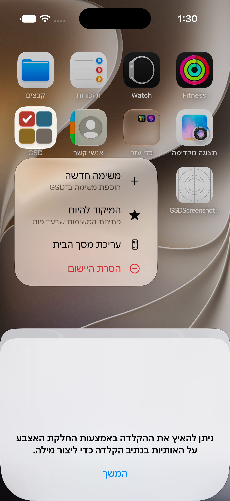
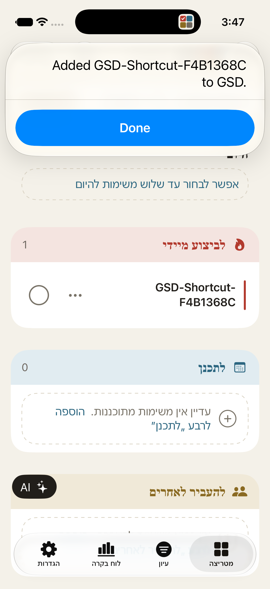
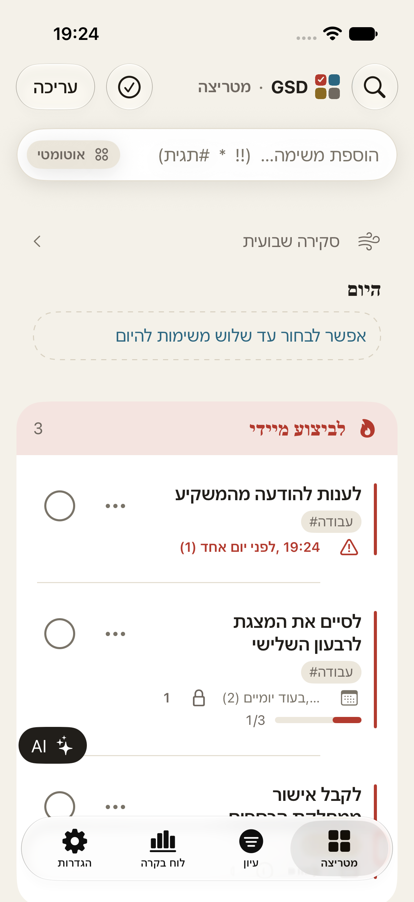
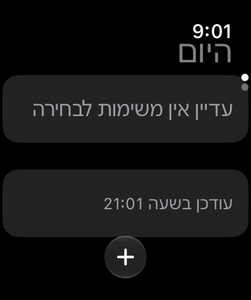

# GSD — מצב מסירה נוכחי, עדכון 25.11.2026, 09:06 UTC

**קבלת ה־Widget המלאה על המקור הסופי `fd6e2944` עברה בתוך GitHub Actions: בדיקה אחת, הצלחה אחת, ללא כישלונות או דילוגים.** [ריצה 45575270618](https://github.com/davidpovarsky/gsd-iosapp/actions/runs/45575270618) אימתה התקנת Widget אמיתי במסך הבית, הצגת המשימה, רענון הכותרת ופתיחת אותה משימה בעורך עברי עם RTL. הבדיקה המקורית והתוצרים נשמרו ללא שינוי, והמכשיר וה־source claim שבבעלות הריצה שוחררו. הענף הקנוני עודכן ב־fast-forward ל־fd6 ב־09:01:29; `main` נשאר ללא שינוי.

**המסירה המאומתת ב־TestFlight נשארת GSD 4.1.0 (48).** ניסיון ה־Archive הראשון של fd6 נעצר ב־09:02:10 בבדיקת קיבולת, לפני הפעלת ילד Archive, חתימה או פנייה ל־Apple. למקור זה עדיין נדרשים ארכיון Release חתום, ייצוא, אימות והעלאה, עיבוד Apple וזמינות לבודקים. ארכיון 49 ההיסטורי של 9f אינו כולל את תיקון ה־Widget. קבלות Share ו־Shortcuts נשמרות לפי מקורותיהן; אין ייחוס שלהן להרצה חדשה על fd6. הראיות ההיסטוריות של 48 נשמרות ב־[דוח ההפצה](TESTFLIGHT_DELIVERY_20261124.md) וב־[דוח האינטגרציה](GSD_INTEGRATION_20261124.md).

**השלבים האישיים עדיין אינם מאומתים:** Connect של ה־Plugin הופסק ב־24.11 ב־18:49 ולא חודש; סיבת סיווג Desktop only אינה ידועה. אין קבלה לשמירת Session/הרשאה אישית לאחר תיקון Darwin או לתשובת Hanlin ראשונה באמצעות Continue with ChatGPT. דיווח ההתחברות מ־14:29 קדם לתקלה ולתיקון; אין ראיה לדחיית זכאות רשמית או לשימוש במכסת ChatGPT.

## קבלת Widget הסופית והאינטגרציה — 25.11, 08:51–09:06 UTC

[קבלת Actions המקורית](evidence/delivery-20261124/continuation-20261125-0906/actions/widget-actions-receipt.json), [terminal המקור](evidence/delivery-20261124/continuation-20261125-0906/native-terminal.json), [binding המקור](evidence/delivery-20261124/continuation-20261125-0906/native-binding.json) ו־[תצפית המקור](evidence/delivery-20261124/continuation-20261125-0906/native-observation.json) קושרים את אותה ריצה ל־`fd6e2944a5a215d317fa5cc2a2802121e3ae3d61`: יישום, בדיקות, workflow וסט Products מלא מאותו מקור. קובץ הבדיקה נשאר ב־SHA-256 `2443a031bee63c546062de0f90192e793ac07f09bf84c46dddc2d9e0252efeba`; הורץ המקרה המקורי `GSDNativeSystemAcceptanceUITests/test01RealWidgetTimelineRefreshAndTaskTap`, ללא הרצה מקומית כפולה.

| ראיה | תוצאה שהתקבלה |
|---|---|
| ריצה בפועל | attempt 1 של [45575270618](https://github.com/davidpovarsky/gsd-iosapp/actions/runs/45575270618); job `widget-final` הסתיים ב־success. ארבעת ה־jobs הישנים, ובהם `native-acceptance` ו־`signed-testflight`, היו skipped. |
| XCTest | **08:45:00.491718–08:51:21.870241 UTC**; סך הכול 1, עברו 1, נכשלו 0, דולגו 0, כישלונות צפויים 0. סיום הבקר ב־08:51:29.030306 וקבלת המתאם ב־08:51:29.048739 הם שלבים נפרדים. |
| ארבעת תנאי ה־Widget | `passed`, `installedWidgetDisplayedInitialTask`, `realWidgetTimelineRefreshObserved` ו־`widgetRowOpenedExactTask` הם true. הכותרת השתנתה מ־`GSD-Widget-A-2C89BA1D` ל־`GSD-Widget-B-2C89BA1D`, ואותה משימה נפתחה בעורך. |
| מקור, תוצרים וניקוי | `sourceAndProductsUnchanged=true`; כל 421 קובצי סט התוצרים הסופי נקשרים ל־tree `b0b6c65c2f9a820cff3d18562361639981931644388d5310ee870d1bde188716`. הסימולטור הוסר, הילדים הסתיימו וה־source claim שוחרר. |
| היקף הקבלה | iPhone 17 Pro Simulator, ‏iOS 27.2, ‏he/IL. אין קבלה למכשיר פיזי, לכל משפחות הווידג׳ט, Siri, VoiceOver speech, WatchConnectivity, הרשאה אישית או לשפת תוצאת Shortcuts. |

[תצפית GitHub שנשמרה](evidence/delivery-20261124/continuation-20261125-0906/actions/actions-terminal.json) ו־[קבלת הורדת ה־artifact](evidence/delivery-20261124/continuation-20261125-0906/actions/artifact-transfer-manifest.json) קושרות את ארבעת קובצי הציבור ל־artifact **15006680376**, בשם `GSD-Widget-System-Acceptance-45575270618-1`. ZIP ההורדה הוא 2,784 בתים, SHA-256 `b300d6388a6b4456dc49e2e30bf9c391f110b44086d004615d768fca598e4a7d`; ה־digest ש־Root קרא מ־GitHub זהה. [ביקורת Root שנשמרה](evidence/delivery-20261124/continuation-20261125-0906/root-widget-acceptance-review.json) היא projection של תשובות connector שכבר נקראו ושל צפייה בשלוש התמונות, ללא fetch או צילום חדש בעת שמירתה. שלושת קובצי `*-public.json` הם projections שהמתאם הפיק מן הקבלות המקוריות, והועתקו בדיוק. הדגלים הציבוריים `nativeAcceptance`, `fullSystemSurfaceCoverage`, `accountGrantVerified`, `buildExecutedByAdapter` ו־`appleUploadExecuted` נשארים **false**; הצלחת `widget-final` אינה משנה אותם.

| צילום מקורי שנבדק | הראיה החזותית |
|---|---|
| [Widget עם A](evidence/delivery-20261124/continuation-20261125-0906/visual/12-installed-widget-initial.png) · [AX](evidence/delivery-20261124/continuation-20261125-0906/visual/12-installed-widget-initial.hierarchy.txt) | Widget אמיתי מותקן במסך הבית עם כותרת עברית ומשימת A. |
| [Widget לאחר רענון ל־B](evidence/delivery-20261124/continuation-20261125-0906/visual/14-installed-widget-refreshed.png) · [AX](evidence/delivery-20261124/continuation-20261125-0906/visual/14-installed-widget-refreshed.hierarchy.txt) | אותו Widget מציג את משימת B המעודכנת. |
| [פתיחת משימת B בעורך](evidence/delivery-20261124/continuation-20261125-0906/visual/15-widget-row-task-editor.png) · [AX](evidence/delivery-20261124/continuation-20261125-0906/visual/15-widget-row-task-editor.hierarchy.txt) | הכותרת המדויקת `GSD-Widget-B-2C89BA1D` בעורך עברי עם RTL, שמירה/ביטול ובקרות רבעים. |

**אינטגרציה שהושלמה.** [קבלת הפרסום הקנוני](evidence/delivery-20261124/continuation-20261125-0906/canonical-fd6-publication.json) מאמתת push רגיל ל־`fork` המאומת של `davidpovarsky/gsd-iosapp`, מ־b558 ל־fd6: שמונה קומיטים וחמישה נתיבים, ללא force. הענף `fix/gsd-latest-sdk-completion-20261124` הגיע ל־fd6 ב־09:01:29; `main` נשאר `fe35879146b7994f71b5d0a49289336315604192` וכל 32 הקבצים המקוריים בשלוש תיקיות העבודה נשמרו. [קומיט התיעוד 655c5a3](https://github.com/davidpovarsky/gsd-iosapp/commit/655c5a3bcaf1024fa12002f41739f095444255cd) פורסם קודם בענף הטיוטה; [PR 3](https://github.com/davidpovarsky/gsd-iosapp/pull/3) נשאר Draft ולא מוזג. עדכון זה נוסף לבדיקה לפני פרסום המשך.

**תחזוקת Mac שהושלמה, בנפרד מהקבלה.** [מעטפת הקבלה השמורה](evidence/delivery-20261124/continuation-20261125-0906/maintenance-approved-20-envelope.json) מתעדת 08:46:49.370899–08:46:56.504364: מתוך 20 מועמדים הוסרו רק חמש תיקיות intermediate ניתנות לשחזור של מטמון הסימולטור הישן 671; **590,127,104 בתים מוקצים**, ו־15 מועמדים דולגו. המקור, Products והראיות נשמרו. זהו עותק מדויק של מעטפת Windows בגודל 46,702 בתים, המכילה קבלת Native שזהותה 43,481 בתים / `ea8d3df46651d8f57d820a6715aae9ca50e5c67999a1e0ceed6b59059481a101`; אין כאן שחזור של קובץ Native. ההפרש הכולל בנפח הפנוי היה 335,040,512 בתים, ואין ייחוס עצמאי של פינוי APFS לפעולה. קבלת המשאבים ב־08:43:59 והתחלת ה־suite ב־08:44:00 **קדמו** לניקוי, ולכן הניקוי אינו מוצג כסיבת תחילת הבדיקה.

[manifest התוספת](evidence/delivery-20261124/continuation-20261125-0906/manifest.json) מונה עותקים מדויקים ואת סוג המקור של כל אחד. קבלות הכישלון הקודמות נשמרו ללא שינוי. תגובות Asana [Apple](https://app.asana.com/0/1220770501963372/1220820292484722) `1220893196663065`, [עברית](https://app.asana.com/0/1220770501963372/1220823124041036) `1220893263826802` ומצב הפרויקט `1220893183283696` מ־09:04:33.912 UTC מתעדים את הצלחת ה־Widget, האינטגרציה ושיגור ניסיון ה־Archive; הפרויקט נשאר צהוב.

## היסטוריית האבחון, התיקון והבנייה — עד 08:42 UTC

| שלב | תוצאה וגבול הראיה |
|---|---|
| שחזור סט התוצרים האבחוני 620 | [קבלת הסיום](evidence/delivery-20261124/continuation-20261125-0724/widget-620-recovery-terminal.json) ו־[קבלת ההרכבה](evidence/delivery-20261124/continuation-20261125-0724/widget-620-recovery-composition.json) מאמתות העתקה מלאה של תוצרי הבנייה הקיימת, 421 קבצים וחמישה יעדים; ה־Watch הפנימי והחיצוני זהים. השלב הסתיים ב־06:12:24, ללא הידור חוזר או runtime, ועם `productionAcceptance=false`. ההרכבה הקודמת שנכשלה נשמרה. |
| האבחון בפועל על 620 | [ה־terminal](evidence/delivery-20261124/continuation-20261125-0724/widget-620-diagnostic-terminal.json), [קשירת הריצה](evidence/delivery-20261124/continuation-20261125-0724/widget-620-diagnostic-binding.json) ו־[תצפית הממשק](evidence/delivery-20261124/continuation-20261125-0724/widget-620-diagnostic-observation.json) שומרים תוצאה של **1 בדיקה, 0 עברו, 1 נכשלה**, ללא דילוגים או כישלונות צפויים. XCTest של `test03DiagnoseInstalledWidgetTaskRoute` הסתיים ב־06:32:54.477355 UTC לאחר שהעורך לא נפתח; ה־terminal של הבקר נרשם ב־06:33:01.571023 UTC. נאסף trace תקין; הסימולטור נוקה והתוצרים נשמרו. זו בדיקה אבחונית, לא קבלת Widget מלאה. |
| תיקון המקור | [`1d4033c54542b161da65ab34f083cac8aec0b1c4`](https://github.com/davidpovarsky/gsd-iosapp/commit/1d4033c54542b161da65ab34f083cac8aec0b1c4) מוסיף 11 שורות ל־`App/ContentView.swift`: שימוש ב־`BackgroundDatabaseWindow` הקיים לפני קריאת המשימה ושחרורו בסיום, עם חידוש המסד כשהאפליקציה כבר פעילה. [קבלת הפרסום](evidence/delivery-20261124/continuation-20261125-0724/widget-route-fix-1d4033-publication.json) מאמתת parent 3ca וקובץ בדיקה ללא שינוי. |
| שומרי מסלול Actions | [`f56a8acea008336d26ed832ab5fee0525b126023`](https://github.com/davidpovarsky/gsd-iosapp/commit/f56a8acea008336d26ed832ab5fee0525b126023) כולל שלושה קובצי CI בלבד. [קבלת 25 הבדיקות](evidence/delivery-20261124/continuation-20261125-0724/widget-actions-guards-25-review.json) ו־[קבלת הפרסום](evidence/delivery-20261124/continuation-20261125-0724/widget-actions-f56-publication.json) מאמתות **25/25 בדיקות ממוקדות ב־Windows**. ארבעת ה־jobs הקודמים ושערי Release נשמרו; `widget-final` דורש קבלות, זהויות מקור/תוצרים, זמן ריצה, ארבעת דגלי ה־Widget וניקוי אמיתי. אלה בדיקות המתאם, לא ריצת Xcode או Actions חדשה. |
| אינטגרציה סופית | [`fd6e2944a5a215d317fa5cc2a2802121e3ae3d61`](https://github.com/davidpovarsky/gsd-iosapp/commit/fd6e2944a5a215d317fa5cc2a2802121e3ae3d61) פורסם בענף `fix/gsd-widget-final-20261125` ב־06:56:08. [קבלת הפרסום](evidence/delivery-20261124/continuation-20261125-0724/widget-final-fd6-publication.json) מאמתת העתקת שלושת קובצי CI אל 3ca + תיקון 1d4033; **620 אינו ancestor וקוד האבחון אינו כלול**. |
| בניית fd6 שהושלמה | [השיגור](evidence/delivery-20261124/continuation-20261125-0724/widget-final-fd6-build-dispatch.json) החל ב־07:16:35, PID 70210; [קשירת Xcode](evidence/delivery-20261124/continuation-20261125-0724/widget-final-fd6-build-binding.json) מאמתת exit 0 ב־07:17:53–07:18:13. [קבלת הסיום](evidence/delivery-20261124/continuation-20261125-0724/widget-final-fd6-build-terminal.json) מאשרת השלמה ב־07:18:16, שחרור נעילת המטמון וסיום התהליכים. `runtimeExecuted=false` ו־`signingOrUploadExecuted=false`. |
| Actions ראשון על fd6 — עצירה לפני XCTest | [תצפית יצירת הריצה](evidence/delivery-20261124/continuation-20261125-0820/actions-45573374526-creation.json) קושרת את attempt 1 למקור ול־workflow ‏fd6 וליצירה ב־08:06:08. [הקבלה הציבורית](evidence/delivery-20261124/continuation-20261125-0820/actions-45573374526-widget-receipt.json) שומרת `passed=false`, בקר PID 5569 ו־exit 1. [תצלום המצב הפרטי שנשמר](evidence/delivery-20261124/continuation-20261125-0820/actions-45573374526-private-state.json) כולל את ה־terminal: `GuardError: writer_cwd_unavailable` בעת בדיקת Python ‏PID 416, `cases={}` וזמן בקר 08:06:17.726304–08:06:17.924522 UTC. אין תוצאת XCTest או קבלת Widget מהריצה. |

[ה־trace המסונן](evidence/delivery-20261124/continuation-20261125-0724/widget-620-route-trace.json) ו־[שדות האיסוף שחולצו מן ה־binding](evidence/delivery-20261124/continuation-20261125-0724/widget-620-trace-collection.json) קושרים את 13 האירועים לאותו PID ‏37155, nonce סינתטי ומזהה המשימה הצפוי. ב־06:32:33.167053 הגיעה כתובת המשימה; ב־.618089 התחילה קריאת המשימה במצב inactive; ב־.648437 התקבלה `GRDB.DatabaseError` בקוד 4 ונבחרה חזרה ל־Matrix; חידוש המסד נרשם רק ב־.785202. סדר זה הוא הבסיס לתיקון. הוא אינו מוכיח שהתיקון כבר עבר runtime. קובץ שדות האיסוף הוא העתק byte-for-byte של `collection-receipt-from-binding.json`, שכבר הופק מחילוץ שדות מן ה־binding; הוא אינו קבלת איסוף עצמאית שנכתבה ב־Native. החילוץ לא בוצע מחדש לצורך הדוח.

[manifest התוצרים הסופיים](evidence/delivery-20261124/continuation-20261125-0724/widget-final-fd6-products.json), [קבלת ההרכבה](evidence/delivery-20261124/continuation-20261125-0724/widget-final-fd6-composition.json) ו־[קשירת המקור](evidence/delivery-20261124/continuation-20261125-0724/widget-final-fd6-source-closure.json) מאמתים מקור אחיד fd6 ליישום, לבדיקות ול־workflow; סט מלא של **421 קבצים**, tree `b0b6c65c2f9a820cff3d18562361639981931644388d5310ee870d1bde188716`, חמישה יעדים, הרשאות runtime ומשאבי EN/HE, ללא ערבוב תוצרים. `App/Info.plist` והפרויקט שנוצר נקשרו בגיבובים. קובץ הבדיקה המקורי נשאר ב־SHA-256 `2443a031bee63c546062de0f90192e793ac07f09bf84c46dddc2d9e0252efeba`. ביקורת המשאבים משתמשת בשדה `signatureVerified=false`; ביקורת חתימות הסימולטור הקשיחה נערכה בנפרד. חתימת Apple Distribution של fd6 עדיין ממתינה. הריצה הראשונה נעצרה לפני תחילת XCTest; קבלת **test01 המלא בתוך Actions** הושלמה בהמשך בריצה 45575270618, כמפורט בעדכון הסופי לעיל. לא הורצה קבלה מקומית כפולה, ולא הופק ממסלול זה `native-acceptance.json` של שערי ההפצה.

[קבלת הורדת artifact ‏15003511971](evidence/delivery-20261124/continuation-20261125-0820/actions-45573374526-artifact-read.json) מאמתת את קובץ הכישלון הציבורי: 1,240 בתים, SHA-256 `13340bb9e1ce6654a1286ee340d604a1284702161ff067c1f46626d52c529cbd`. בתצפית 08:11 לא נמצא source/cache claim, וה־terminal אינו כולל מקרה שהתחיל. [הקריאה הממוקדת המאוחרת](evidence/delivery-20261124/continuation-20261125-0820/actions-45573374526-pid416-cwd.json), `sudo -n lsof` ב־08:14:01.830100, הצליחה והחזירה cwd ‏`/` עבור PID 416. היא אינה משנה את הכישלון השמור ואינה קבלה להרצת הבדיקה. תצפית יצירת הריצה נשמרה עם `in_progress` כפי שנקראה בתחילתה; הקבלה הציבורית וה־terminal המאוחרים הם ראיות הכישלון. לא בוצעה קבלת Widget מקומית כפולה.

[תצפית יצירת הריצה הבאה](evidence/delivery-20261124/continuation-20261125-0820/actions-45575270618-creation.json) קושרת את attempt 1 החדש לאותו fd6: נוצרה ב־08:19:30 ונקראה ב־08:19:36.982902 עם `in_progress` ו־`conclusion=null`. זו תצפית היסטורית של התקדמות, ללא טענה שהבדיקה התחילה או עברה; Native נשאר הצופה היחיד בהרצה.

**מצב קיבולת Mac מתוארך, ללא תוצאת בדיקה חדשה:** בתצפית 08:22:56 ריצה 45575270618 המתינה למשאבים לפני XCTest, עם `suites={}`; מעטפת הריצה כבר התחילה, אך 0 מקרי XCTest הורצו עד אותה תצפית. [מלאי הקריאה בלבד מ־08:42:57.770552](evidence/delivery-20261124/continuation-20261125-0842/mac-old-runner-cache-inventory.json) מצא 6,049,550,336 בתים פנויים ותשעה מועמדי intermediate ישנים, בסך מחושב של 1,242,959,872 בתים. תיקיית העבודה הפעילה, המקור, Products וראיות ההפצה הוחרגו; במלאי רשום `noDeletionPerformed=true`. זו אינה קבלה לניקוי, לפינוי זמין בפועל או לתחילת XCTest לאחר מכן. מצב ההמתנה תועד בתגובת Apple `1220892415973235` ובמצב הפרויקט הצהוב `1220892352697562` מ־08:35; תגובת התיאום `1220892190769174` נשמרת במשימה `1220883442886052`.

[מניפסט עדכון הקיבולת והריצה](evidence/delivery-20261124/continuation-20261125-0820/manifest.json) ממפה את העותקים המדויקים ואת סוגי המקורות. דוח Oracle הוא projection שכבר הופק מתצפיות; תצלום המצב הפרטי והמידע על יצירת הריצה הם קבלות קריאה הכוללות שדות מקוריים, ולא קבלות XCTest עצמאיות. תוכן קבלות הכישלון נשמר ללא שינוי.

[בדיקת גרף GitHub בקריאה בלבד](evidence/delivery-20261124/continuation-20261125-0724/github-remote-graph-20261125T070946Z.json) מתעדת את 07:06–07:09 UTC: main ‏`fe358791` והענף הקנוני `b5588f3f` הם ancestors של fd6; האחרון מתקדם בהתאמה 148 ו־8 קומיטים, ללא קומיטים חסרים. באותה קריאה היסטורית, [PR 3](https://github.com/davidpovarsky/gsd-iosapp/pull/3) היה טיוטה פתוחה בראש ad5e6641, עם 97 נתיבי תיעוד/ראיות בלבד. אין חפיפה לנתיבי שינוי המקור מאז האב המשותף. לא בוצע fast-forward או מיזוג מתוך בדיקה זו.

[מניפסט התוספת המצומצם](evidence/delivery-20261124/continuation-20261125-0724/manifest.json) ממפה את הקבלות המקוריות ואת העותקים לפי בתים ו־SHA-256. התיעוד והראיות ההיסטוריות נשמרו; אין בתוספת טענה להרשאה אישית, מכשיר פיזי, חתימת Release של fd6 או זמינות 49 ב־TestFlight.

## מקורות והיקף השימוש החוזר

| רכיב | מקור מאומת | היקף הראיה |
|---|---|---|
| מקור הייצור והיסטוריית בדיקת Share | [`9f2736d3e071d2ceb4a6dfada1a2c3767c9906be`](https://github.com/davidpovarsky/gsd-iosapp/commit/9f2736d3e071d2ceb4a6dfada1a2c3767c9906be), tree `1079979780cfcac4ef19ac2bef9731f9d1d75b6e` | build-for-testing עבר ב־21:54:27; ריצת 9f המקורית נכשלה לאחר Add. הכישלון נשמר כהיסטוריה; קבלת Share הושלמה בהמשך בבדיקות b558 על תוצרי 9f. |
| תיקון בדיקה ותשתית בדיקות לאחר 9f | [`6bd91d6a36155bd73ab71a428e69642b5989d842`](https://github.com/davidpovarsky/gsd-iosapp/commit/6bd91d6a36155bd73ab71a428e69642b5989d842) | מעבר על כל רבעוני Matrix, רישומי בדיקות בפרויקט ותוכנית משטחי מערכת; מקור הייצור 9f נשמר. בניית UI runner עברה ב־22:40:34; ריצות ההמשך מתועדות למטה. |
| תיקון מחרוזת בבדיקה לאחר 6bd | [`0ae293b8f1d867a09be6d95cc7029a9442728bfc`](https://github.com/davidpovarsky/gsd-iosapp/commit/0ae293b8f1d867a09be6d95cc7029a9442728bfc) | שינוי מחרוזת צפויה אחת לכותרת שנצפתה בפועל: `היום, 0 מתוך 3`. מקור הייצור נשאר 9f; אין כאן טענה שהריצה החדשה עברה. |
| ריצת Share שהתקבלה | [`b5588f3f0c42df328dba34024d569be8605e51d0`](https://github.com/davidpovarsky/gsd-iosapp/commit/b5588f3f0c42df328dba34024d569be8605e51d0), חמשת תוצרי הייצור 9f ללא שינוי | **2/2 עברו, כל שמונת הדגלים true**, סיום 25.11 ב־00:44:38; ביקורת המתאם בדקה גם את מעבר Matrix המלא ואת הצילום לאחר סגירת החלונית. b558 שולב בענף הקנוני לאחר הקבלה. |
| בדיקות מערכת ראשונות | בדיקות [`9190c72587cea69d1fd4b186051eef70d73d7500`](https://github.com/davidpovarsky/gsd-iosapp/commit/9190c72587cea69d1fd4b186051eef70d73d7500) על ייצור 9f | Widget ו־Shortcuts נכשלו כל אחת ב־1/1; קלטי המקור והתוצרים נשמרו והסימולטורים שבבעלות הריצות הוסרו. אלה אינן קבלות התקנה או הפעלה מוצלחת. |
| תיקון בחירת רכיבי מערכת 870 | [`870cf76ff383b7b90368e952796f7c250d10e1d6`](https://github.com/davidpovarsky/gsd-iosapp/commit/870cf76ff383b7b90368e952796f7c250d10e1d6), parent b558 | קובץ בדיקות יחיד, ‎+36/−8. בניית Xcode עברה ב־15.96 שניות; Widget ו־Shortcuts נכשלו בנפרד בשערי ממשק, כמפורט בהמשך. פסק הזמן הקודם של Swift parse ב־Windows נשמר כתצפית כלי נפרדת. |
| תיקוני גלריית Widget והגשת Task — קבלת Shortcuts בלבד | [`41d2b422dd259cd4b04abef8911449c74a89c9e4`](https://github.com/davidpovarsky/gsd-iosapp/commit/41d2b422dd259cd4b04abef8911449c74a89c9e4) ולאחריו [`7098dcb9abdc2d7e8e20afa8d9ec95d7e69c34ef`](https://github.com/davidpovarsky/gsd-iosapp/commit/7098dcb9abdc2d7e8e20afa8d9ec95d7e69c34ef) | שני קומיטים נפרדים שנבדקו ופורסמו; ביחד קובץ בדיקות יחיד, ‎+112/−24 לעומת 870. מקור הייצור 9f והעזר המשותף נשמרו. בניית Xcode של המקור המשולב עברה ב־24.22 שניות, וההרכבה הושלמה ב־02:31:02 UTC. לאחריה Shortcuts עבר 1/1 ו־Widget נכשל 1/1 בבחירת תוצאת הגלריה; הקבלות הנפרדות מובאות בהמשך. |
| תיקון בחירת Cell ובניית a2 | [`a2f1c09d6ef2b3ba9a281288bab985ebe44aa9ac`](https://github.com/davidpovarsky/gsd-iosapp/commit/a2f1c09d6ef2b3ba9a281288bab985ebe44aa9ac), parent 7098 | שינוי בדיקה בלבד, ‎+5/−8. בניית Xcode ראשונה עברה בכ־31 שניות; הרכבת רץ הבדיקות עם חמשת תוצרי 9f הושלמה ב־03:16:34 UTC. הריצה התקינה את ה־Widget והציגה את המשימה הראשונית, ואז נכשלה בשאילתת TextField לפי ערכו הישן. קבלת timeline ופתיחת המשימה עדיין ממתינה; קבלות Share ו־Shortcuts נשמרות לפי מקורן. |
| תיקון שאילתת הכותרת 791 | [`791faede904ec32e4254c0346919515edd792626`](https://github.com/davidpovarsky/gsd-iosapp/commit/791faede904ec32e4254c0346919515edd792626), parent a2 | שינוי בדיקה בלבד, ‎+6/−2; בנייה עברה ב־14.38 שניות. הריצה הסתיימה ב־1/0/1 לפני גלריה ועורך, ולכן לא בחנה את קטע הכותרת המתוקן. |
| המתנה למוכנות Home ב־3ca | [`3ca346ef595a6a7e062a2a2fc66cbe5b2a76ff2c`](https://github.com/davidpovarsky/gsd-iosapp/commit/3ca346ef595a6a7e062a2a2fc66cbe5b2a76ff2c), parent 791 | שינוי בדיקה בלבד, ‎+6/−2; בנייה עברה ב־14.74 שניות וחמשת תוצרי 9f נשמרו. בריצה שהסתיימה ב־04:50:53 עברו מוכנות Home, התקנה, הצגת המשימה ורענון timeline. הסיכום הכולל הוא 1 בדיקה, 0 עברו ו־1 נכשלה בשלב פתיחת עורך המשימה מהווידג׳ט. |
| Hanlin המקורי | [`bea35c3c2a435d1cc5f7ce93b08a649b104bc10f`](https://github.com/davidpovarsky/hanlin-ai/commit/bea35c3c2a435d1cc5f7ce93b08a649b104bc10f) | שילוב ה־SDK המקורי, תיקון הנתיב הפרטי ב־Darwin, חוזי SIWC והתמדה; אין מנוע משימות או SDK חלופי. |
| בדיקות חבילות Native | GSDKit ב־[`9d0faa061b0b41f7127fa40c265fef3e3fc3dd88`](https://github.com/davidpovarsky/gsd-iosapp/commit/9d0faa061b0b41f7127fa40c265fef3e3fc3dd88): 160; Hanlin ב־[`77c0455823cad90168106f2196d6e94d1ce03598`](https://github.com/davidpovarsky/gsd-iosapp/commit/77c0455823cad90168106f2196d6e94d1ce03598): 23 | **183 בדיקות שעברו**, בשני מקורות מתועדים. שימוש חוזר חל רק על קלטים שנבדקה זהותם. |
| ממשק iPhone/iPad בעברית ובאנגלית | [`6712921d1dc379c41c6919524e599ad7e0b9e5e0`](https://github.com/davidpovarsky/gsd-iosapp/commit/6712921d1dc379c41c6919524e599ad7e0b9e5e0) | **13/13** בדיקות UI, סיום 18:45:08; ביקורת **24/24** תמונות. אין טענה שכולן הורצו מחדש ב־9f. |
| Watch מעודכן | [`ee5e95f536c375cfdbfa13cb6c812dcef8987a5f`](https://github.com/davidpovarsky/gsd-iosapp/commit/ee5e95f536c375cfdbfa13cb6c812dcef8987a5f) | הפעלה רגילה בעברית ובאנגלית, חיות תהליך במשך 5 שניות וביקורת חזותית 416×496; עבר ב־20:02:07. לא בדיקת WatchConnectivity או מחזור WidgetKit. |
| Cloud פעיל | [`e74abb292cfb10b43cf5dfa11fac5167caa98cad`](https://github.com/davidpovarsky/gsd-iosapp/commit/e74abb292cfb10b43cf5dfa11fac5167caa98cad) | hardening מאומת ופריסה; אינו שינוי ב־Native או ב־TaskStore. |

[הוכחת השימוש החוזר במקור 9f](evidence/delivery-20261124/source-reuse-9f.json) נשמרה עם SHA-256 `7ebf4dbe4967dda431fde6d849e33e5f91ad0f74bf0d5370aaf1c7af93362eb1`; [אימות המתאם](evidence/delivery-20261124/source-root-review-9f.json): `7155fc11aae63d6a04d51fa19406c4475a59b378f520e7a8351443aa3042176d`. זו הוכחת קלטים תואמים בהיקף הרשום, ולא טענה לזהות בינארית בין בניות. שינוי Share מחייב קבלה משלו ו־IPA חתום מחדש.

קבלות החבילות ההיסטוריות נשמרו במלואן: [Hanlin ב־77c045](evidence/delivery-20261124/packages-77c045-historical.json) ו־[GSDKit ב־9d0faa](evidence/delivery-20261124/packages-9d0faa-historical.json). מצב הכישלון הכולל בקבלות אלה מתייחס גם לשלבים מאוחרים ואינו משנה את תוצאות החבילות שעברו. [קבלת הבנייה ב־671](evidence/delivery-20261124/native-build-671.json) מרכזת את השימוש החוזר בתוצאות לפי מקורן; אין כאן הצגה של הריצות ההיסטוריות השלמות כעברו.

## מטריצת תנאי הקבלה

| תנאי | מצב נתמך בראיות | מה עדיין אינו מאומת |
|---|---|---|
| עברית ו־RTL | 13 בדיקות UI בארבעה פרופילים, 24 תמונות ו־Watch EN/HE התקבלו; Share בעברית עבר עם כל שמונת התנאים ו־Matrix נגיש לאחר Cancel. Shortcuts יצר משימה ברקע; Widget אמיתי על fd6 הותקן, רוענן ופתח את המשימה המדויקת בעורך עברי עם RTL, 1/1 בתוך Actions. | תוויות Shortcuts היו בעברית, אך prompt ותוצאת המערכת הציגו `Task` / `Done` / `Added…` באנגלית. ה־locale האפקטיבי של ההפעלה לא נצפה, ולא הוכח פגם מקור מסוים. Siri, VoiceOver מלא ו־WatchConnectivity אינם כלולים בקבלות אלה. |
| יצירת חשבון והתחברות | התחברות דרך המסך האמיתי ב־iPad Simulator, ניהול Session, בידוד חשבונות ומחיקה מכוסים בראיות הקיימות. | התקנה ומעבר חשבון באייפד פיזי חדש של המשתמש. |
| סנכרון עם Oracle | כתיבה לשרת כשהאפליקציה סגורה, הופעה לאחר פתיחה, כתיבה בכיוון ההפוך והתמדה אחרי פתיחה חוזרת אומתו במסלול Native; חוזי אופליין, גרסאות, מחיקות ובידוד נבדקו. | אין להציג בדיקת סימולטור כהתקנה פיזית. |
| קריאה וכתיבה ללא אייפד פתוח | כל **22 כלי MCP** עברו E2E מול הענן בחשבונות בדיקה; הנתונים נשמרים ב־Oracle. | הפעלה מתוך חיבור ChatGPT האישי של המשתמש. |
| Plugin עם כניסה רגילה | OAuth בענן, PKCE, scopes, רענון, דחיית replay, ביטול והרשאות לפי חשבון; plugin פרטי 0.2.0 מפנה לענן. | Connect אישי הסתיים ב־abort ב־18:49. לפי התיעוד הרשמי Desktop only אינו זמין במובייל; סיבת סיווג GSD עדיין לא הוכחה ולא נמצא תיקון הגדרה מתועד שמבטיח זמינות באייפד. |
| Hanlin ו־22 הכלים | SDK המקורי משולב; 23 בדיקות הצרכן וחוזי הכלים נשמרו, יחד עם בדיקות הענן לכל 22 הפעולות. | תשובת AI אמיתית ראשונה אחרי התיקון אינה נובעת מבדיקות חוזים. |
| Continue with ChatGPT | זרימת preconsent והחוזים הסינתטיים עברו; דיווח המשתמש על התחברות ב־24.11, 14:29 נשמר כדיווח שקדם לתקלה ולתיקון Darwin. | אין קבלה ל־Session/credentials אישיים שנשמרו אחרי bea35 או לתשובת inference ראשונה. לא נצפתה דחיית זכאות רשמית; נדרשת בדיקת המצב האישי בגרסה המעודכנת והרשאה תקינה רק אם נחוצה. |
| דוחות, תרשימים וממשק | ראיות UI ו־MCP הקיימות מכסות את התצוגות והפעולות שנבדקו; תוצאות 24 התמונות נשמרו. | משטחי מערכת נוספים שלא נכללו בקבלות אינם מסומנים כעברו. |
| Xcode ובדיקות | 183 בדיקות חבילות, 13 UI, Share 2/2 ו־Shortcuts 1/1 נשמרים לפי מקורותיהם. 25/25 שומרי המתאם עברו ב־Windows. בניית fd6 וסט Products מלא עברו ב־07:18:16; בדיקת Widget המקורית עברה 1/1 בריצת Actions ‏45575270618. | הריצה המוקדמת 45573374526 נעצרה לפני XCTest; כישלונות 3ca ו־test03 האבחוני ב־620 נשמרים. ארבעת ה־jobs הישנים היו skipped בריצת Widget הממוקדת; אין לייחס לה קבלה מחודשת של כל בדיקות Native או Release. |
| מזהי Apple ופרופילים | ארכיון ו־IPA ההיסטוריים של 9f קושרים את חמשת יעדי `com.itorah.gsd` והפרופילים ל־Team `NA6HPWARQ2`, גרסה 4.1.0 (49), עם חתימות תקינות ו־EN/HE. | נדרשת ביקורת Release חתום של המקור הסופי fd6; ביקורת תוצרי הסימולטור אינה פרופיל הפצה או קבלת העלאה. |
| Release חתום | ארכיון 9f, IPA חתום ואימות Apple עברו ב־25.11, 02:24:43 UTC; זו ראיה היסטורית לפני תיקון ה־Widget. ה־Widget הסופי התקבל והועבר לשער ה־Archive. | [ניסיון fd6 הראשון](evidence/delivery-20261124/continuation-20261125-0906/archive-attempt1-admission-terminal.json) נעצר בבדיקת קיבולת לפני ילד Archive, חתימה או פנייה ל־Apple. ארכיון, חתימה, ייצוא ואימות Apple למקור fd6 עדיין ממתינים; IPA של 9f או ee5 אינו תוצר המכיל את התיקון החדש. |
| TestFlight | [קריאת כל עמודי Apple ב־06:53:54 UTC](evidence/delivery-20261124/continuation-20261125-0724/asc49-train-readonly-20261125T065354Z.json) מצאה רק 4.1.0 (48), במצב `VALID` וללא תפוגה; 49 נעדרה והייתה מעל הגבוה ביותר. `IN_BETA_TESTING` וקבוצת הבעלים נשמרים מהבדיקה הנפרדת של 24.11. | נדרשת בדיקה מיידית נוספת לפני העלאה, קבלת הבנייה ועיבודה, וזמינות במסלול הבודקים. המספר אינו שמור; הזמנה נוכחית והתקנה פיזית לא אומתו. |
| Asana וראיות | תגובות Apple `1220893196663065`, עברית `1220893263826802` ומצב הפרויקט `1220893183283696` מ־09:04 מתעדים Widget PASS, fast-forward ל־fd6 ושיגור Archive. ממצאי Plugin והמובייל, סיכון Oracle ושלבי הבנייה הקודמים נשמרים בעדכונים המתוארכים. | הפרויקט נשאר צהוב. Release/TestFlight והשלבים האישיים נשארים פתוחים. התיעוד פורסם בקומיט 655c5a3 בענף `docs/gsd-delivery-49-20261124`; התוספת הנוכחית ממתינה לביקורת, ו־PR 3 נשאר Draft וללא מיזוג. |

עדכון Asana מתקן: תגובת עברית `1220887608471422` ומצב הפרויקט הצהוב `1220887940869704` מ־04:03 UTC מתעדים את כישלון 791 בפועל ומחליפים במפורש את התיאור הישן של ריצה פעילה מ־03:54. לאחר פרסום 3ca נוספו תגובת עברית `1220887609734172` ב־04:11:29 ומצב הפרויקט הצהוב `1220887942219032` ב־04:11:31. זהו עדכון שלב מקור; לא נרשמה בו תוצאת runtime חדשה או הצלחה אישית ב־Plugin/SIWC. תגובת עברית `1220887929379434` ב־04:24:57 ומצב הפרויקט הצהוב `1220887880777626` ב־04:24:58 מתעדים את הצלחת בניית 3ca ואת הבקר שהופעל; הם אינם ראיה שה־XCTest התחיל.

## Cloud, OAuth וגיבויים

[קבלת E2E הציבורית של הענן](https://github.com/davidpovarsky/gsd-iosapp/blob/cfe9470b6020c28474395ff97f0672d4a5c8f126/docs/ai-agent/evidence/cloud-20261124/public-e2e.txt) מכסה את 22 הכלים, CRUD, דוחות, התנגשויות ובידוד. [קובץ המטא־נתונים הנלווה](https://github.com/davidpovarsky/gsd-iosapp/blob/cfe9470b6020c28474395ff97f0672d4a5c8f126/docs/ai-agent/evidence/cloud-20261124/public-e2e.json) שומר את פרטי ההרצה. [דוח OAuth/MCP](CLOUD_MCP_AUTH_ACCEPTANCE_20261124.md) מוסיף חוזי scopes ותגובות reconnect. [דוח ההגנה והשחזור העדכני](CLOUD_AUTH_BACKUP_ACCEPTANCE_20261124.md) מקשר **21/21 בדיקות HTTP** ופריסת e74. מספר הכלים ומספר בדיקות ההגנה מודדים דברים שונים.

השחזור העדכני אימת מסד פעיל עם WAL, שני משתמשים, שתי משימות, שתי תצוגות ונתוני OAuth; לאחר שחזור הופעלו שירותי החשבון האמיתיים ונבדקו גישה מבודדת, רענון מתחלף ודחיית replay. [הגיבוי המתוזמן](BACKUP_CALENDAR_ACCEPTANCE_20261124.md) והקבלה המאוכלסת הקודמת ב־`540bde78d1eb7b90de9eb12d20d319d1c439f1f4` נשמרים כראיות קודמות. לא נטען שחזור volume של ספק הענן או מעבר באייפד פיזי.

בבדיקת המתאם ב־22:02:46 UTC מקור gateway הפעיל עדיין תאם SHA-256 `4bcc55288e28576aaacf24cd6657f254e6703637f732929b139ca78645b2a598`; ארבעת השירותים והגיבויים שנבדקו היו תקינים ושתי בדיקות health החזירו 200. מקום פנוי שנצפה: כ־7.23 GiB בשורש וכ־27.74 GiB בדיסק הנתונים. זו מדידה נקודתית בלבד; אין בדוח ייחוס שלה לפעולת ניקוי.

[בדיקת מוכנות Oracle מ־23:57–23:58 UTC](evidence/delivery-20261124/oracle-release-readiness-20261124T235834Z.json) היא תוספת מאוחרת לקריאה זו: PocketBase, gateway, הגישור הישן ו־Lorvex פעילים; שני נתיבי health החזירו 200 וה־backup timer פעיל. שאילתת SQLite במצב קריאה בלבד מצאה אפס רשומות users/tasks/gsd_library של בעל חשבון הבדיקה הסינתטי המדויק. לא נקראו נתוני משתמשים אישיים, לא הופעל שחזור נוסף, ולא בוצעו מחיקה, שינוי תצורה או restart. הקבלה המקורית נשמרה ב־1,952 בתים, SHA-256 `59153ece72ada26435802a689f1c2dc55d691b9b9234cc0cb0243873545b91ed`.

[קריאת Oracle מ־25.11, 03:10:54–03:11:34 UTC](evidence/delivery-20261124/oracle-readonly-health-20261125T031134Z.json) נשמרת כמצב קודם: שירותי GSD ו־Lorvex הפעילים שנבדקו פעלו, PocketBase ו־gateway הפנימי והציבורי החזירו 200, וה־timer המתוזמן היה פעיל. בכונן הנתונים `/mnt/development` נצפו אז 5,122,420,736 בתים פנויים. שירות הגיבוי מסוג `oneshot` היה במצב `inactive` לאחר השלמה מוצלחת של הריצה הקודמת; זה אינו כשל שירות. באותה קריאה הריצה הבאה של 25.11 עדיין הייתה מתוכננת ל־03:23:05.

[קבלת הגיבוי המתוזמן המאוחרת](evidence/delivery-20261124/oracle-scheduled-backup-20261125T032340Z.json), שנקראה ב־03:23:40.664 UTC, מאשרת שההפעלה האוטומטית של **25.11 ב־03:23:05 UTC הסתיימה בהצלחה**, `Result=success` ו־`ExecMainStatus=0`. ה־timer נשאר פעיל והריצה הבאה מתוכננת ל־**26.11 ב־03:22:58 UTC**. לא הופעל גיבוי ידני, לא בוצעו שינוי שירות או ניקוי, ולא חזרו על בדיקת השחזור שכבר התקבלה. במדידה המאוחרת נותרו בכונן הנתונים **4,707,729,408 בתים** פנויים; זו מדידה נקודתית חדשה, ללא ייחוס הסיבה לשינוי בנפח. מצב הפרויקט נשאר צהוב.

### קיבולת Oracle — תצפיות 25.11, 07:51–07:57 UTC

[מלאי GSD המצומצם](evidence/delivery-20261124/continuation-20261125-0820/oracle-gsd-space-inventory.json) הוא **projection של תוצאות קריאה שנאספו קודם**, שהועתק ללא שינוי; הוא אינו מדידה חדשה בזמן עדכון הדוח. שלושת שירותי GSD שנבדקו היו active/running. המדידה האחרונה ב־07:55:57.893808 מצאה **1,797,406,720 בתים פנויים בשורש** ו־**1,360,441,344 בתים ב־`/mnt/development`**. בדיקת `df` הקודמת ב־07:51 הציגה בהתאמה 97% ו־99% תפוסה. הקריאות ההיסטוריות לעיל נשמרות ואינן מצב הקיבולת הנוכחי.

שורש הענן של GSD תפס 34,942,976 בתים, בעיקר בינארי PocketBase הפעיל; שורש הגישור הישן תפס 106,496 בתים. **12 בדיקות של prefixes זמניים מדויקים החזירו 0 התאמות.** שלושה ארטיפקטים היסטוריים תפסו יחד 77,824 בתים; לא נמצאו להם handles פתוחים בזמן הבדיקה, אך לא הוכחה אי־תלותם בשחזור או בשימוש עתידי, ולכן נשמרו. המטא־נתונים של `/dev/sda` ו־`/dev/sdb` ומבני ext4 הראו שאין שטח הרחבה מוקצה משמעותי ושאין blocks שמורים לשחרור: מערכת הנתונים משתרעת על כל ההתקן, והפרש מערכת השורש מהמחיצה הוא 3,584 בתים בלבד. לא נמצא מועמד GSD בטוח שנותן פינוי משמעותי; לא בוצעו מחיקה, שינוי שירות או מערכת קבצים. **סיכון הקיבולת נשאר פתוח**, ללא ייחוס הגידול לפרויקט אחר.

[תצפית מטמון apt שנשמרה](evidence/delivery-20261124/continuation-20261125-0820/oracle-os-apt-cache-observation.json) מ־08:06:26.927652 היא projection נפרד של stdout שכבר נקרא: `/var/cache/apt/archives` תפס 28,672 בתים וללא קובצי `.deb`; `/var/lib/apt/lists/partial` תפס 20,480 בתים. גם שם לא נמצא פינוי משמעותי ולא בוצע ניקוי. הנתונים אינם מלאי של פרויקטים אחרים.

### קריאת ספק OCI — 25.11, 08:38 UTC

[קבלת הספק המקורית](evidence/delivery-20261124/continuation-20261125-0842/oci-provider-readback.json) מתעדת שמונה תשובות HTTP 200 ב־08:38:02–08:38:20, מול החשבון והאזור הקיימים בלבד. שני ה־volumes הקשורים לשרת נשארו 50 ו־103 GB; סך ה־boot וה־block באזור היה 200 GB. ב־AD המתאים לשני היעדים, `total-storage-gb` החזיר limit ‏200, used ‏200 ו־available ‏0. זו תמונת מצב לא אטומית; לא אומתו הרשאת עדכון או זכאות חיוב, והנתונים אינם מבטיחים הרחבה ללא עלות.

[קבלת הפעולה המקורית](evidence/delivery-20261124/continuation-20261125-0842/oci-operation-receipt.json) מאשרת אפס כתיבות לענן, תצורה קיימת ללא שינוי והסרת סביבת ה־SDK הזמנית ב־Windows; לא בוצעו הרחבה או ניקוי ב־Oracle. שני הקבצים הם קבלות שהפיק לקוח OCI בפעולה שהסתיימה, והועתקו בדיוק. [התיעוד הרשמי של Always Free](https://docs.oracle.com/en-us/iaas/Content/FreeTier/freetier_topic-Always_Free_Resources.htm) מתאר 200 GB משותפים ל־boot/block; [מכסת `total-storage-gb`](https://docs.oracle.com/en-us/iaas/Content/Quotas/Concepts/resourcequotas_topic-Block_Volume_Quotas.htm) היא לפי AD, ו־[הגדלת volume](https://docs.oracle.com/en-us/iaas/Content/Block/Tasks/resizingavolume.htm) אינה מסלול להקטנתו. אלה כללים כלליים, לא אימות מחיר או אישור שינוי בחשבון זה. [מניפסט תוספת הפרסום](evidence/delivery-20261124/continuation-20261125-0842/manifest.json) קושר את שלושת העותקים המדויקים; קבלות הביקורת הקודמות נשארות היסטוריה ללא שינוי.

## ChatGPT: שני חיבורים נפרדים

**Plugin לחשבון GSD בענן.** השרת וה־OAuth נבדקו, אך ניסיון Connect אישי ב־24.11, 18:49 הופסק ולא הופעל מחדש. החבילה הקיימת היא `USER` / `PRIVATE`, גרסה `0.2.0`, release `pluginrel_6b04d42b006c81919d7c1f65c062159a`, עם MCP מרוחק מסוג `streamable-http` ו־OAuth DCR בהרשאות `gsd.read gsd.write offline_access`. בבדיקה לא נמצאו `requires_local_executor`, שרת `stdio`, פקודות מקומיות, hooks או scripts; המטא־דאטה אינו חושף מדוע החבילה מסומנת Desktop only. [משימת Plugin](https://app.asana.com/0/1220770501963372/1220828170561422), ובפרט תגובה `1220888481711955`, מתעדת את הממצא העדכני.

התיעוד הרשמי [Plugins](https://learn.chatgpt.com/docs/plugins) קובע שתוספים המסומנים **Desktop only אינם זמינים במובייל**. [מדריך MCP](https://learn.chatgpt.com/docs/extend/mcp) מבהיר ששרת HTTPS מרוחק לבדו אינו מוכיח תאימות למשטח הווב. [מדריך ייבוא התוספים](https://learn.chatgpt.com/docs/enterprise/plugin-management) מזהיר שהוספת `.app.json` לבדה אינה מסירה סיווג Desktop only; סעיף זה עוסק בייבוא למרחב עבודה ואינו מוכיח שזה מקור הסיווג בחבילת GSD האישית. [מדריך האריזה](https://developers.openai.com/plugins/build/plugins) מתאר `.app.json` כרכיב אופציונלי למיפוי חיבור רשום, ו־[מדריך Desktop only](https://developers.openai.com/plugins/deploy/desktop-only) מתאר שדה שמחייב הרצה מקומית; היעדר השדה אינו הבטחה לזמינות בכל משטח.

[מסלול הרישום הרשמי](https://developers.openai.com/plugins/deploy/connect-chatgpt) מאפשר הוספת MCP מותאם, הגדרת חיבור ואימות ויצירת תוסף, בכפוף למדיניות החשבון ולהרשאה האישית. הוא לא בוצע בבדיקה זו, ואין ראיה שיפתור את סיווג החבילה הקיימת או ישמר את זהותה. **הסיבה המדויקת לסיווג GSD נשארת לא ידועה; לא נמצא שדה הגדרה מתועד שמבטיח תיקון, ואין הבטחה שהתחברות במחשב תאפשר שימוש באייפד.** לא הומצא app ID, לא שונתה החבילה ולא חודש Connect שבוטל. השימוש מתוך חשבון ChatGPT האישי עדיין אינו מאומת.

**Continue with ChatGPT בתוך GSD.** קבלת f1 בדקה את כניסת המשתמש הרגילה, מעבר לדפדפן וביטול לפני הסכמה, בשני מחזורים: 1/1 בדיקה ו־10 דגלים. נצפה host `auth.openai.com` במצב `visible_host_only`; השדה `observedOrigin` לא נכתב. אין להסיק מכך URL מלא או אישור חשבון. הריצה הכוללת של f1 נכשלה ב־Share; הצלחת רכיב preconsent נשמרת בנפרד.

ב־24.11.2026, בשעה 14:29 UTC, המשתמש דיווח על התחברות אישית מוצלחת, כמתועד ב־[משימת AI](https://app.asana.com/0/1220770501963372/1220820292511448), סיפורים `1220863756603297` ו־`1220865013712659`. הדיווח קדם לכשל האחסון ולתיקון Darwin ב־bea35. התיקון שוחזר ונבדק בקוד, אך ללא נתיב או לוג מהמכשיר לא הוכחה סיבתיות מדויקת לתקלה הפיזית. **אין בקבלות שנאספו אימות של Session או credentials אישיים שהתמידו לאחר התיקון.** חוזי ה־SDK משתמשים ב־credentials סינתטיים; [קבלת preconsent](evidence/delivery-20261124/preconsent-f1-observation.json) מציינת `authorizationSucceeded=false`, ‏`grantVerified=false`, ‏`entitlementVerified=false` ו־`inferenceInvokedByProbe=false`, בהתאם לביטול המתוכנן. נותר לבדוק את מצב החשבון בגרסה המעודכנת ללא חשיפת סודות, להשלים הרשאה רשמית רק אם נחוצה ולראות תשובת Hanlin אמיתית עד `response.completed`. **לא נצפתה דחיית זכאות, תוכנית או מכסה רשמית; חסרה קבלה אישית לאחר התיקון, ולא הוכח מחסום זכאות.** לא הופעלה התחברות או בקשת inference חדשה לצורך הדוח. OpenRouter ו־OpenAI API נשמרו.

## Share — הקבלה שהושלמה והיסטוריית התיקונים

### קבלת b558 — 25.11.2026, 00:44:38 UTC

[הקבלה הסופית](evidence/delivery-20261124/share-b558-terminal.json), [קשירת הריצה](evidence/delivery-20261124/share-b558-runtime-binding.json), [הסיכום הציבורי](evidence/delivery-20261124/share-b558-summary.json) ו־[ספירות XCTest](evidence/delivery-20261124/share-b558-test-counts.json) מאמתים **2 בדיקות, 2 עברו, 0 נכשלו, 0 דילוגים ו־0 כישלונות צפויים**. הריצה החלה ב־00:40:14.194720 והסתיימה ב־00:44:38.370081 UTC, exit 0. מקור הבדיקות הוא b558; מקור הייצור הוא 9f, manifest קפוא `38aae93e3330893c26c1ce837a05af933b1d2115b69b01b0ea67f0e8fb2eb67f`. manifest ההרכבה הוא `605a5631510c1632d690dac26a2b71132237065fbfb7a9b54c081dbe412d2a8a`.

[תמצית שמונת התנאים](evidence/delivery-20261124/share-b558-observation-summary.json) משמרת את כולם כ־true: `sourceCreated`, `activitySheetOpened`, `extensionOpenedForAdd`, `addCreatedExactlyOne`, `addedTaskPersisted`, `extensionOpenedForCancel`, `cancelCreatedNone`, `cancelNoneAfterRelaunch`. כלולה יצירה של משימה אחת בדיוק, התמדה אחרי relaunch, והיעדר משימה מבוטלת גם לאחר relaunch. הבדיקות ממשיכות לעבור על כל ארבעת הרבעונים ועד לתחתית ולשמור את זהות המשימה.

[ביקורת המתאם העצמאית](evidence/delivery-20261124/share-b558-root-review.json), שנשמרה ב־00:57:28, מאשרת שקרא את הקבלות ואת הוכחת מעבר Matrix וצפה בפועל בצילום שלאחר הסגירה. צילום יחיד אינו מחליף את בדיקות ההיעדר וההתמדה. מקור התוצרים וקבלות המערכות הקודמות נשמרו, וכל הסימולטורים שבבעלות הריצה הוסרו. השדות `fullSystemSurfaceCoverage` ו־`accountGrantVerified` נשארים false בכוונה: קבלת Share אינה קבלת WidgetKit, Shortcuts או הרשאה אישית.

התיקון [b558](https://github.com/davidpovarsky/gsd-iosapp/commit/b5588f3f0c42df328dba34024d569be8605e51d0) החליף רק את מחוות ההחלקה בהקשה על `PopoverDismissRegion` שנצפה, עם ייחודיות, hittability והיעלמות אמיתית של החלונית. הוא שולב בענף הקנוני ב־fast-forward לאחר קבלה; לא שונה קוד הייצור ולא הורצה שוב סוויטת Share בעקבות תיקון מערכות 870cf76. השדה `canonicalLastVerified: 0ae` בקבלת הביקורת נשמר כמות שהיה בזמן יצירתה, לפני ה־fast-forward המאוחר.

הצילום אושר אחרי צפייה: 395,765 בתים, SHA-256 `85afd910ad09ef4126a00db8975a58f5738df4611c0dd5ce6d21e76aa9d5085a`. מצב קבלת Share אינו משנה את השערים הנותרים לחתימה ולהפצה של 49.

### היסטוריה: כישלון מחוות הסגירה ב־9190 — 25.11, 00:13:18 UTC

[הקבלה הסופית של 9190](evidence/delivery-20261124/share-9190-terminal.json), [קשירת הריצה](evidence/delivery-20261124/share-9190-runtime-binding.json), [הסיכום הציבורי](evidence/delivery-20261124/share-9190-summary.json) ו־[תמצית הדגלים](evidence/delivery-20261124/share-9190-observation-summary.json) נשמרו ללא שינוי. הריצה נכשלה: קריאת XCTest השמורה תיעדה 2 בדיקות, 1 עברה ו־1 נכשלה, ללא דילוגים או כישלונות צפויים. אין בחבילת ההמשך קובץ ספירות נפרד של 9190. ששת הדגלים הראשונים עברו; שני תנאי Cancel נשארו false משום שהבדיקה לא הגיעה אליהם.

כשל XCTest התרחש בסינתזת `swipeDown` על `ActivityListView`: המערכת דיווחה שה־visible frame ריק, אף ששערי הייחודיות וה־hittability עברו. באותה נקודת זמן נצפה `Other(identifier: PopoverDismissRegion)`, והצילום שנבדק הראה את חלונית הפעילות מעל Matrix, ללא כפתור סגירה מצויר. זו הייתה הראיה לתיקון הבדיקה b558; אין כאן ראיה לכשל שמירה נוסף. ה־AX המקורי: SHA-256 `56e08f1ba7098aa9fd240fb1e836394d929009bb797973ce3f5786f6abdeff49`.

זהו תיעוד לפני המחווה, לא תוצאת סגירה. הצילום הסינתטי נשמר ב־844,466 בתים, SHA-256 `191c93ff74ffc5bd10bc89e747c8ff9968b7ca6d4b856aee8985870c6fb33620`.

### היסטוריה: בדיקות 0ae על תוצרי 9f — 24.11, 23:31:52 UTC

הריצה החלה ב־23:28:26.894760 והסתיימה ב־23:31:52.697571 UTC עם exit 1. בניית runner הבדיקות 0ae עברה קודם לכן ב־19.37 שניות, exit 0; חמשת תוצרי הייצור נשארו 9f. manifest הייצור הוא `38aae93e3330893c26c1ce837a05af933b1d2115b69b01b0ea67f0e8fb2eb67f`; manifest ההרכבה הוא `d6f999a9647e8bc9c3c7aaaa93aa5bae3f0d02df8124fb6c5f49b6e23779f8b3`.

| בדיקה | תוצאה | משך XCTest |
|---|---|---|
| `test00RecordSystemSurfaceDiscovery` | עברה | 18.524 שניות |
| `test01TextShareExtensionRoundTripAndCancellation` | נכשלה לאחר Cancel | 133.950 שניות |
| סיכום | 2 בדיקות, 1 עברה, 1 נכשלה, 0 דילוגים, 0 כישלונות צפויים | |

ששת התנאים `sourceCreated`, `activitySheetOpened`, `extensionOpenedForAdd`, `addCreatedExactlyOne`, `addedTaskPersisted`, `extensionOpenedForCancel` אומתו כ־true. הוספה יצרה בדיוק משימה אחת, והתמדתה אחרי פתיחה חוזרת אומתה. שני התנאים `cancelCreatedNone` ו־`cancelNoneAfterRelaunch` נשמרו כ־false מפני שהריצה לא הגיעה לאימותם; אין מכך מסקנה שנוצרה משימה מבוטלת.

כישלון XCTest בפועל הוא `The Matrix capture field is obscured.` בעת המתנה ל־`capture-field.isHittable` לאחר Cancel. המתאם בדק בפועל את צילום `09-after-cancel` ב־23:43 UTC: מסך ה־compose נסגר, אך חלונית הפעילות/השיתוף המקורית של iOS נשארה מעל Matrix, ללא כפתור סגירה גלוי. זו הראיה לחסימת הגישה ל־Matrix; `share_assertion_keys` שבסיכום העזר הוא קוד האימות המסכם ולא תיאורו של כשל ה־UI המקורי. Native הוא הבעלים היחיד של תיקון בדיקה ממוקד לסגירת החלונית שנצפתה; בעת תמונת מצב זו עדיין אין ריצה חוזרת או קבלת Share מלאה.

| קבלה מצורפת — בתים מקוריים | בתים | SHA-256 |
|---|---:|---|
| [share-0ae-runtime-binding.json](evidence/delivery-20261124/share-0ae-runtime-binding.json) | 1,401 | `d84829d52e328776b54744e0bd65473fc3026d541651b1555533bd7be8989ef2` |
| [share-0ae-summary.json](evidence/delivery-20261124/share-0ae-summary.json) | 636 | `63935c8d02927ae0a011e423d13e397a5f9d48f40d1acc3c0a93f84a0334d4b5` |
| [share-0ae-test-counts.json](evidence/delivery-20261124/share-0ae-test-counts.json) | 148 | `a307390d19251c9b80f7cacdb0e7fed774c3d1577759614df3d2dde43192c0f2` |
| [share-0ae-terminal.json](evidence/delivery-20261124/share-0ae-terminal.json) | 1,078 | `04e28333555650e365b448a5479b98e9f16bc565dce577d9ae6561d0a4cfae4d` |
| [share-0ae-observation-summary.json](evidence/delivery-20261124/share-0ae-observation-summary.json) | 587 | `66f986096168c4068c67501f2bedf42ab7ef932a37cc07a5668c492396e7f471` |

שדה `appSourceSHA` בתמצית התצפית נשמר בדיוק כ־0ae, כפי שסיפק ה־runner. מקור הייצור בפועל הוא 9f לפי `productionSourceSHA` ב־runtime binding וקשירת חמשת התוצרים ב־composition; השדה בתצפית לא שוכתב. הקבלה הסופית מאשרת תוצרים שלא השתנו וסימולטורים בבעלות הריצה שהוסרו, ומציינת שלא בוצעו חתימה, העלאה או הרצה חוזרת של הסוויטות ההיסטוריות שהתקבלו.

צילום האבחון הבא מכיל נתוני בדיקה סינתטיים בלבד ואושר לפרסום בידי המתאם לאחר צפייה. הוא הועתק ללא שינוי: 846,012 בתים, SHA-256 `5e46e2fd5dcec15462f5c1b591b02a9d451d238743444dba829277dbdfe3a6cd`. חמש קבלות ה־JSON והצילום הם נספחים נפרדים; ה־manifest המקורי של 19 קובצי הראיות לא הורחב ולא שונה.

בקשת העוקב `job_11be8a7df705` נדחתה לפני הפעלה משום ש־timeout של 4,320 שניות חרג ממגבלת 3,600. הדבר לא ביטל את ריצת Share בפועל; התוצאה לעיל נשענת על הקבלות הסופיות של הריצה, שנקראו לאחר סיומה.

### היסטוריה: תיקון המקור ותוצאת 9f הקודמת

[תיקון 9c3efb81](https://github.com/davidpovarsky/gsd-iosapp/commit/9c3efb81e1cc05ea44cb40d5a382566c56a67cd9) מטפל בטקסט מספקי נתונים; [דוח Foundation](SHARE_INPUT_ACCEPTANCE_20261124.md) ו־[הקבלה המצונזרת](evidence/share-input-20261124/foundation-regressions.json) מראים 4/14 במקור הישן לעומת **14/14** במתוקן. גבולות TaskStore ותיבת ה־Share נשמרו.

בריצת 3c552350 היו 2 בדיקות: אחת עברה ואחת נכשלה. הכישלון היה באיתור שדה הכותרת לפי placeholder לפני בדיקת ההתאמה המחמירה; בהיררכיה כבר נצפתה כותרת שאינה ריקה. לכן זו אינה ראיה נוספת לכשל פענוח, וגם אינה הוכחה שהכותרת המלאה עברה את ה־assertion. מקור 9f מוסיף מזהה נגישות קבוע `share.title` ומעדכן את בחירת השדה, תוך שימור שמונת שערי Share.

בניית 9f הסתיימה בהצלחה ב־21:54:27. [manifest התוצרים](evidence/delivery-20261124/simulator-products-9f.json): `38aae93e3330893c26c1ce837a05af933b1d2115b69b01b0ea67f0e8fb2eb67f`. ריצת Share החלה ב־21:55:43 והסתיימה בכישלון ב־22:12:25.938982. התוצאה המדויקת: **2 בדיקות, 1 עברה, 1 נכשלה, 0 דילוגים, 0 כישלונות צפויים**. גילוי עבר ב־16.818 שניות; round-trip נכשל אחרי 905.978 שניות. שלושת דגלי הפתיחה הראשונים מתוך שמונה היו true; חמשת האחרים לא הושגו. בדיקת הכותרת המקורית המחמירה, אימות סמן העריכה וסגירת חלון ה־compose הושלמו לפני כשל הכרטיס. כשל XCTest המקורי הוא `No task card contains synthetic marker Added-D561D70F`: ב־`uniqueCard`, [שורה 242 במקור הבדיקה](https://github.com/davidpovarsky/gsd-iosapp/blob/9f2736d3e071d2ceb4a6dfada1a2c3767c9906be/ScreenshotTests/GSDSystemSurfaceUITests.swift#L242), שנקראה משורה 180. שורה 102 היא הדיווח העוטף ב־catch ואינה מקור הכשל. התוצרים נשארו ללא שינוי והסימולטורים שבבעלות הריצה הוסרו. קבלת binding: `06995cb1f17905b5d12ab669274324cdfe9ebf942558a5f037c2962b8ea5db3a`; summary: `98c3b3f2f219b7fdf1f7485e998779f8d28e93a80effbc63690ffee23e63e47e`.

צילום המארח אחרי Add נבדק בידי המתאם ב־22:24. Q4 נמצא מחוץ לאזור המוצג. במקור 9f, ברירת המחדל של `ShareComposeView` היא Q4 וסדר `MatrixList` הוא Q1 עד Q4; הבדיקה אינה גוללת לפני שאילתות הכרטיס החיוביות או השליליות. זהו פער מוכח בכיסוי החיפוש של הבדיקה. תוצאת הייבוא ומצב מסד הנתונים בפועל עדיין אינם ידועים; הצילום אינו מוכיח שהמשימה נשמרה או אבדה.

צילום האבחון הנוסף מן הריצה שנכשלה מכיל נתוני בדיקה סינתטיים, ללא מסך אימות, ואושר בידי המתאם. הוא נשמר בנפרד מחבילת 19 הקבצים המקורית, שה־manifest שלה לא שונה: 397,431 bytes, SHA-256 `fc2d09c192c84725ec30360813973fed9246c8dba04dea12b522dc9db41a16e7`.

בתיקון הבדיקה [`6bd91d6a36155bd73ab71a428e69642b5989d842`](https://github.com/davidpovarsky/gsd-iosapp/commit/6bd91d6a36155bd73ab71a428e69642b5989d842) החיפוש עובר על כל ארבעת הרבעונים ועד לתחתית, ובדיקות Add ו־Cancel שומרות אימות זהות, ספירות מלאות והיעדר משימה שבוטלה. זמני ההמתנה של ה־assertions לא השתנו; רק תקציב הזמן החיצוני לריצה גדל מ־2,400 ל־3,600 שניות. נוספו ארבעה רישומי בדיקות בפרויקט ו־[תוכנית משטחי מערכת נפרדת](https://github.com/davidpovarsky/gsd-iosapp/blob/6bd91d6a36155bd73ab71a428e69642b5989d842/docs/ai-agent/SYSTEM_SURFACE_ACCEPTANCE_PLAN_20261124.md). קוד הייצור של 9f נשמר. [השוואת המקורות 9f→6bd](https://github.com/davidpovarsky/gsd-iosapp/compare/9f2736d3e071d2ceb4a6dfada1a2c3767c9906be...6bd91d6a36155bd73ab71a428e69642b5989d842) נבדקה בידי המתאם: כל 497 קובצי קלט ה־Native שהושוו שומרים אותו Git blob ואותו mode; ארבע השורות שנוספו ל־pbxproj שייכות רק ליעד `GSDScreenshotTests`, והסרתן משחזרת בדיוק את קובץ 9f. אין שינוי ביעדי הייצור או בהגדרותיהם. Git blob של בדיקת Share החדשה הוא `4d9b06caaba655ef5b82f2640b0a259cfb3b1524`. בניית ה־UI runner של 6bd עברה ב־22:40:34. לאחריה נוסף 0ae, המשנה רק את מחרוזת הכותרת הצפויה כמפורט בטבלת המקורות. ריצת 0ae המאוחרת נכשלה לאחר Cancel, כמפורט לעיל; קבלות הכישלון וה־manifest של 9f נשארים ראיות היסטוריות מלאות.

## WidgetKit ו־Shortcuts — קבלות תפקודיות הושלמו; שפת תוצאת Shortcuts עדיין לא אומתה

**קבלה סופית:** בדיקת Widget המלאה על fd6 עברה ב־08:51, כולל פתיחת המשימה המדויקת בעורך; קבלות המקור והצילומים מפורטים בראש הדוח. ההיסטוריה שלהלן נשמרת לפי המקור והזמן של כל ריצה. היא אינה משנה את הקבלה התפקודית של Shortcuts או משלימה את בירור שפת חלונית המערכת.

### היסטוריה: שני מקרי 9190

שני המקרים הורצו בנפרד על מקור בדיקות 9190 ותוצרי ייצור 9f, בסימולטורים חדשים בבעלות הריצה. כל מקרה כלל בדיקה אחת בלבד; כל אחד הסתיים ב־**1 בדיקה, 0 עברו, 1 נכשלה, 0 דילוגים ו־0 כישלונות צפויים**. קלטי המקור והתוצרים נשארו ללא שינוי והסימולטורים הוסרו. אלה בדיקות ההפעלה האמיתית שנכשלו; בדיקת גילוי עורך Shortcuts ההיסטורית אינה משמשת תחליף לקבלתן.

| מקרה | קבלה ותצפית | תוצאה שהושגה |
|---|---|---|
| Widget: `test01RealWidgetTimelineRefreshAndTaskTap` | [binding](evidence/delivery-20261124/systems-9190-widget-binding.json), [observation](evidence/delivery-20261124/systems-9190-widget-observation.json); 00:27:52–00:30:27 UTC | המשימה הסינתטית נוצרה באפליקציה; בחירת בקרת Widget בינוני נכשלה. התקנה, עדכון timeline ופתיחת המשימה מן ה־Widget לא אומתו. |
| Shortcuts: `test02RunRegisteredCreateTaskShortcutAndVerifyPersistence` | [binding](evidence/delivery-20261124/systems-9190-shortcut-binding.json), [observation](evidence/delivery-20261124/systems-9190-shortcut-observation.json); 00:30:34–00:32:08 UTC | GSD הייתה סגורה לפני הפעולה, אך בחירת הפעולה הרשומה נכשלה. הפעלה, יצירת משימה והתמדה נשארו false. |

**Widget.** בהיררכיה ובהקלטה שנשמרו, תפריט GSD מכיל את פעולות האפליקציה, `עריכת מסך הבית` והסרת אפליקציה, ללא רצועת גדלי Widget. במקביל עדיין מופיעה הדרכת QuickPath: `UIContinuousPathIntroductionView` עם כפתור `המשך`. קיים במקור עזר המטפל בדיוק בחלונית הזאת, אך קריאותיו הקודמות התרחשו לפני הופעתה. מזהה הפעולה שנצפה עבור עריכת מסך הבית הוא `com.apple.springboardhome.application-shortcut-item.rearrange-icons`. לא נצפתה עדיין גלריית Widget, ולכן אין כאן בחירה מומצאת של פקד גלריה. הרחבת Widget קיימת במטא־נתונים הקפואים; הראיות האלה אינן מוכיחות קריסת הרחבה או ליקוי בתצורת הייצור. SHA-256 של ה־AX שנשמר: `d8e8aa7c9491e4eadd8e050da40e051eb99d95f9775bf7f6c9a6b8b3f678b797`.

**Shortcuts.** בדפי GSD שנבדקו בפועל מופיעות שלוש פעולות בעברית. `הוספת משימה` רשומה ומתורגמת: הכותרת נמצאת ב־Other וב־StaticText, ואילו כפתור הביצוע שמתחתיה הוא `Button(identifier: plus.circle, label: הוספה)`. הבדיקה חיפשה Button שכותרתו מתחילה ב־`הוספת משימה`, ולכן לא התאימה לרכיב שנצפה. אין כאן היעדר רישום או תרגום. שתי היררכיות המקור נשמרו עם SHA-256 `efff1db5c3334bc0f4f1fb63ff16127a3ea1949f08924e935dca7ae19a91bd1c` ו־`eea5e0f5adc878c196381d1c9d299de3473cfbce33705fb2a0e9e72547afccdd`.

**תיקון 870 שהורץ בהמשך.** [870cf76](https://github.com/davidpovarsky/gsd-iosapp/commit/870cf76ff383b7b90368e952796f7c250d10e1d6), בענף `fix/gsd-system-controls-20261125`, מבוסס על b558 ומשנה רק את `ScreenshotTests/GSDNativeSystemAcceptanceUITests.swift`, ‎+36/−8. הוא בוחר את פעולת Shortcuts לפי רכיב Other בעל הכותרת המדויקת וכפתור הביצוע שנצפה בתוכו; ב־Widget הוא מטפל בהדרכה אחרי הלחיצה הארוכה, שומר PNG+AX לפני ואחרי, ומשחזר את התפריט פעם אחת בלבד אם בקרת העריכה שנצפתה חסרה. אם בחירת הגודל עדיין חסרה, מותרת פעולה מתועדת אחת של עריכת מסך הבית ולאחריה כישלון מפורש לצורך גילוי המצב הבא. מסלול זה אינו יכול לסמן התקנה או קבלת Widget.

שערי ה־timeline, הקישור למשימה, הפרמטר המקורי של Shortcuts, מצב GSD ברקע, זהות המשימה והתמדה נשמרו. `git diff --check` עבר; ניסיון Swift frontend ישיר ב־Windows הסתיים לאחר 45.437 שניות בפסק זמן, ולכן תחבירו לא אומת באותו ניסיון. בהמשך בניית Xcode של אותו מקור עברה; שתי תוצאות ה־runtime שנכשלו מובאות בסעיף הבא. Git blob: `12139c0c98d041e0e43669b190c23503d739ccdd`; SHA-256 של מקור LF ב־Git: `8af32d387ec5409330dd1c06f14536aab9fbc89a817000949c4807f73a770704`. אין שינוי בייצור או הרצה חוזרת של Share שהתקבל.

[manifest נספחי ההמשך](evidence/delivery-20261124/continuation-20261125-0106-manifest.json) מפרט 15 קבלות JSON וארבע תמונות שהועתקו בדיוק, כולל מקור, מספר בתים ו־SHA-256 לכל קובץ. ה־manifest המקורי של 19 הקבצים נשאר ללא שינוי; גם היסטוריית 9f/0ae/48 לא שוכתבה כתוצאה מוצלחת. הנספחים אינם כוללים מסכי אימות אישיים או סודות.

### בניית 870 והמעבר להפעלה לפי משאבים מדודים

[קבלת הבנייה](evidence/delivery-20261124/systems-870-build-binding.json) ו־[קבלת סיום הבנייה](evidence/delivery-20261124/systems-870-build-terminal.json) קושרות למקור 870 הנקי בנייה שעברה ב־01:13:14–01:13:30 UTC, במשך **15.96 שניות**; קבלת הסיום נרשמה ב־01:13:32. חמשת תוצרי הייצור הקפואים נשארו 9f. SHA-256 של קבלת הבנייה: `ff6f2b39e2bde092a26f7d8bb49d3ebe9a71ef3a6d107168a04b175aa5179a9b`; manifest ההרכבה: `91334a990923bd9003000389f13d1136797e08b6b06e8177867ce58e4587624c`; קבלת ההרכבה: `c3ea662d59fab790d04c18ee0ddc43ddee6f90dd5b1cf1c029e644dacfd3bdf8`.

המתאם הישן המתין ללא התחלת מקרה כלשהו: **0 מקרים ו־0 תיקיות ריצה**. ב־01:39:25 נעשה [מעבר מתועד לבקרת משאבים מדודים](evidence/delivery-20261124/systems-870-capacity-transition.json), תוך נעילת בעלות ושליחת SIGINT רק למתאם הממתין שבבעלות המסלול. יציאתו אומתה ונשמרו הראיות. בתחילת המסלול החדש לחץ הזיכרון היה תקין, כ־7.7 GiB זמינים לעומת תקציב 4 GiB, ו־38.45 GB דיסק זמינים לעומת תקציב 9.14 GB. שערי מקור, תוצרים, ספירות, תצפיות וניקוי נשמרו; לא הורצו שוב בדיקות שכבר התקבלו. ההמתנה הישנה אינה כישלון של בדיקת UI.

### שתי תוצאות 870 שנכשלו

| מקרה | זמנים וקבלות | תוצאה מדויקת |
|---|---|---|
| Widget | 01:39:26–01:45:33 UTC; [binding](evidence/delivery-20261124/systems-870-widget-binding.json), [observation](evidence/delivery-20261124/systems-870-widget-observation.json) | **1 בדיקה, 0 עברו, 1 נכשלה, 0 דילוגים, 0 כישלונות צפויים**; `xcodebuild` החזיר 65. הדרכת QuickPath נסגרה ופעולת עריכת מסך הבית הצליחה; לא הופיעה רצועת הגדלים והבדיקה נעצרה במפורש לצורך גילוי הגלריה. |
| Shortcuts | 02:07:17–02:09:08 UTC; [binding](evidence/delivery-20261124/systems-870-shortcut-binding.json), [observation](evidence/delivery-20261124/systems-870-shortcut-observation.json) | **1 בדיקה, 0 עברו, 1 נכשלה, 0 דילוגים, 0 כישלונות צפויים**; `xcodebuild` החזיר 65. פעולת `plus.circle` / `הוספה` אותרה, אך בחירת שדה הפרמטר בבעלים הלא נכון נכשלה. |

ב־01:45:37, לאחר סיום Widget, קבלת המקרה הבא נדחתה בגלל סיכון משאבים מדוד; Shortcuts **לא התחיל באותו מתאם**. רק ב־02:07:17 התחילה הריצה הנפרדת שלו. בשני המקרים שהושלמו הוסרו הסימולטורים שבבעלות הריצה, והמקור ותוצרי הייצור נשארו ללא שינוי. כישלון Widget אינו הוכחת התקנה או timeline; כישלון Shortcuts משאיר `shortcutInvoked`, יצירת המשימה והתמדתה ב־false.

בצילום ובהיררכיה הסופיים של Widget נצפה מצב עריכת מסך הבית, עם Button ייחודי שכותרתו `עריכה`, ללא מזהה. SHA-256 של ה־AX: `3a9efd7609764a883c2b1a68969df5da6ff44f07edbc424e33e73ed4a5b1aa46`; של הצילום שנבדק: `3a69a5346256f7dad9576264c5dc95d58ce5694a4afc49f0dba8ceeb452a7245`. לא הוכחה תקלה ברישום הרחבת הייצור.

ב־Shortcuts נצפה prompt אמיתי מעל דף הפעולות, ולא עורך הגדרה. שדה `Task` וכפתורי `Done` / `Cancel` שייכים ל־SpringBoard; הבדיקה חיפשה `shortcuts.textFields`. ל־TextField יש placeholder `Task` ללא label או identifier. בתיקון 7098 שהתקבל בהמשך, כפתור ההגשה נבחר לפי **label מדויק `Done`** כדי להבדילו ממקש המקלדת בעל identifier `Done` ו־label `סיום`. SHA-256 של ה־AX: `227da1a1400fedbb87e6de97e7e0c135e84265e27b9c43c227d9c4cfd520fd56`; של הצילום שנבדק: `48e14812423845ac4f9d01938031c9623a4fe2f7889d284d8732c4923cf7a677`. תרגום `Task=משימה` כבר קיים ב־[קטלוג האפליקציה ב־9f](https://github.com/davidpovarsky/gsd-iosapp/blob/9f2736d3e071d2ceb4a6dfada1a2c3767c9906be/App/Localizable.xcstrings) ובמשאב האפליקציה שהורכב, SHA-256 `ebcff91cc1cefb5bfb16ef88adb239855974c5012f0b0a90848793aafaf973c9`; השפה המעורבת שנצפתה אינה מוכיחה חוסר בתרגום הייצור.

### תיקוני הבדיקות 41d ו־7098 — מקור ובנייה שהתקבלו

שני התיקונים נמצאים בענף המבודד `fix/gsd-widget-gallery-20261125`, בקובץ `ScreenshotTests/GSDNativeSystemAcceptanceUITests.swift` בלבד. [41d](https://github.com/davidpovarsky/gsd-iosapp/commit/41d2b422dd259cd4b04abef8911449c74a89c9e4), parent 870, משנה רק את מסלול Widget, ‎+88/−16: מעבר מ־Edit אל פעולה ייחודית ונגישה המזוהה במפורש כהוספת Widget, חיפוש מקורי, זיהוי GSD, המתנה לבקרת ההתקנה ורישום מאפייני התצוגה שנבחרה. אין בחירת עמוד לפי סדר, קואורדינטות או כפתור Add כללי. משפחה מפורשת מתועדת אם נחשפה; אחרת נשמר `unknown/default`. גודל medium אינו תנאי פונקציונלי: [תצוגת הייצור ב־9f](https://github.com/davidpovarsky/gsd-iosapp/blob/9f2736d3e071d2ceb4a6dfada1a2c3767c9906be/Widgets/TodaysFocusView.swift) משתמשת באותו קישור מדויק למשימה בכל שלוש המשפחות. שערי שורת המשימה האמיתית, שינוי הכותרת, רענון timeline ופתיחת עורך **אותה משימה** נשמרו.

[7098](https://github.com/davidpovarsky/gsd-iosapp/commit/7098dcb9abdc2d7e8e20afa8d9ec95d7e69c34ef), parent 41d, משנה רק את קטע הפרמטר של Shortcuts, ‎+24/−8: בחירת השדה בבעלותו שנצפתה ב־SpringBoard, בדיקת placeholder ראשונית נפרדת מהשאילתה הנשמרת בעת הקלדה, טיפול בהדרכת QuickPath באמצעות העזר הקיים, והקשה על כפתור `Done` ייחודי, פעיל ונגיש. מסלול הפעולה הרשומה, ערך הפרמטר המדויק, היעדר GSD מן החזית, זהות המשימה והתמדה אחרי הפעלה מחדש נשמרו ללא שינוי, וכך גם העזרים המשותפים.

ה־Push הרגיל אומת מול SHA מרוחק מדויק וה־worktree נקי. ההשוואה [870→7098](https://github.com/davidpovarsky/gsd-iosapp/compare/870cf76ff383b7b90368e952796f7c250d10e1d6...7098dcb9abdc2d7e8e20afa8d9ec95d7e69c34ef) מכילה קובץ יחיד, ‎+112/−24. blob המקור הסופי: `e615904645eb55685a03ce20798baa686ba9d082`; SHA-256 של מקור LF ב־Git: `46d2bca77d3cd0a8b0dede074d9569755765c4b46270cb917aec31f2400a3ae8`. `git diff --check` עבר. לא חזרו על Swift parse של Windows. [בניית Native של 7098](evidence/delivery-20261124/systems-7098-build-binding.json) עברה ב־24.22 שניות, 02:30:33–02:30:57 UTC; [קבלת סיום הבנייה וההרכבה](evidence/delivery-20261124/systems-7098-build-terminal.json) נרשמה ב־02:31:02.750 UTC. [קשירת המקור](evidence/delivery-20261124/systems-7098-source-closure.json) ו־[קבלת ההרכבה](evidence/delivery-20261124/systems-7098-composition.json) מאמתות את מקור הבדיקה 7098 ואת חמשת תוצרי הייצור הקפואים 9f ללא שינוי. [manifest ההרכבה הנוכחי](evidence/delivery-20261124/systems-7098-composed-products.json) הוא `e6097dd7767e578561a81f2dab64d793c663014916c0a3213a3915c20dd59e15`; [קבלת בעלות המטמון](evidence/delivery-20261124/systems-7098-cache-terminal.json) מאשרת את סיום ילדי הבנייה ושחרור הנעילה שבבעלותה. קבלות אלה מתייחסות לבנייה בלבד, ו־`runtimeExecuted=false` בקבלת הסיום. תוצאות ההפעלה בפועל מובאות בנפרד בהמשך: Shortcuts התקבל ו־Widget נכשל. בדיקת Share שהתקבלה נשמרת לשימוש חוזר.

בניסיון ההפעלה הראשון של Widget ב־7098, בדיקת המשאבים המקדימה נעצרה ב־02:34:28: `suites={}`, ללא יצירת מנהל סימולטור, מכשיר או XCTest; גם Shortcuts לא התחיל באותו ניסיון. הזיכרון הזמין ירד זמנית מכ־4.376 GB לכ־4.230 GB מול תקציב 4 GiB, ולחץ הזיכרון נשאר תקין. זו עצירת קבלה לפני ביצוע, **לא כישלון assertion או XCTest**. הניסיון הריק נשמר בנפרד; ההמשך למקרים שטרם הורצו משתמש בהמתנה מוגבלת בתוך אותם שערי משאבים, ללא שינוי בקוד המקור, בתקציבים או בתנאי הקבלה הפונקציונליים. בנקודת זמן זו עדיין לא הייתה תוצאת XCTest ל־7098; התוצאות המאוחרות מובאות להלן.

עדכון היסטורי 02:40 UTC: ניסיון חדש של Widget ב־7098 התחיל ב־02:37:51.994; עד 02:39:13 נוצר והותקן הסימולטור שבבעלות הריצה ונרשמה פקודת XCTest למקרה הנבחר, בריצה `ui7098dcb9-widget-lau5_by9`. תוצאת המקרה עדיין ממתינה; Shortcuts עדיין לא הורץ בעדכון זה. ניסיון זה נפרד מעצירת הקבלה הריקה של 02:34.

[manifest התוספות לעדכון זה](evidence/delivery-20261124/continuation-20261125-0225-manifest.json) מפרט 20 קובצי JSON: 19 הועתקו בדיוק, ובעותק [manifest העברת בניית 7098](evidence/delivery-20261124/systems-7098-transfer-manifest.json) נורמלו סיומות שורה בלבד מ־CRLF ל־LF, ללא שינוי בערכי ה־JSON. המקור ב־Windows נשמר: 2,534 בתים, SHA-256 `e24b8848c7f0a1b5ca17145594d3c8b79044883a5128897fb0febfb8da3441c5`; העותק לפרסום הוא 2,485 בתים, SHA-256 `96a8bf18f15b2f289aabb3f54cfbb61a5f6476752498bbf6490abb4c42c80ddc`. שתי הזהויות והנרמול מתועדים ב־manifest התוספות. שני ה־manifests ההיסטוריים נשמרו ללא שינוי. לא נוספו צילומי אימות אישיים, לוגים גולמיים או בדיקות חדשות במסגרת עריכת הדוח.

### תוצאות 7098 — יצירה ב־Shortcuts התקבלה; בחירת תוצאת Widget נכשלה

שני המקרים הורצו בנפרד על מקור הבדיקות `7098dcb9abdc2d7e8e20afa8d9ec95d7e69c34ef` ועל חמשת תוצרי הייצור הקפואים `9f2736d3e071d2ceb4a6dfada1a2c3767c9906be`. זמני הסיום בטבלה הם זמני קבלות המקרים לאחר ניקוי הסימולטורים. בשניהם נשמרו המקור והתוצרים, והסימולטורים שבבעלות הריצה הוסרו.

| מקרה | תוצאה וסיום UTC | קבלות נפרדות |
|---|---|---|
| Shortcuts: `test02RunRegisteredCreateTaskShortcutAndVerifyPersistence` | **PASS: 1 בדיקה, 1 עברה, 0 נכשלו, 0 דילוגים, 0 כישלונות צפויים**; 25.11, 02:47:52.097 | [binding](evidence/delivery-20261124/shortcut-7098-binding.json), [observation](evidence/delivery-20261124/shortcut-7098-observation.json) |
| Widget: `test01RealWidgetTimelineRefreshAndTaskTap` | **FAIL: 1 בדיקה, 0 עברו, 1 נכשלה, 0 דילוגים, 0 כישלונות צפויים**; 25.11, 02:45:37.201 | [binding](evidence/delivery-20261124/widget-7098-binding.json), [observation](evidence/delivery-20261124/widget-7098-observation.json) |

**Shortcuts — קבלה תפקודית.** הפעולה הרשומה `plus.circle` / `הוספה` הופעלה כאשר GSD לא הייתה פעילה; הפרמטר הסינתטי `GSD-Shortcut-F4B1368C !!` הוזן ל־TextField בבעלות SpringBoard והוגש בכפתור בעל label מדויק `Done`. הקבלה מאשרת `appNotRunningBeforeShortcut=true`, `requiredTaskSubmittedFromShortcuts=true`, `shortcutInvoked=true`, `createdTaskVisibleAfterInvocation=true` ו־`persistedAfterRelaunch=true`. המשימה `task-card-Pw9j-ScjR4J0` נשמרה בזהותה לאחר הפעלה מחדש. זו ראיית הפעלה ויצירה אמיתית, ולא רק גילוי הפעולה הרשומה. הקבלה נשמרת לשימוש חוזר עם מקור 7098; תיקון Widget מבודד אינו מחייב הרצת Shortcuts מחדש אם מקטע Shortcuts והעזרים נשארים זהים. `personalAccountUsed`, `siriVerified`, `voiceOverSpeechVerified` ו־`watchConnectivityVerified` נשארו false.

הצילום השמור, שנבדק בפועל בידי המתאם, מציג את המשימה הצפויה `GSD-Shortcut-F4B1368C` ב־Q1 לאחר הפעלה מחדש, מעל Matrix בעברית. הודעת התוצאה `Added … to GSD.` וכפתור `Done` מופיעים באנגלית. בביקורת הראיות הקיימות נמצא שממשק Shortcuts הציג `ספריה`, `הוספת משימה` ו־`הוספה` בעברית, בעוד בקשת הפרמטר שבבעלות SpringBoard הציגה `Task` / `Done`. אין כאן ראיה שכל ממשק Shortcuts פעל באנגלית.

הגדרות הסימולטור הגלובליות `he` / `he_IL` נכתבו כשהסימולטור החדש היה במצב Shutdown **לפני האתחול**, ונקראו בחזרה לאחריו. פקודת הבדיקה השתמשה ב־`he` / `IL`, ולהפעלות ה־UI של GSD הועברו ארגומנטים עבריים מפורשים. השפה האפקטיבית בתהליך המארח בזמן הפעלת ה־AppIntent ברקע לא נרשמה, ולכן הגדרות אלה אינן מוכיחות את שפת אותה הפעלה.

[Apple מתעדת](https://developer.apple.com/documentation/foundation/localizedstringresource.md) ש־App Intents פותר `LocalizedStringResource` בשלב מאוחר ושממשק Siri עשוי להשתמש בהעדפות שפה שונות מן האפליקציה. [התיעוד של `IntentSystemContext.locale`](https://developer.apple.com/documentation/appintents/intentsystemcontext/locale.md), הזמין מ־iOS 27, מתאר את שפת ביצוע ה־intent ואת האפשרות שתיקבע לפי בקשה או Shortcut מותאם. מידע זה תומך בצורך לתעד את שפת ההפעלה המסוימת; הוא אינו מוכיח שב־7098 נבחרה אנגלית, פגם במקור או באג של Apple. הקבלה התפקודית 1/1 נשמרת ללא בדיקה או שינוי מקור חדשים.

[מקור ה־IntentDialog ב־fd6](https://github.com/davidpovarsky/gsd-iosapp/blob/fd6e2944a5a215d317fa5cc2a2802121e3ae3d61/App/Intents/GSDAppIntents.swift) זהה ל־7098 בקטע זה: `.result(dialog: "Added \(parsed.title) to GSD.")`, ללא locale אנגלי מפורש או החלפת bundle/table. [קטלוג המקור](https://github.com/davidpovarsky/gsd-iosapp/blob/fd6e2944a5a215d317fa5cc2a2802121e3ae3d61/App/Localizable.xcstrings) כולל למפתח `Added %@ to GSD.` את התרגום `המשימה „%@” נוספה ל־GSD.`. לא הוכח פגם לוקליזציה מסוים בקוד או שינוי מוצדק ב־fd6; סיבת בחירת השפה נותרת לא מאומתת, ללא ייחוס ל־Apple. קבלת Shortcuts התפקודית **1/1 נשמרת**, וקבלת עברית לחלונית המערכת עדיין חסרה. הביקורת השתמשה בראיות שמורות; לא בוצעו שינוי מקור או בדיקת UI חדשה.

**Widget — תוצאת חיפוש קיימת, בחירת תפקיד שגויה.** הריצה עברה דרך הבקרות המקוריות `עריכת מסך הבית`, `עריכה`, `הוספת וידג׳ט` ו־`חיפוש וידג׳טים`; מאפייניהן בפועל נרשמו ב־observation. היא הסתיימה ב־`11-widget-gallery-04-gsd-results` עם `visible matches: 0` בבורר הבדיקה. בביקורת השמורה של צילום ו־AX נמצאה בתוך `CollectionView(identifier: add-sheet-collection-view)` תוצאה יחידה מסוג `Cell` עם label מדויק `GSD`; הילד `StaticText` שהבדיקה ניסתה לבחור לא עבר את בדיקת הנגישות להקשה. ערך החיפוש היה `GSD`. לכן אין ראיה לחיפוש ריק או לפגם ברישום ה־Widget. זהויות הראיות שנבדקו: PNG — `d4730ecce67c195a22ed8a1aa945fa584fea37d294b0196036429283ca11e4e0`; AX — `f3238f37cfbc754e8a412c92c406a9d46388623a2551c8417601603a474e08b4`. התקנה, רענון timeline ופתיחת אותה משימה מן ה־Widget **לא הושגו**. תיקון בחירת ה־Cell פורסם בנפרד ב־[`a2f1c09d6ef2b3ba9a281288bab985ebe44aa9ac`](https://github.com/davidpovarsky/gsd-iosapp/commit/a2f1c09d6ef2b3ba9a281288bab985ebe44aa9ac), parent 7098: קובץ בדיקות יחיד, ‎+5/−8, ללא שינוי בייצור, ב־Shortcuts או בעזרים המשותפים. תוצאת הריצה המאוחרת של תיקון זה מובאת להלן; כישלון 7098 נשמר במלואו כראיה היסטורית.

[קבלת סיום שני המקרים](evidence/delivery-20261124/systems-7098-terminal.json) מסתיימת ב־`passed=false` בגלל Widget; היא משמרת את `cases.shortcut.passed=true` ואין להשתמש בתוצאה המצטברת כדי לבטל את קבלת Shortcuts הנפרדת. `uploadAuthorized=false` נשאר כפי שנרשם. [manifest ההעתקה](evidence/delivery-20261124/systems-7098-terminal-transfer-manifest.json), SHA-256 `3247caace1cd385d83e695708071715c21dd2bf8e3c8264f69ffa35ee151ed97`, ו־[manifest התוספת הנוכחית](evidence/delivery-20261124/continuation-20261125-0254-manifest.json) קושרים חמישה קובצי JSON מקוריים, את קבלת העברתם ואת צילום המשימה לאחר ההפעלה מחדש. כל שבעת הקבצים הועתקו בדיוק. ששת קובצי ה־JSON כבר היו ב־LF ולא נורמלו; הצילום הסינתטי נוסף בנפרד לאחר ביקורת המתאם. `newRuntimeExecuted=false` ב־manifest ההעתקה מתייחס לפעולת העתקת הראיות בלבד. הקבלות ההיסטוריות ו־manifests הקודמים נשמרו ללא שינוי.

### בניית a2 והפעלת Widget — התקנה הוכחה, בדיקת ההמשך נכשלה

[קבלת המשך הבנייה](evidence/delivery-20261124/widget-a2-build-continuation.json) קושרת את המקור והשימור הקודמים לעצירת התזמור שלפני Xcode, SHA-256 `0a16fc98801119cfd141aa47c74a46047747e6d22e42f57860113dad8cfc9d4d`. העצירה נבעה מפסק זמן של פקודת `ps` מידעית, לפני תחילת קומפילציה; היא אינה כשל Xcode או XCTest. הקבלה מציינת במפורש `priorNativeBuildExecuted=false`, `nativeBuildAttempt=1`, ושימוש חוזר בהעברת המקור ובבדיקות השימור. אין כאן בנייה כפולה.

[בניית a2](evidence/delivery-20261124/widget-a2-build-binding.json) התחילה ב־25.11, 03:15:59.407 UTC והסתיימה ב־03:16:30.068 עם `xcodebuild returncode=0` — כ־31 שניות. [קבלת הסיום](evidence/delivery-20261124/widget-a2-build-terminal.json) נרשמה ב־03:16:34.621, לאחר [הרכבת התוצרים](evidence/delivery-20261124/widget-a2-composition.json). [קשירת המקור](evidence/delivery-20261124/widget-a2-source-closure.json) מאשרת מקור בדיקה נקי `a2f1c09d6ef2b3ba9a281288bab985ebe44aa9ac`, blob `c0f82627d16466f912f6de917b4a916ca311a16b` ו־SHA-256 של קובץ הבדיקה `f512cf030bfff35a63c834dcb18783380568e9219f71c814659b84a71a153814`. השינוי היחיד לעומת 7098 נשאר בחירת Cell בבדיקת Widget. קבלת Share במקור b558 וקבלת Shortcuts במקור 7098 נשמרות לשימוש חוזר.

[manifest ההרכבה](evidence/delivery-20261124/widget-a2-composed-products.json), SHA-256 `1ce5327d90029445753aba9ad329c1ed211541a15aa4574511e20f126411eba7`, קשור ל־422 קבצים בתוצר המשולב ולחמשת יעדי הסימולטור הקפואים של ייצור 9f, עם `productionBundlesEqualOriginal=true`. [קבלת בעלות המטמון](evidence/delivery-20261124/widget-a2-cache-terminal.json) מאשרת שילדי הבנייה הסתיימו והנעילה שבבעלותה שוחררה. ביקורת המשאבים כאן מתייחסת לתוצרי הסימולטור; חתימת Apple Distribution וה־IPA נשענות על קבלות Release של 9f המובאות בפרק Apple. קבלת הבנייה מציינת `runtimeExecuted=false` ו־`signingOrUploadExecuted=false` לגבי שלב זה.

[קשירת הריצה](evidence/delivery-20261124/widget-a2-binding.json), [התצפית המקורית](evidence/delivery-20261124/widget-a2-observation.json) ו־[קבלת הסיום](evidence/delivery-20261124/widget-a2-terminal.json) מתעדות את הריצה `uia2f1c09d-widget-a3cijbv7`, 25.11, **03:21:23.073–03:28:28.945 UTC**. הופעל רק `test01RealWidgetTimelineRefreshAndTaskTap`: **1 בדיקה, 0 עברו, 1 נכשלה, 0 דילוגים ו־0 כישלונות צפויים**, `xcodebuild returncode=65`. מקור הבדיקה a2 ותוצרי ייצור 9f נשארו ללא שינוי, והסימולטור שבבעלות הריצה הוסר.

התצפית מאשרת בחירת `Cell(label: GSD)` פעיל ונגיש בגלריה, ולאחריה כפתור ההתקנה המקורי. נרשמו `widgetGalleryInstallationRequested=true` ו־`installedWidgetDisplayedInitialTask=true`: ה־Widget המותקן הציג את המשימה הסינתטית `GSD-Widget-A-0ADEF83A`, זהות `task-card-PyJF4VC4HVvQ`. משפחת התצוגה נשארה `unknown/default`, במצב `native_default_preview`; לא נטען שנבחר medium.

הכשל המאוחר נרשם בשאילתת `TextField` שתלויה בערך הישן `value == "GSD-Widget-A-0ADEF83A"`, לאחר שהעריכה החלה: `Failed to get matching snapshot`. התוצאה אינה מוכיחה פגם מוצר או כשל שמירה. הבדיקה לא הגיעה לאימות שמירת הכותרת, רענון timeline או פתיחת עורך אותה משימה מן ה־Widget. בניתוח המאוחר של snapshot שמור אומת שהערך `GSD-Widget-B-0ADEF83A` כבר הוזן לשדה; הממצא ותיקון 791 מתועדים להלן. 791 הורצה אך נעצרה לפני שהגיעה לקטע העריכה. בדיקות Share ו־Shortcuts שהתקבלו נשמרות ולא הורצו שוב. קבלת ההעתקה מציינת `newRuntimeExecuted=false` לגבי ההעתקה בלבד, ומשמרת את הכישלון בפועל.

[manifest העברת בניית a2](evidence/delivery-20261124/widget-a2-build-transfer-manifest.json), SHA-256 `fe675d072b385582030c70a356f08df91ff58a0b8bdac625125023053559be6e`, קושר את שבע קבלות הבנייה המקוריות. [manifest התוספת הנוכחית](evidence/delivery-20261124/continuation-20261125-0324-manifest.json) כולל אותן, את קבלת העברתן, את שתי קבלות Oracle ושלוש קבלות ה־runtime עם [manifest העברת תוצאת a2](evidence/delivery-20261124/widget-a2-terminal-transfer-manifest.json), SHA-256 `5968ddfbf4c6b1ee0785d9064122aaf61bfc6c9270d6c28106f5332f7750d5c6` — **14 קובצי JSON שהועתקו בדיוק**, כולם ב־LF וללא נרמול. ארבעת ה־manifests הקודמים נשמרו ללא שינוי.

### אימות הערך בעורך, תיקון 791 וכשל Home הנפרד

ב־snapshot הבינרי השמור של כשל a2 נמצא אובייקט TextField מספר `2685`, ללא identifier או label, עם placeholder `כותרת` ועם **value מלא ומדויק `GSD-Widget-B-0ADEF83A`**. החלפת הטקסט באמצעות ⌘A הצליחה; השאילתה בשורה 121 נשארה תלויה בערך A שכבר השתנה. זהות ה־snapshot: SHA-256 `6f9d1490f76407435a6dccc99567f9613e02b7c9a95f6db1d1ccb689328de2d6`; זהות ה־AX: `f801a74fb176fc8ca9ad364ef01f88e525bca9fefcd0172020a6db5b64b0784b`. אלו ראיות שנשמרו מהריצה הקודמת, ללא בדיקה או צילום חדשים. אימות שדה העריכה אינו ראיית שמירה או רענון של ה־Widget.

[תיקון 791](https://github.com/davidpovarsky/gsd-iosapp/commit/791faede904ec32e4254c0346919515edd792626) משנה רק את שאילתת הכותרת בבדיקת Widget, ‎+6/−2, לבחירה יציבה ומוגבלת לפי ה־placeholder שנצפה. בדיקות הערכים המדויקים A ו־B וכל שערי השמירה, timeline והמשימה המדויקת נשמרו. [קשירת המקור](evidence/delivery-20261124/widget-791-source-closure.json) קושרת blob `8b83dc375a02ab066a4ade4010dde383d5292da3` ו־SHA-256 של מקור LF `43e7e77549c05dabf99028477935da41befc503377742ec8dac11d20308d39f4`, ומאשרת שקלטי הייצור וקבלות Share/Shortcuts לא השתנו.

[בניית 791](evidence/delivery-20261124/widget-791-build-binding.json) עברה ב־**14.38 שניות**, 03:46:24.506–03:46:38.887 UTC, exit0; [קבלת הסיום](evidence/delivery-20261124/widget-791-build-terminal.json) נרשמה ב־03:46:40.752. [קבלת ההרכבה](evidence/delivery-20261124/widget-791-composition.json) ו־[manifest התוצרים](evidence/delivery-20261124/widget-791-composed-products.json), SHA-256 `c32b73cbc2e5d442ffc15e0b994c48b31da3836151b66dd0b1e6c20e49b9f33e`, מאשרים חמישה יעדי סימולטור זהים לייצור 9f. [קבלת שימור a2](evidence/delivery-20261124/widget-791-preservation.json), [קשירת ראיות הריצה הקודמת](evidence/delivery-20261124/widget-791-prior-evidence-binding.json) ו־[קבלת שחרור המטמון](evidence/delivery-20261124/widget-791-cache-terminal.json) משמרות את שרשרת המקור והבעלות. [manifest ההעתקה](evidence/delivery-20261124/widget-791-build-transfer-manifest.json) קושר שמונה קבלות בנייה מקוריות; הוא אינו ראיית הפצה או קבלת מערכת.

[קשירת ריצת 791](evidence/delivery-20261124/widget-791-binding.json), [התצפית](evidence/delivery-20261124/widget-791-observation.json) ו־[קבלת הסיום](evidence/delivery-20261124/widget-791-terminal.json) מאשרות את הריצה `ui791faede-widget-l9vb2h2h`, 03:48:25.865–03:49:58.091 UTC: **1 בדיקה, 0 עברו, 1 נכשלה, 0 דילוגים ו־0 כישלונות צפויים**, xcodebuild65. הכשל היה `Observed GSD Home icon is unavailable.`, לפני הגלריה ולפני קטע הכותרת המתוקן; `lastCapture=10-widget-source-task`. הסימולטור שבבעלות הריצה הוסר, והמקור ותוצרי 9f נשמרו. קבלת 791 אינה מבטלת את ההתקנה שנצפתה בריצת a2 הקודמת. [manifest העברת תוצאת 791](evidence/delivery-20261124/widget-791-terminal-transfer-manifest.json) משמר את שלוש הקבלות המקוריות.

### ראיות Home ותיקון 3ca — רענון הווידג׳ט אומת, פתיחת העורך נכשלה בבדיקה

[אבחון ההקלטה השמורה](evidence/delivery-20261124/widget-791-home-retained-diagnosis.json) מתעד את מקור הווידאו, SHA-256 `cc8b2a9d91e42869fd2e9aa9f383bd2890900670ec13eb51a9609d2fdd698d4a`, ושלושה פריימים שנבדקו: בהיסט `+20.400 s` האפליקציה עדיין מתכווצת למסך הבית; ב־`+21.500 s` אייקון GSD מופיע בעמוד הנסחף החוצה בזמן כניסת App Library; ב־`+22.837 s` נראית ספריית היישומים. לא נראתה הדרכת QuickPath בפריימים האלה. אלו דגימות מן ההקלטה, **לא צילום סופי ברגע הכשל**; ההקלטה מסתיימת ב־`+22.986667 s`. ה־AX הקרוב מכיל Application בלבד עם `children=[]` ואינו מספק מאפייני אייקון חדשים. לא נגזר ממנו בורר חדש ולא נוצר צילום סימולטור נוסף.

[תיקון 3ca](https://github.com/davidpovarsky/gsd-iosapp/commit/3ca346ef595a6a7e062a2a2fc66cbe5b2a76ff2c), parent 791, מסיר את לולאת שתי ההחלקות המיידיות וממתין עד 10 שניות למוכנות האייקון שכבר נצפה, עם לכידות Home לפני ואחרי ותיעוד קיומו ומוכנותו. [קבלת הפרסום](evidence/delivery-20261124/widget-3ca-source-publication.json) מאשרת normal push, SHA מרוחק ועץ עבודה נקי ב־04:10:38.208 UTC. השתנה קובץ בדיקות יחיד, ‎+6/−2; blob `ff2e6164cc201053feff63230480948315dc3740`, מקור LF SHA-256 `2443a031bee63c546062de0f90192e793ac07f09bf84c46dddc2d9e0252efeba`. שערי הכותרת, timeline ופתיחת אותה משימה וקבלות Share/Shortcuts נשמרו. תוצאת הריצה המאוחרת מובאת להלן; פרסום המקור בפני עצמו אינו קבלת runtime.

[קשירת בניית 3ca](evidence/delivery-20261124/widget-3ca-build-binding.json) ו־[קבלת הסיום](evidence/delivery-20261124/widget-3ca-build-terminal.json) מתעדות קומפילציה יחידה שהחלה ב־04:15:19.567 והסתיימה ב־04:15:34.308 UTC: **14.74 שניות, exit 0**; ההרכבה הסתיימה ב־04:15:36.252 והבעלות על המטמון שוחררה ב־04:15:36.253. [סגירת המקור](evidence/delivery-20261124/widget-3ca-source-closure.json), [קבלת השימור](evidence/delivery-20261124/widget-3ca-preservation.json), [קשירת ההרכבה](evidence/delivery-20261124/widget-3ca-composition.json), [רשימת התוצרים](evidence/delivery-20261124/widget-3ca-composed-products.json), [סיום הבעלות](evidence/delivery-20261124/widget-3ca-cache-terminal.json) ו־[קשירת הכישלון הקודם](evidence/delivery-20261124/widget-3ca-prior-evidence-binding.json) משמרות את מקור 3ca ואת חמשת יעדי הסימולטור והמשאבים הזהים ל־791 ולמקור הייצור 9f. זו ראיית build-for-testing, נפרדת מביקורת ה־Release החתום. [manifest ההעברה](evidence/delivery-20261124/widget-3ca-build-transfer-manifest.json) קושר את שמונה קובצי המקור המדויקים.

לפני הקומפילציה, הבקר המקורי המתין לשער הקיבולת המדודה והפעיל בנייה אחת כשהמשאבים התאימו. בקר Widget היחיד הופעל ב־04:23:27.733; בתצפית 04:26:17.312 הוא עדיין המתין, עם `case={}` ו־`binding=null`. בהמשך הוא קיבל אישור קיבולת ב־04:43:38.593 והפעיל את המקרה. תקציב המשאבים והבקר לא שונו. זמני הבנייה, תחילת הבקר ותחילת המקרה הם שלבים נפרדים.

[קשירת ריצת 3ca](evidence/delivery-20261124/widget-3ca-binding.json), [התצפית המקורית](evidence/delivery-20261124/widget-3ca-observation.json) ו־[קבלת הסיום](evidence/delivery-20261124/widget-3ca-terminal.json) מתעדות את `ui3ca346ef-widget-w03pmt0k`: מקרה Widget בלבד, iPhone 17 Pro, ‏iOS 27.2 / `24B8117`, ‏he/IL, ללא בדיקות מקבילות. הכנת המקרה החלה ב־04:43:40.291, XCTest הסתיים ב־04:50:47.155, והבקר סיים ב־**04:50:53.735 UTC**. התוצאה: **1 בדיקה, 0 עברו, 1 נכשלה, 0 דילוגים ו־0 כישלונות צפויים**, xcodebuild65.

בתוך הריצה אומתו `widgetHomeIconWaitSucceeded=true`, התקנה דרך הגלריה המקורית, `installedWidgetDisplayedInitialTask=true` ו־**`realWidgetTimelineRefreshObserved=true`**. המשימה היא `task-card-WrSn-6jwqlVY`; הכותרת השתנתה מ־`GSD-Widget-A-9696F15D` ל־`GSD-Widget-B-9696F15D` בווידג׳ט. הלכידה האחרונה היא `14-installed-widget-refreshed`. הכשל הסופי הוא **`Widget row tap did not open the task editor.`**; הוא אינו מוכיח לבדו אם הסיבה היא יעד ההקשה, ניווט המוצר או זיהוי העורך בבדיקה. המשפחה נשמרה כ־`unknown/default` ולא הוסקה משפחת Widget מהנחה.

`passed=false` ו־`widgetTimelineVerified=false` ב־binding הם שערי הקבלה הכוללים של המקרה; הם אינם מבטלים את תצפית הרענון החיובית המפורשת. פתיחת אותה משימה אינה מאומתת. המקור, חמשת תוצרי 9f וקבלות Share/Shortcuts נשמרו, והסימולטור שבבעלות המקרה הוסר. [manifest העברת הקבלות](evidence/delivery-20261124/widget-3ca-terminal-transfer-manifest.json) קושר שלושה עותקים מדויקים; שגיאת קידוד בפענוח Windows תוקנה באמצעות אותם בתים שכבר הועתקו, ללא העברה או הרצת בדיקה חוזרת.

פעולת [פינוי מטמוני הביניים המאומתת](evidence/delivery-20261124/widget-3ca-inactive-intermediates-cleanup-v2-20261125.json) נערכה ב־04:45:56–04:46:14, **לאחר שהמקרה כבר התחיל ב־04:43:38**. מתוך 20 תיקיות מוגדרות מראש הוסרו 15; חמש נשארו בגלל בעלות שלא הוכרעה. [קבלת סקירת התיקון לשומר הבעלות](evidence/delivery-20261124/widget-cleanup-guard-v2-review-receipt.json) קושרת את הדלתא שנבדקה. ארבעה עצי Products וה־IPA החתום נשארו זהים לפי גיבובי תוכן; תיקיות הראיות נשמרו לפי מטא־דאטה, ללא טענה לגיבוב תוכן מלא שלהן. הנפח המוקצה של התיקיות שהוסרו היה 2,675,871,744 בתים; השינוי הגלובלי בשטח הפנוי היה 1,523,507,200 בתים ואינו מדידת APFS מיוחסת לפעולה בלבד. לא בוצע ניקוי נוסף.

| קבלת הפינוי — זהויות נפרדות | בתים | SHA-256 |
|---|---:|---|
| מעטפת Windows המצורפת, הכוללת את נתוני הקבלה | 23,993 | `db0b96a685692437491e24801261fc7cc108906665c3944c891408ec97c293a3` |
| קבלת Mac המקורית שאליה המעטפת מפנה | 22,567 | `b91667226d118dc84d883295b6f4eef49e9aae012c1e0a5f3e98846dc0aeec18` |

אלה שני קבצים במבנה שונה, ולא שני עותקים שמבדיל ביניהם נרמול שורות. [manifest ההמשך של 04:58](evidence/delivery-20261124/continuation-20261125-0458-manifest.json) מפרט שבעה קובצי JSON שהועתקו בדיוק, ללא שינוי בקבלות הקודמות או הרצת בדיקות מתוך פעולת התיעוד.

[manifest התוספת](evidence/delivery-20261124/continuation-20261125-0411-manifest.json) מפרט **25 קובצי JSON**: 23 עותקים מדויקים ושני עותקים שבהם נורמלו סיומות שורה בלבד מ־CRLF ל־LF, ללא שינוי בערכי JSON. המקורות ב־Windows נשמרו. אין שינוי ב־Git attributes או בתצורת Git, וחמשת ה־manifests הקודמים נשארו ללא שינוי.

| עותק עם נרמול מתועד | מקור Windows | עותק לפרסום |
|---|---|---|
| אבחון Home | 4,217 בתים; `d6ef33026ea8e35389f3e6a23b4f2bb85b4c7da611ced538ccc66689135f6a29` | 4,126 בתים; `7ed34f22260df5784fcf397aafa220b027f8552487223894ed20b0fd3ec635da` |
| קבלת פרסום 3ca | 1,366 בתים; `87315c4929489b1d069ecc812c4f0ce9c62d11a5e8aba868f0128e3fbd9770d9` | 1,339 בתים; `95f9c4fcf5335e058ff545822502fce02e7a7cc9285d4f66d29b79ae6f4e169e` |

## קבלות Native מצורפות

[manifest העברת הראיות](evidence/delivery-20261124/completion-manifest.json) מזהה 13 קובצי JSON ושישה צילומים שאושרו לפרסום. כל קובץ הועתק ללא שינוי ורק לאחר התאמת SHA-256 וגודל; המקורות נשמרו. אין כאן לוגי אימות גולמיים או צילומי חשבון ודפדפן. קבלות שלא צורפו מצוינות במפורש לפי hash אצל המתאם.

| קבלה | מיקום או מקור | SHA-256 |
|---|---|---|
| 160+23 בדיקות חבילות | [native-build-671.json](evidence/delivery-20261124/native-build-671.json) | `2f5e0d8b2dfdf78c960e0984a76ce43f0ff9b81f764dcdb88a9242ce418c9ede` |
| קשירת UI למקור 671 | קבלת `native-ui-binding` אצל המתאם | `2d7aaf24f709ba937b5fe2ec3e470bd7003f8f20c9b4540298f2261b9139e175` |
| תוצאת 13/13 UI | [native-ui-671.json](evidence/delivery-20261124/native-ui-671.json), סיום 18:45:08 | `8549f05885d1c611a7e60c1f6fe9282cac1147de1ef7719e2987dae81ad264f5` |
| ביקורת 24 תמונות | [visual-qa-671.json](evidence/delivery-20261124/visual-qa-671.json) | `20c7e138336cb103fbdf05a1c29f8040adb473af604df337bf94a3b454ca8901` |
| Watch EN/HE ב־ee5 | [watch-ee5-summary.json](evidence/delivery-20261124/watch-ee5-summary.json) | `4a7051190c9bd417778f88f86e4570f4d610cdfaab5d6767c1f57f988a6599c5` |
| ביקורת Watch | [watch-ee5-root-review.json](evidence/delivery-20261124/watch-ee5-root-review.json) | `06a09f6095af3fd09d8791814173edbc0a08cf2f7ff988c6585d80e6219f49e7` |
| preconsent f1 | [preconsent-f1-observation.json](evidence/delivery-20261124/preconsent-f1-observation.json) | `881e8b78cbea7f0e55f6877cea49350c6f67a90a6d45c20694dc57b16f3b987f` |
| summary כולל f1 | [supplemental-f1-summary.json](evidence/delivery-20261124/supplemental-f1-summary.json); הכללי נכשל ב־Share | `484a4e677dc3c8313dc1dbe7e0096edba278fd907fe420ef80d08ff6fd754d55` |
| Foundation Share | [foundation-regressions.json](evidence/share-input-20261124/foundation-regressions.json) | `7a12b248ef2506acaf94889ab22410814ed4ea3ec6add759502614f2ecc41e8c` |

בדיקת preconsent משתמשת במקור בדיקה `f1fc8676cd1cce5a275f246b0d7dedcfb73416db` ובתוצרי ייצור `ee5e95f536c375cfdbfa13cb6c812dcef8987a5f`. קבלת Watch ההיסטורית של 48 ב־[Actions 45423742737](https://github.com/davidpovarsky/gsd-iosapp/actions/runs/45423742737) היא ראיה נפרדת מקבלת Watch המעודכנת של ee5.

## דוגמאות מהצילומים שכבר התקבלו

ארבעת הצילומים הבאים הם בחירה מתוך 24 התמונות שנבדקו במקור `6712921d1dc379c41c6919524e599ad7e0b9e5e0`; העתקתם אינה ביקורת חזותית חדשה.

| iPhone, אנגלית — Matrix | iPhone, עברית — Matrix |
|---|---|
|  |  |

| iPad, אנגלית — Dashboard | iPad, עברית — Dashboard |
|---|---|
|  |  |

צילומי Watch קשורים למקור ee5 ול־[ביקורת החזותית שנשמרה](evidence/delivery-20261124/watch-ee5-visual-review.json). מצב הנתונים בשני הצילומים שונה; אין להסיק מהבדלי תוכן או ספירות על שינוי הנגרם מהשפה. הביקורת קיבלה את המסגרת שנבדקה, 416×496, ואינה מוכיחה WatchConnectivity או timeline.

| Watch, אנגלית | Watch, עברית |
|---|---|
|  |  |

## Apple, TestFlight והשלמת המסירה

[קריאת ASC מ־06:53:54.243730 UTC](evidence/delivery-20261124/continuation-20261125-0724/asc49-train-readonly-20261125T065354Z.json) צרכה את כל עמודי הבניות באמצעות GET בלבד: נמצאה בנייה אחת, **48 במצב `VALID` וללא תפוגה**, והיא הגבוהה ברכבת 4.1.0. 49 לא נמצאה והייתה זמינה מעל המספר הגבוה בזמן הקריאה. [הקריאה מ־04:52](evidence/delivery-20261124/asc49-train-readonly-20261125T045248Z.json) נשמרת כראיה קודמת. המספר אינו שמור ונדרשת בדיקה מיידית נוספת לפני העלאה. לא בוצעו בקריאה זו mutation, העלאה או פתיחת Keychain.

- **48 שנמסרה:** [Native Actions 45397928701](https://github.com/davidpovarsky/gsd-iosapp/actions/runs/45397928701), [Release Actions 45401779393](https://github.com/davidpovarsky/gsd-iosapp/actions/runs/45401779393), מקור אפליקציה `71b1b7ce4adf7bea2ddacfc683a69906d6acd6ae`, ASC app `6838520892`, build `04715dbf-3b05-4d01-ba3d-d0b0e580d257`. מצב `VALID` / `IN_BETA_TESTING` וקבוצת הבעלים מתועדים ב־[קבלת TestFlight](TESTFLIGHT_DELIVERY_20261124.md).
- **49 מוקדמת:** IPA חתום אמיתי של ee5, SHA-256 `121e0e2c2d65d2b774c5897e9acd3071704ed55c7c117e246faae756ba6bd483`, עבר את שערי החתימה והאימות שתועדו. תיקון Share שינה את מקור הייצור; אין להשתמש ב־IPA זה כקבלה לתיקון החדש.
- **49 של מקור 9f — היסטוריה מאומתת:** קבלת Share הושלמה על תוצרי 9f. מסלול הארכיון של אותו מקור עבר ב־25.11, 02:19:27–02:24:43; הארכיון, ה־IPA ואימות Apple מפורטים להלן. `uploadAuthorized=false` ו־`uploadExecuted=false` בקבלה המקורית נשמרו ללא שינוי.
- **49 של המקור הסופי fd6:** בניית הסימולטור, סט התוצרים המלא ו־test01 המקורי בתוך Actions עברו. [ניסיון ה־Archive הראשון](evidence/delivery-20261124/continuation-20261125-0906/archive-attempt1-admission-terminal.json), PID 33642, התחיל ב־09:01:54.685459 ונעצר ב־09:02:10.159118 בשלב admission: ‏6,917,701,632 בתים פנויים לעומת תקציב 13,839,392,837, לאחר מדידת ירידה טרייה של כ־11,764,838.5 בתים לשנייה. לא הופעל ילד Archive, לא התחילו חתימה או פנייה ל־Apple, ולא הוחזקו claims. המקור, הראיות ותוצרי Release הישנים נשמרו. נדרשים עדיין Archive, חתימה, ייצוא, אימות, העלאה ועיבוד של fd6; אין להשתמש ב־IPA ההיסטורי כקבלה לתיקון החדש.

### היסטוריה: ארכיון חתום ואימות Apple למקור 9f — 25.11.2026, 02:24:43 UTC

[קבלת ההפצה](evidence/delivery-20261124/release49-9f-status.json) ו־[קבלת סיום הבקר](evidence/delivery-20261124/release49-9f-archive-terminal.json) קושרות למקור `9f2736d3e071d2ceb4a6dfada1a2c3767c9906be`, גרסה **4.1.0 (49)**, שבעה שלבים שכולם הסתיימו ב־exit 0: `apple-preflight`, `archive`, `archive-signatures`, `export-options`, `export`, `ipa-signatures` ו־`apple-validate`. אימות Apple הסתיים ב־02:24:42; הבקר סיים ב־02:24:43.584 UTC.

**IPA חתום היסטורי של מקור 9f:** `GSD-4.1.0-49.ipa`, **27,949,024 בתים**, SHA-256 **`1a5f770ca236fe43d0091fe0d649f9a266a78dfb6106f8a3545a2cd99db93c69`**. קובץ ה־IPA עצמו והלוגים הפרטיים אינם מצורפים למאגר; קבלות הביקורת מצורפות ללא שינוי.

[ביקורת חתימות הארכיון](evidence/delivery-20261124/release49-9f-archive-signatures.json) ו־[ביקורת חתימות ה־IPA](evidence/delivery-20261124/release49-9f-ipa-signatures.json) עברו עבור חמשת היעדים: האפליקציה, Share, Widgets, Watch ו־Watch Widgets. בכל יעד אומתו Team `NA6HPWARQ2`, מספרי הגרסה והבנייה, פרופיל ההפצה וחתימה תקינה; בכל יעד נשמרו משאבי `en` ו־`he`. אין זו קבלת runtime חדשה של Watch או WidgetKit.

| קבלה | בתים | SHA-256 |
|---|---:|---|
| release49-9f-status.json | 7,415 | `e7f482c479881610515ec18c10bb13b8f63ad39603b7f3d61137cf0cb8a9b7ec` |
| release49-9f-archive-terminal.json | 7,214 | `14add2ebd2dff4e6ee4a6762adad97fb0af30a1290b38aeb963aa3e604d9300f` |
| release49-9f-archive-signatures.json | 1,912 | `5ea9234a945a06bfa0d587a258e1444737ae9dcd9564579fe009e21d24d02f80` |
| release49-9f-ipa-signatures.json | 1,912 | `5ea9234a945a06bfa0d587a258e1444737ae9dcd9564579fe009e21d24d02f80` |

[manifest העברת קבלות הארכיון](evidence/delivery-20261124/release49-9f-transfer-manifest.json), SHA-256 `cb0bef7603938391dc5599acea3a3eefd496a99197b689bf06d2c48c6373bc67`, נשמר עם שמות המקור שלו; manifest התוספות של הדוח ממפה לשמות הציבוריים שלעיל. הארכיון וה־IPA הקודמים של ee5 נשמרו. קבלת ההפצה מציינת `awaitingSupplementalAcceptance=true`; הבקר מציין במפורש **`uploadExecuted=false`**. הצלחת החתימה ואימות Apple אינה ראיה להעלאה, לעיבוד ב־App Store Connect או לזמינות ב־TestFlight.

### היסטוריה: בדיקת מספרי הבנייה ב־App Store Connect — 25.11.2026, 02:14:47 UTC

[קבלת GET-only ההיסטורית](evidence/delivery-20261124/asc49-train-readonly-20261125T021447Z.json) נרשמה ב־02:14:47.783304 UTC לאפליקציה `6838520892` / `com.itorah.gsd`, מסלול iOS 4.1.0, באמצעות Team `NA6HPWARQ2` והעזר הקיים. כל העמודים נצרכו; התקבלה בנייה אחת בלבד: **48**, במצב `VALID`, ללא פקיעת תוקף.

`exact49AcrossApp` ריק ו־`exact49Absent=true`; המספר הגבוה במסלול הוא 48 ולכן `build49AboveCurrentTrainMaximum=true`. גם 50 לא הופיעה בתוצאות בזמן הקריאה. זו בדיקת התנגשות במספרים לפני הארכיון, ללא שמירת מספר בנייה, העלאה או שינוי של מקור אחר. לא בוצעו mutation או פתיחת Keychain. גודל הקבלה **1,401 בתים**, SHA-256 `02e19139ef24eba1c77dd8e7c367e85371e19ad47344d31e65b0578e37f76e33`.

קריאה זו אינה מעדכנת את מצב הבודק או קבוצת TestFlight; ראיות הקבוצה נשארות בבדיקה ההיסטורית הנפרדת שלהלן. אין להסיק מהיעדר 49 ב־02:14 שהיא הועלתה או התקבלה לאחר מכן.

### היסטוריה: בדיקת App Store Connect — 24.11.2026, 22:57 UTC

[קבלת הקריאה ההיסטורית](evidence/delivery-20261124/asc-readonly-20261124T225746Z.json) מתעדת שמונה בקשות GET בלבד, בין 22:57:40.736579 ל־22:57:46.527641 UTC, לאפליקציה `6838520892` / `com.itorah.gsd` באמצעות מסלול Team `NA6HPWARQ2` הקיים.

- **4.1.0 (48):** הבנייה `04715dbf-3b05-4d01-ba3d-d0b0e580d257` נמצאה, `VALID`, `expired: false`, במצב פנימי `IN_BETA_TESTING`.
- **49:** השאילתה המדויקת לאפליקציה ולמספר הבנייה החזירה `found: 0`, `total: 0`, `hasNextPage: false`; לא נמצאה בניית 49 בזמן הקריאה. זו אינה שמירת מספר בנייה או הוכחה לגבי העלאה שתתחיל מאוחר יותר.
- **קבוצת הבעלים:** `791ccd13-9b19-46c4-b1c6-380887f27edb` / GSD Owner Testing מכילה את build 48 ובודק יחיד, `73170283-fec7-467a-8a27-77764393ec4a`; שתי רשימות הקשרים הושלמו ללא עמוד המשך.
- **מצב הבודק:** `inviteType: EMAIL`; השדה `state` שנשמר בקבלה הוא `null`, ולכן מצב אישור ההזמנה הנוכחי אינו ידוע. `INVITED` שנצפה ב־13:42 הוא ממצא היסטורי בלבד. חברות בקבוצה אינה ראיה לאישור הזמנה או להתקנה פיזית.

הקובץ שומר את אובייקט הקבלה המסונן בדיוק בפורמט JSON קומפקטי: מפתחות ממוינים, `ensure_ascii=true`, מפרידים `,` ו־`:`, ללא שורת סיום. גודלו 2,624 בתים ו־SHA-256 שלו `df849bc6de4c61cbdfe4d928ff7b75f05c5ff6bd20f2c84752fa53c2dcd856a8`. מקורו ב־`job_cc23fdaa62a1`, שהסתיים בהצלחה ב־22:57:47.181931 UTC. לא בוצעו בקריאה זו העלאה, חתימה, שינוי קבוצה, הזמנה או שינוי Keychain; ה־manifest המקורי של 19 קובצי הראיות נשמר ללא שינוי.

משימות המעקב: [Cloud](https://app.asana.com/0/1220770501963372/1220825972434803), [Plugin](https://app.asana.com/0/1220770501963372/1220828170561422), [AI](https://app.asana.com/0/1220770501963372/1220820292511448), [עברית ו־RTL](https://app.asana.com/0/1220770501963372/1220823124041036), [Apple/TestFlight](https://app.asana.com/0/1220770501963372/1220820292484722). משימות והפרויקט ייסגרו לפי הראיות שהתקבלו. תוצאת 3ca הכושלת נשמרה כהיסטוריה; קבלת Widget הסופית על fd6 הושלמה, כולל פתיחת המשימה. Release והעלאה ועיבוד Apple של fd6, תוצאות החיבורים האישיים וההגבלות המפורשות של בדיקות המערכת עדיין נדרשים לפני מסירה מלאה.
