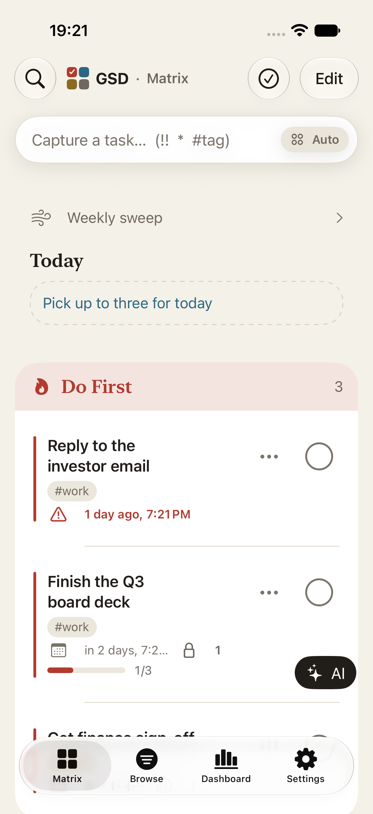

# GSD — מצב מסירה נוכחי, 24.11.2026

טיוטת מסירה לעדכון סופי בידי המתאם. ריצת Share העדכנית, בדיקות 0ae על תוצרי הייצור 9f, הסתיימה ב־23:31:52 UTC עם בדיקה אחת שעברה ואחת שנכשלה לאחר Cancel. הוספת משימה והתמדתה אומתו; שני תנאי היעדר היצירה לאחר Cancel טרם אומתו. ביקורת צילום הכשל בוצעה ב־23:43 UTC, וקריאת Apple האחרונה בדוח היא מ־22:57 UTC. אין בדוח זה קבלת Share מלאה או קבלת TestFlight עבור build 49.

**GSD 4.1.0 (48) כבר נמסרה במסלול TestFlight המאומת.** המועמד המעודכן ל־4.1.0 (49) כולל SDK חדש, תיקוני AI ותיקון טעינת Share, ולכן דורש השלמת קבלת Share וארכיון חתום של המקור המתוקן. הראיות ההיסטוריות של 48 נשמרות ב־[דוח ההפצה](TESTFLIGHT_DELIVERY_20261124.md) וב־[דוח האינטגרציה](GSD_INTEGRATION_20261124.md).

## מקורות והיקף השימוש החוזר

| רכיב | מקור מאומת | היקף הראיה |
|---|---|---|
| מקור הייצור ובדיקת Share שנכשלה | [`9f2736d3e071d2ceb4a6dfada1a2c3767c9906be`](https://github.com/davidpovarsky/gsd-iosapp/commit/9f2736d3e071d2ceb4a6dfada1a2c3767c9906be), tree `1079979780cfcac4ef19ac2bef9731f9d1d75b6e` | build-for-testing עבר ב־21:54:27; ריצת Share הסתיימה ב־1/2 בדיקות שעברו ובכישלון לאחר Add. שער הקבלה נשאר פתוח. |
| תיקון בדיקה ותשתית בדיקות לאחר 9f | [`6bd91d6a36155bd73ab71a428e69642b5989d842`](https://github.com/davidpovarsky/gsd-iosapp/commit/6bd91d6a36155bd73ab71a428e69642b5989d842) | מעבר על כל רבעוני Matrix, רישומי בדיקות בפרויקט ותוכנית משטחי מערכת; מקור הייצור 9f נשמר. בניית UI runner עברה ב־22:40:34; קבלת runtime עדיין פתוחה. |
| תיקון מחרוזת בבדיקה לאחר 6bd | [`0ae293b8f1d867a09be6d95cc7029a9442728bfc`](https://github.com/davidpovarsky/gsd-iosapp/commit/0ae293b8f1d867a09be6d95cc7029a9442728bfc) | שינוי מחרוזת צפויה אחת לכותרת שנצפתה בפועל: `היום, 0 מתוך 3`. מקור הייצור נשאר 9f; אין כאן טענה שהריצה החדשה עברה. |
| ריצת Share העדכנית | בדיקות 0ae לעיל, חמשת תוצרי הייצור 9f ללא שינוי | runner נבנה ב־19.37 שניות, exit 0. בריצת 23:31:52: 1/2 עברו; Add והתמדה אומתו, אימות Cancel נעצר בגלל חלונית השיתוף שנותרה מעל Matrix. |
| Hanlin המקורי | [`bea35c3c2a435d1cc5f7ce93b08a649b104bc10f`](https://github.com/davidpovarsky/hanlin-ai/commit/bea35c3c2a435d1cc5f7ce93b08a649b104bc10f) | שילוב ה־SDK המקורי, תיקון הנתיב הפרטי ב־Darwin, חוזי SIWC והתמדה; אין מנוע משימות או SDK חלופי. |
| בדיקות חבילות Native | GSDKit ב־[`9d0faa061b0b41f7127fa40c265fef3e3fc3dd88`](https://github.com/davidpovarsky/gsd-iosapp/commit/9d0faa061b0b41f7127fa40c265fef3e3fc3dd88): 160; Hanlin ב־[`77c0455823cad90168106f2196d6e94d1ce03598`](https://github.com/davidpovarsky/gsd-iosapp/commit/77c0455823cad90168106f2196d6e94d1ce03598): 23 | **183 בדיקות שעברו**, בשני מקורות מתועדים. שימוש חוזר חל רק על קלטים שנבדקה זהותם. |
| ממשק iPhone/iPad בעברית ובאנגלית | [`6712921d1dc379c41c6919524e599ad7e0b9e5e0`](https://github.com/davidpovarsky/gsd-iosapp/commit/6712921d1dc379c41c6919524e599ad7e0b9e5e0) | **13/13** בדיקות UI, סיום 18:45:08; ביקורת **24/24** תמונות. אין טענה שכולן הורצו מחדש ב־9f. |
| Watch מעודכן | [`ee5e95f536c375cfdbfa13cb6c812dcef8987a5f`](https://github.com/davidpovarsky/gsd-iosapp/commit/ee5e95f536c375cfdbfa13cb6c812dcef8987a5f) | הפעלה רגילה בעברית ובאנגלית, חיות תהליך במשך 5 שניות וביקורת חזותית 416×496; עבר ב־20:02:07. לא בדיקת WatchConnectivity או מחזור WidgetKit. |
| Cloud פעיל | [`e74abb292cfb10b43cf5dfa11fac5167caa98cad`](https://github.com/davidpovarsky/gsd-iosapp/commit/e74abb292cfb10b43cf5dfa11fac5167caa98cad) | hardening מאומת ופריסה; אינו שינוי ב־Native או ב־TaskStore. |

[הוכחת השימוש החוזר במקור 9f](evidence/delivery-20261124/source-reuse-9f.json) נשמרה עם SHA-256 `7ebf4dbe4967dda431fde6d849e33e5f91ad0f74bf0d5370aaf1c7af93362eb1`; [אימות המתאם](evidence/delivery-20261124/source-root-review-9f.json): `7155fc11aae63d6a04d51fa19406c4475a59b378f520e7a8351443aa3042176d`. זו הוכחת קלטים תואמים בהיקף הרשום, ולא טענה לזהות בינארית בין בניות. שינוי Share מחייב קבלה משלו ו־IPA חתום מחדש.

קבלות החבילות ההיסטוריות נשמרו במלואן: [Hanlin ב־77c045](evidence/delivery-20261124/packages-77c045-historical.json) ו־[GSDKit ב־9d0faa](evidence/delivery-20261124/packages-9d0faa-historical.json). מצב הכישלון הכולל בקבלות אלה מתייחס גם לשלבים מאוחרים ואינו משנה את תוצאות החבילות שעברו. [קבלת הבנייה ב־671](evidence/delivery-20261124/native-build-671.json) מרכזת את השימוש החוזר בתוצאות לפי מקורן; אין כאן הצגה של הריצות ההיסטוריות השלמות כעברו.

## מטריצת תנאי הקבלה

| תנאי | מצב נתמך בראיות | מה עדיין אינו מאומת |
|---|---|---|
| עברית ו־RTL | 13 בדיקות UI בארבעה פרופילים, 24 תמונות ו־Watch EN/HE התקבלו; תרגומי App וההרחבות משולבים. | השלמת אימות שני תנאי Cancel לאחר סגירת חלונית השיתוף של iOS; אין להמיר תצוגת Widget בתוך האפליקציה להוכחת מחזור WidgetKit, Siri או VoiceOver מלא. |
| יצירת חשבון והתחברות | התחברות דרך המסך האמיתי ב־iPad Simulator, ניהול Session, בידוד חשבונות ומחיקה מכוסים בראיות הקיימות. | התקנה ומעבר חשבון באייפד פיזי חדש של המשתמש. |
| סנכרון עם Oracle | כתיבה לשרת כשהאפליקציה סגורה, הופעה לאחר פתיחה, כתיבה בכיוון ההפוך והתמדה אחרי פתיחה חוזרת אומתו במסלול Native; חוזי אופליין, גרסאות, מחיקות ובידוד נבדקו. | אין להציג בדיקת סימולטור כהתקנה פיזית. |
| קריאה וכתיבה ללא אייפד פתוח | כל **22 כלי MCP** עברו E2E מול הענן בחשבונות בדיקה; הנתונים נשמרים ב־Oracle. | הפעלה מתוך חיבור ChatGPT האישי של המשתמש. |
| Plugin עם כניסה רגילה | OAuth בענן, PKCE, scopes, רענון, דחיית replay, ביטול והרשאות לפי חשבון; plugin פרטי 0.2.0 מפנה לענן. | Connect אישי הסתיים ב־abort ב־18:49; הזמינות ב־iPad כפופה גם למסלול Desktop-only שתועד. |
| Hanlin ו־22 הכלים | SDK המקורי משולב; 23 בדיקות הצרכן וחוזי הכלים נשמרו, יחד עם בדיקות הענן לכל 22 הפעולות. | תשובת AI אמיתית ראשונה אחרי התיקון אינה נובעת מבדיקות חוזים. |
| Continue with ChatGPT | זרימת preconsent עברה; המשתמש דיווח על התחברות אישית מוצלחת. | תשובה ראשונה לאחר תיקון SDK, זכאות inference ושימוש בפועל במכסת ChatGPT טרם אומתו. |
| דוחות, תרשימים וממשק | ראיות UI ו־MCP הקיימות מכסות את התצוגות והפעולות שנבדקו; תוצאות 24 התמונות נשמרו. | משטחי מערכת נוספים שלא נכללו בקבלות אינם מסומנים כעברו. |
| Xcode ובדיקות | 183 בדיקות חבילות, 13 UI ובניית 9f התקבלו לפי מקורותיהם; Actions של 48 נשמרות למטה. | ריצת Share העדכנית, בדיקות 0ae על תוצרי 9f, הסתיימה ב־1/2 שעברו; אין ריצת Actions 49 או קבלת runtime מוצלחת שנוצרה מהנחה. |
| מזהי Apple ופרופילים | מסלול החתימה האמיתי של הבעלים אומת: Team `NA6HPWARQ2`, משפחת `com.itorah.gsd`, חמשת היעדים וה־App Group. | נדרשת קשירה של ארכיון 49 המתוקן למקור ולקבלות הסופיות. |
| Release חתום | 48 נחתם ונמסר; IPA מוקדם של 49 נחתם ואומת מול Apple עבור ee5. | IPA של ee5 אינו תוצר המסירה הסופי לאחר שינוי Share. |
| TestFlight | בקריאת Apple ב־22:57 UTC, 48 נשאר `VALID`, לא פג תוקף ו־`IN_BETA_TESTING`; קבוצת הבעלים מכילה את הבנייה ואת הבודק. | שאילתת 49 המדויקת החזירה 0 תוצאות ללא עמוד המשך. מצב אישור ההזמנה הנוכחי אינו ידוע; אין טענה להתקנה פיזית. |
| Asana וראיות | מצב הפרויקט `1220884588251447` ותגובת עברית `1220884588250387`, 23:44 UTC, מתעדים את הצלחת Add/התמדה ואת הכשל לאחר Cancel. הפרויקט נשאר במצב צהוב; ההיסטוריה והקבלות נשמרו. | עדכון סופי לאחר קבלת Share, שתי בדיקות המערכת, ארכיון, העלאה ועיבוד Apple. |

## Cloud, OAuth וגיבויים

[קבלת E2E הציבורית של הענן](https://github.com/davidpovarsky/gsd-iosapp/blob/cfe9470b6020c28474395ff97f0672d4a5c8f126/docs/ai-agent/evidence/cloud-20261124/public-e2e.txt) מכסה את 22 הכלים, CRUD, דוחות, התנגשויות ובידוד. [קובץ המטא־נתונים הנלווה](https://github.com/davidpovarsky/gsd-iosapp/blob/cfe9470b6020c28474395ff97f0672d4a5c8f126/docs/ai-agent/evidence/cloud-20261124/public-e2e.json) שומר את פרטי ההרצה. [דוח OAuth/MCP](CLOUD_MCP_AUTH_ACCEPTANCE_20261124.md) מוסיף חוזי scopes ותגובות reconnect. [דוח ההגנה והשחזור העדכני](CLOUD_AUTH_BACKUP_ACCEPTANCE_20261124.md) מקשר **21/21 בדיקות HTTP** ופריסת e74. מספר הכלים ומספר בדיקות ההגנה מודדים דברים שונים.

השחזור העדכני אימת מסד פעיל עם WAL, שני משתמשים, שתי משימות, שתי תצוגות ונתוני OAuth; לאחר שחזור הופעלו שירותי החשבון האמיתיים ונבדקו גישה מבודדת, רענון מתחלף ודחיית replay. [הגיבוי המתוזמן](BACKUP_CALENDAR_ACCEPTANCE_20261124.md) והקבלה המאוכלסת הקודמת ב־`540bde78d1eb7b90de9eb12d20d319d1c439f1f4` נשמרים כראיות קודמות. לא נטען שחזור volume של ספק הענן או מעבר באייפד פיזי.

בבדיקת המתאם ב־22:02:46 UTC מקור gateway הפעיל עדיין תאם SHA-256 `4bcc55288e28576aaacf24cd6657f254e6703637f732929b139ca78645b2a598`; ארבעת השירותים והגיבויים שנבדקו היו תקינים ושתי בדיקות health החזירו 200. מקום פנוי שנצפה: כ־7.23 GiB בשורש וכ־27.74 GiB בדיסק הנתונים. זו מדידה נקודתית בלבד; אין בדוח ייחוס שלה לפעולת ניקוי.

## ChatGPT: שני חיבורים נפרדים

**Plugin לחשבון GSD בענן.** השרת וה־OAuth נבדקו, אך ניסיון Connect אישי ב־18:49 הופסק. תגובת הכלי נשמרה בשיחה; [משימת Plugin](https://app.asana.com/0/1220770501963372/1220828170561422) מפנה לקבלת iPad/Desktop-only בתגובה `1220863768674461`. התגובה `1220879074525208` מתעדת שאין בהגדרות שנבדקו `requires_local_executor`, `stdio`, פקודות מקומיות או hooks. לא אותר דגל נוסף להסרה, לא נצפתה דחיית זכאות של החשבון, ואין בסיס להבטיח שמעבר דרך דפדפן שולחני יאפשר את התוסף ב־iPad. ההקשר הרשמי: [Desktop-only](https://developers.openai.com/plugins/deploy/desktop-only.md), [Connect to ChatGPT](https://developers.openai.com/plugins/deploy/connect-chatgpt.md). בחיבור הכלים הנוכחי לא נצפה Session אישי פעיל של GSD MCP.

**Continue with ChatGPT בתוך GSD.** קבלת f1 בדקה את כניסת המשתמש הרגילה, מעבר לדפדפן וביטול לפני הסכמה, בשני מחזורים: 1/1 בדיקה ו־10 דגלים. נצפה host `auth.openai.com` במצב `visible_host_only`; השדה `observedOrigin` לא נכתב. אין להסיק מכך URL מלא או אישור חשבון. הריצה הכוללת של f1 נכשלה ב־Share; הצלחת רכיב preconsent נשמרת בנפרד.

ב־24.11.2026, בשעה 14:29 UTC, המשתמש דיווח על התחברות אישית מוצלחת, לפני בדיקת preconsent של 21:25 UTC, כמתועד ב־[משימת AI](https://app.asana.com/0/1220770501963372/1220820292511448), סיפורים `1220863756603297` ו־`1220865013712659`. תיקון ה־Darwin ב־SDK שוחזר ונבדק, אך ללא נתיב או לוג מהמכשיר לא הוכחה סיבתיות מדויקת לתקלה באייפד הפיזי. אין עדיין קבלה של התשובה הראשונה אחרי התיקון, זכאות inference או שימוש במכסה. אפשרויות OpenRouter ו־OpenAI API נשמרו.

## Share והפער שמונע קבלת 49 סופית

### ריצת Share העדכנית: בדיקות 0ae על תוצרי 9f — 23:31:52 UTC

הריצה החלה ב־23:28:26.894760 והסתיימה ב־23:31:52.697571 UTC עם exit 1. בניית runner הבדיקות 0ae עברה קודם לכן ב־19.37 שניות, exit 0; חמשת תוצרי הייצור נשארו 9f. manifest הייצור הוא `38aae93e3330893c26c1ce837a05af933b1d2115b69b01b0ea67f0e8fb2eb67f`; manifest ההרכבה הוא `d6f999a9647e8bc9c3c7aaaa93aa5bae3f0d02df8124fb6c5f49b6e23779f8b3`.

| בדיקה | תוצאה | משך XCTest |
|---|---|---|
| `test00RecordSystemSurfaceDiscovery` | עברה | 18.524 שניות |
| `test01TextShareExtensionRoundTripAndCancellation` | נכשלה לאחר Cancel | 133.950 שניות |
| סיכום | 2 בדיקות, 1 עברה, 1 נכשלה, 0 דילוגים, 0 כישלונות צפויים | |

ששת התנאים `sourceCreated`, `activitySheetOpened`, `extensionOpenedForAdd`, `addCreatedExactlyOne`, `addedTaskPersisted`, `extensionOpenedForCancel` אומתו כ־true. הוספה יצרה בדיוק משימה אחת, והתמדתה אחרי פתיחה חוזרת אומתה. שני התנאים `cancelCreatedNone` ו־`cancelNoneAfterRelaunch` נשמרו כ־false מפני שהריצה לא הגיעה לאימותם; אין מכך מסקנה שנוצרה משימה מבוטלת.

כישלון XCTest בפועל הוא `The Matrix capture field is obscured.` בעת המתנה ל־`capture-field.isHittable` לאחר Cancel. המתאם בדק בפועל את צילום `09-after-cancel` ב־23:43 UTC: מסך ה־compose נסגר, אך חלונית הפעילות/השיתוף המקורית של iOS נשארה מעל Matrix, ללא כפתור סגירה גלוי. זו הראיה לחסימת הגישה ל־Matrix; `share_assertion_keys` שבסיכום העזר הוא קוד האימות המסכם ולא תיאורו של כשל ה־UI המקורי. Native הוא הבעלים היחיד של תיקון בדיקה ממוקד לסגירת החלונית שנצפתה; בעת תמונת מצב זו עדיין אין ריצה חוזרת או קבלת Share מלאה.

| קבלה מצורפת — בתים מקוריים | בתים | SHA-256 |
|---|---:|---|
| [share-0ae-runtime-binding.json](evidence/delivery-20261124/share-0ae-runtime-binding.json) | 1,401 | `d84829d52e328776b54744e0bd65473fc3026d541651b1555533bd7be8989ef2` |
| [share-0ae-summary.json](evidence/delivery-20261124/share-0ae-summary.json) | 636 | `63935c8d02927ae0a011e423d13e397a5f9d48f40d1acc3c0a93f84a0334d4b5` |
| [share-0ae-test-counts.json](evidence/delivery-20261124/share-0ae-test-counts.json) | 148 | `a307390d19251c9b80f7cacdb0e7fed774c3d1577759614df3d2dde43192c0f2` |
| [share-0ae-terminal.json](evidence/delivery-20261124/share-0ae-terminal.json) | 1,078 | `04e28333555650e365b448a5479b98e9f16bc565dce577d9ae6561d0a4cfae4d` |
| [share-0ae-observation-summary.json](evidence/delivery-20261124/share-0ae-observation-summary.json) | 587 | `66f986096168c4068c67501f2bedf42ab7ef932a37cc07a5668c492396e7f471` |

שדה `appSourceSHA` בתמצית התצפית נשמר בדיוק כ־0ae, כפי שסיפק ה־runner. מקור הייצור בפועל הוא 9f לפי `productionSourceSHA` ב־runtime binding וקשירת חמשת התוצרים ב־composition; השדה בתצפית לא שוכתב. הקבלה הסופית מאשרת תוצרים שלא השתנו וסימולטורים בבעלות הריצה שהוסרו, ומציינת שלא בוצעו חתימה, העלאה או הרצה חוזרת של הסוויטות ההיסטוריות שהתקבלו.

צילום האבחון הבא מכיל נתוני בדיקה סינתטיים בלבד ואושר לפרסום בידי המתאם לאחר צפייה. הוא הועתק ללא שינוי: 846,012 בתים, SHA-256 `5e46e2fd5dcec15462f5c1b591b02a9d451d238743444dba829277dbdfe3a6cd`. חמש קבלות ה־JSON והצילום הם נספחים נפרדים; ה־manifest המקורי של 19 קובצי הראיות לא הורחב ולא שונה.

בקשת העוקב `job_11be8a7df705` נדחתה לפני הפעלה משום ש־timeout של 4,320 שניות חרג ממגבלת 3,600. הדבר לא ביטל את ריצת Share בפועל; התוצאה לעיל נשענת על הקבלות הסופיות של הריצה, שנקראו לאחר סיומה.

### היסטוריה: תיקון המקור ותוצאת 9f הקודמת

[תיקון 9c3efb81](https://github.com/davidpovarsky/gsd-iosapp/commit/9c3efb81e1cc05ea44cb40d5a382566c56a67cd9) מטפל בטקסט מספקי נתונים; [דוח Foundation](SHARE_INPUT_ACCEPTANCE_20261124.md) ו־[הקבלה המצונזרת](evidence/share-input-20261124/foundation-regressions.json) מראים 4/14 במקור הישן לעומת **14/14** במתוקן. גבולות TaskStore ותיבת ה־Share נשמרו.

בריצת 3c552350 היו 2 בדיקות: אחת עברה ואחת נכשלה. הכישלון היה באיתור שדה הכותרת לפי placeholder לפני בדיקת ההתאמה המחמירה; בהיררכיה כבר נצפתה כותרת שאינה ריקה. לכן זו אינה ראיה נוספת לכשל פענוח, וגם אינה הוכחה שהכותרת המלאה עברה את ה־assertion. מקור 9f מוסיף מזהה נגישות קבוע `share.title` ומעדכן את בחירת השדה, תוך שימור שמונת שערי Share.

בניית 9f הסתיימה בהצלחה ב־21:54:27. [manifest התוצרים](evidence/delivery-20261124/simulator-products-9f.json): `38aae93e3330893c26c1ce837a05af933b1d2115b69b01b0ea67f0e8fb2eb67f`. ריצת Share החלה ב־21:55:43 והסתיימה בכישלון ב־22:12:25.938982. התוצאה המדויקת: **2 בדיקות, 1 עברה, 1 נכשלה, 0 דילוגים, 0 כישלונות צפויים**. גילוי עבר ב־16.818 שניות; round-trip נכשל אחרי 905.978 שניות. שלושת דגלי הפתיחה הראשונים מתוך שמונה היו true; חמשת האחרים לא הושגו. בדיקת הכותרת המקורית המחמירה, אימות סמן העריכה וסגירת חלון ה־compose הושלמו לפני כשל הכרטיס. כשל XCTest המקורי הוא `No task card contains synthetic marker Added-D561D70F`: ב־`uniqueCard`, [שורה 242 במקור הבדיקה](https://github.com/davidpovarsky/gsd-iosapp/blob/9f2736d3e071d2ceb4a6dfada1a2c3767c9906be/ScreenshotTests/GSDSystemSurfaceUITests.swift#L242), שנקראה משורה 180. שורה 102 היא הדיווח העוטף ב־catch ואינה מקור הכשל. התוצרים נשארו ללא שינוי והסימולטורים שבבעלות הריצה הוסרו. קבלת binding: `06995cb1f17905b5d12ab669274324cdfe9ebf942558a5f037c2962b8ea5db3a`; summary: `98c3b3f2f219b7fdf1f7485e998779f8d28e93a80effbc63690ffee23e63e47e`.

צילום המארח אחרי Add נבדק בידי המתאם ב־22:24. Q4 נמצא מחוץ לאזור המוצג. במקור 9f, ברירת המחדל של `ShareComposeView` היא Q4 וסדר `MatrixList` הוא Q1 עד Q4; הבדיקה אינה גוללת לפני שאילתות הכרטיס החיוביות או השליליות. זהו פער מוכח בכיסוי החיפוש של הבדיקה. תוצאת הייבוא ומצב מסד הנתונים בפועל עדיין אינם ידועים; הצילום אינו מוכיח שהמשימה נשמרה או אבדה.

צילום האבחון הנוסף מן הריצה שנכשלה מכיל נתוני בדיקה סינתטיים, ללא מסך אימות, ואושר בידי המתאם. הוא נשמר בנפרד מחבילת 19 הקבצים המקורית, שה־manifest שלה לא שונה: 397,431 bytes, SHA-256 `fc2d09c192c84725ec30360813973fed9246c8dba04dea12b522dc9db41a16e7`.

בתיקון הבדיקה [`6bd91d6a36155bd73ab71a428e69642b5989d842`](https://github.com/davidpovarsky/gsd-iosapp/commit/6bd91d6a36155bd73ab71a428e69642b5989d842) החיפוש עובר על כל ארבעת הרבעונים ועד לתחתית, ובדיקות Add ו־Cancel שומרות אימות זהות, ספירות מלאות והיעדר משימה שבוטלה. זמני ההמתנה של ה־assertions לא השתנו; רק תקציב הזמן החיצוני לריצה גדל מ־2,400 ל־3,600 שניות. נוספו ארבעה רישומי בדיקות בפרויקט ו־[תוכנית משטחי מערכת נפרדת](https://github.com/davidpovarsky/gsd-iosapp/blob/6bd91d6a36155bd73ab71a428e69642b5989d842/docs/ai-agent/SYSTEM_SURFACE_ACCEPTANCE_PLAN_20261124.md). קוד הייצור של 9f נשמר. [השוואת המקורות 9f→6bd](https://github.com/davidpovarsky/gsd-iosapp/compare/9f2736d3e071d2ceb4a6dfada1a2c3767c9906be...6bd91d6a36155bd73ab71a428e69642b5989d842) נבדקה בידי המתאם: כל 497 קובצי קלט ה־Native שהושוו שומרים אותו Git blob ואותו mode; ארבע השורות שנוספו ל־pbxproj שייכות רק ליעד `GSDScreenshotTests`, והסרתן משחזרת בדיוק את קובץ 9f. אין שינוי ביעדי הייצור או בהגדרותיהם. Git blob של בדיקת Share החדשה הוא `4d9b06caaba655ef5b82f2640b0a259cfb3b1524`. בניית ה־UI runner של 6bd עברה ב־22:40:34. לאחריה נוסף 0ae, המשנה רק את מחרוזת הכותרת הצפויה כמפורט בטבלת המקורות. ריצת 0ae המאוחרת נכשלה לאחר Cancel, כמפורט לעיל; קבלות הכישלון וה־manifest של 9f נשארים ראיות היסטוריות מלאות.

## קבלות Native מצורפות

[manifest העברת הראיות](evidence/delivery-20261124/completion-manifest.json) מזהה 13 קובצי JSON ושישה צילומים שאושרו לפרסום. כל קובץ הועתק ללא שינוי ורק לאחר התאמת SHA-256 וגודל; המקורות נשמרו. אין כאן לוגי אימות גולמיים או צילומי חשבון ודפדפן. קבלות שלא צורפו מצוינות במפורש לפי hash אצל המתאם.

| קבלה | מיקום או מקור | SHA-256 |
|---|---|---|
| 160+23 בדיקות חבילות | [native-build-671.json](evidence/delivery-20261124/native-build-671.json) | `2f5e0d8b2dfdf78c960e0984a76ce43f0ff9b81f764dcdb88a9242ce418c9ede` |
| קשירת UI למקור 671 | קבלת `native-ui-binding` אצל המתאם | `2d7aaf24f709ba937b5fe2ec3e470bd7003f8f20c9b4540298f2261b9139e175` |
| תוצאת 13/13 UI | [native-ui-671.json](evidence/delivery-20261124/native-ui-671.json), סיום 18:45:08 | `8549f05885d1c611a7e60c1f6fe9282cac1147de1ef7719e2987dae81ad264f5` |
| ביקורת 24 תמונות | [visual-qa-671.json](evidence/delivery-20261124/visual-qa-671.json) | `20c7e138336cb103fbdf05a1c29f8040adb473af604df337bf94a3b454ca8901` |
| Watch EN/HE ב־ee5 | [watch-ee5-summary.json](evidence/delivery-20261124/watch-ee5-summary.json) | `4a7051190c9bd417778f88f86e4570f4d610cdfaab5d6767c1f57f988a6599c5` |
| ביקורת Watch | [watch-ee5-root-review.json](evidence/delivery-20261124/watch-ee5-root-review.json) | `06a09f6095af3fd09d8791814173edbc0a08cf2f7ff988c6585d80e6219f49e7` |
| preconsent f1 | [preconsent-f1-observation.json](evidence/delivery-20261124/preconsent-f1-observation.json) | `881e8b78cbea7f0e55f6877cea49350c6f67a90a6d45c20694dc57b16f3b987f` |
| summary כולל f1 | [supplemental-f1-summary.json](evidence/delivery-20261124/supplemental-f1-summary.json); הכללי נכשל ב־Share | `484a4e677dc3c8313dc1dbe7e0096edba278fd907fe420ef80d08ff6fd754d55` |
| Foundation Share | [foundation-regressions.json](evidence/share-input-20261124/foundation-regressions.json) | `7a12b248ef2506acaf94889ab22410814ed4ea3ec6add759502614f2ecc41e8c` |

בדיקת preconsent משתמשת במקור בדיקה `f1fc8676cd1cce5a275f246b0d7dedcfb73416db` ובתוצרי ייצור `ee5e95f536c375cfdbfa13cb6c812dcef8987a5f`. קבלת Watch ההיסטורית של 48 ב־[Actions 45423742737](https://github.com/davidpovarsky/gsd-iosapp/actions/runs/45423742737) היא ראיה נפרדת מקבלת Watch המעודכנת של ee5.

## דוגמאות מהצילומים שכבר התקבלו

ארבעת הצילומים הבאים הם בחירה מתוך 24 התמונות שנבדקו במקור `6712921d1dc379c41c6919524e599ad7e0b9e5e0`; העתקתם אינה ביקורת חזותית חדשה.

| iPhone, אנגלית — Matrix | iPhone, עברית — Matrix |
|---|---|
|  |  |

| iPad, אנגלית — Dashboard | iPad, עברית — Dashboard |
|---|---|
|  |  |

צילומי Watch קשורים למקור ee5 ול־[ביקורת החזותית שנשמרה](evidence/delivery-20261124/watch-ee5-visual-review.json). מצב הנתונים בשני הצילומים שונה; אין להסיק מהבדלי תוכן או ספירות על שינוי הנגרם מהשפה. הביקורת קיבלה את המסגרת שנבדקה, 416×496, ואינה מוכיחה WatchConnectivity או timeline.

| Watch, אנגלית | Watch, עברית |
|---|---|
|  |  |

## Apple, TestFlight והשלמת המסירה

- **48 שנמסרה:** [Native Actions 45397928701](https://github.com/davidpovarsky/gsd-iosapp/actions/runs/45397928701), [Release Actions 45401779393](https://github.com/davidpovarsky/gsd-iosapp/actions/runs/45401779393), מקור אפליקציה `71b1b7ce4adf7bea2ddacfc683a69906d6acd6ae`, ASC app `6838520892`, build `04715dbf-3b05-4d01-ba3d-d0b0e580d257`. מצב `VALID` / `IN_BETA_TESTING` וקבוצת הבעלים מתועדים ב־[קבלת TestFlight](TESTFLIGHT_DELIVERY_20261124.md).
- **49 מוקדמת:** IPA חתום אמיתי של ee5, SHA-256 `121e0e2c2d65d2b774c5897e9acd3071704ed55c7c117e246faae756ba6bd483`, עבר את שערי החתימה והאימות שתועדו. תיקון Share שינה את מקור הייצור; אין להשתמש ב־IPA זה כקבלה לתיקון החדש.
- **49 המתוקנת:** קבלת Share, ארכיון, חתימה, export, העלאה, עיבוד Apple וזמינות למסלול הבודקים עדיין פתוחים בדוח זה. מספר הבנייה ומקור הארכיון ייקשרו לקבלת Apple בפועל; אין להסיק אותם מהקבלה של 48.

### בדיקת App Store Connect — 24.11.2026, 22:57 UTC

[קבלת הקריאה העדכנית](evidence/delivery-20261124/asc-readonly-20261124T225746Z.json) מתעדת שמונה בקשות GET בלבד, בין 22:57:40.736579 ל־22:57:46.527641 UTC, לאפליקציה `6838520892` / `com.itorah.gsd` באמצעות מסלול Team `NA6HPWARQ2` הקיים.

- **4.1.0 (48):** הבנייה `04715dbf-3b05-4d01-ba3d-d0b0e580d257` נמצאה, `VALID`, `expired: false`, במצב פנימי `IN_BETA_TESTING`.
- **49:** השאילתה המדויקת לאפליקציה ולמספר הבנייה החזירה `found: 0`, `total: 0`, `hasNextPage: false`; לא נמצאה בניית 49 בזמן הקריאה. זו אינה שמירת מספר בנייה או הוכחה לגבי העלאה שתתחיל מאוחר יותר.
- **קבוצת הבעלים:** `791ccd13-9b19-46c4-b1c6-380887f27edb` / GSD Owner Testing מכילה את build 48 ובודק יחיד, `73170283-fec7-467a-8a27-77764393ec4a`; שתי רשימות הקשרים הושלמו ללא עמוד המשך.
- **מצב הבודק:** `inviteType: EMAIL`; השדה `state` שנשמר בקבלה הוא `null`, ולכן מצב אישור ההזמנה הנוכחי אינו ידוע. `INVITED` שנצפה ב־13:42 הוא ממצא היסטורי בלבד. חברות בקבוצה אינה ראיה לאישור הזמנה או להתקנה פיזית.

הקובץ שומר את אובייקט הקבלה המסונן בדיוק בפורמט JSON קומפקטי: מפתחות ממוינים, `ensure_ascii=true`, מפרידים `,` ו־`:`, ללא שורת סיום. גודלו 2,624 בתים ו־SHA-256 שלו `df849bc6de4c61cbdfe4d928ff7b75f05c5ff6bd20f2c84752fa53c2dcd856a8`. מקורו ב־`job_cc23fdaa62a1`, שהסתיים בהצלחה ב־22:57:47.181931 UTC. לא בוצעו בקריאה זו העלאה, חתימה, שינוי קבוצה, הזמנה או שינוי Keychain; ה־manifest המקורי של 19 קובצי הראיות נשמר ללא שינוי.

משימות המעקב: [Cloud](https://app.asana.com/0/1220770501963372/1220825972434803), [Plugin](https://app.asana.com/0/1220770501963372/1220828170561422), [AI](https://app.asana.com/0/1220770501963372/1220820292511448), [עברית ו־RTL](https://app.asana.com/0/1220770501963372/1220823124041036), [Apple/TestFlight](https://app.asana.com/0/1220770501963372/1220820292484722). משימות והפרויקט ייסגרו רק לפי היקף הראיות שהתקבלו. התוצאה הסופית של Share ו־Apple תשולב כאן בידי המתאם לפני פרסום דוח מסירה סופי.
