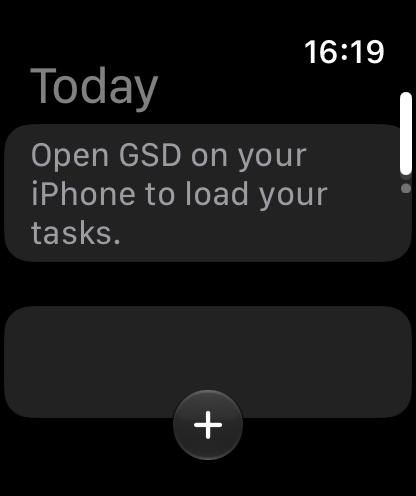
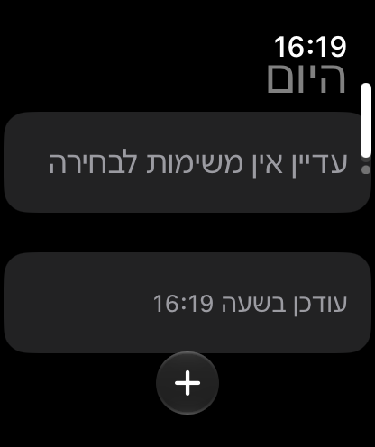

# Actual Watch launch and localization evidence — 24 November 2026

[Watch run 45423742737](https://github.com/davidpovarsky/gsd-iosapp/actions/runs/45423742737) passed on the existing authorized Mac. The workflow restored accepted GSD 4.1.0 (48) products from source `71b1b7ce4adf7bea2ddacfc683a69906d6acd6ae` and native validation `45397928701`; it did not rebuild the app or repeat the native acceptance suite.

The reviewed execution harness was `a4fdad3a1d6fe78b282c0c87b73a4cafd124be9c`. Job `138549957701` used ephemeral GSD runner 24 and succeeded at 15:19:45 UTC. Its artifact `14935288231` is 92,710 bytes with SHA-256 `0cbed170c219db56c69275c9976968bb45b0408c403ca4b558bebb8b8a5003eb`.

## What executed

The helper verified source, successful parent receipt, immutable product hashes, bundle identity and signatures. It created only one owned iPhone 17 Pro / Apple Watch Series 12 46 mm pair using iOS 27.0 and watchOS 27.0 (the installed watch runtime is 24R362). The normal Watch app launched once in English and once in Hebrew, and each reported process remained alive after five seconds. The driver was Xcode 27.0 / 27A266a.

The original raw 416 × 496 PNGs and geometry sidecars are retained below. Visual review found the English Today/instruction text and Hebrew Today/empty-state/update-time text readable without clipping. The two captures contain different data states, so they do not establish a same-state locale comparison. The English initial screen contains an empty rounded footer card; this cosmetic issue remains part of the original evidence and is tracked for a separate source correction.

## Cleanup and ownership

The helper recorded successful owned simulator cleanup. An independent read-only postrun check at 15:23:07 UTC confirmed both exact simulator UUIDs and their pair were absent; the exact GSD runner's Listener/Worker and original listener PID were absent; its local configuration/credential files were absent; and GitHub no longer listed the ephemeral runner. Original `_work` and `_release_work` metadata and the global Xcode selection were unchanged. No unrelated runner or service was stopped.

## Scope

This proves actual Watch process launch, short liveness and these localized initial screens. It does not prove WatchConnectivity, task actions/writes, Watch widget or complication timelines, Siri, VoiceOver, or physical-device operation. It is separate from the previously accepted native iPhone/iPad suite and from owner TestFlight availability.

Evidence: [original receipt](evidence/watch-45423742737/watch-smoke.json), [provenance and hashes](evidence/watch-45423742737/provenance.json), and [independent cleanup](evidence/watch-45423742737/postrun-cleanup.json).

| English | Hebrew |
| --- | --- |
|  |  |
